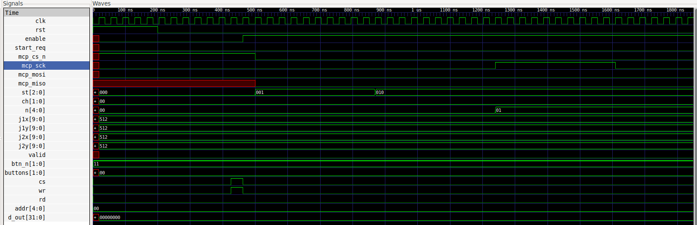

# Simulación y Testbench del Periférico de Joystick (`perip_joystick`)

Este documento explica paso a paso qué archivos se necesitan, cómo configurar de forma general cualquier `Makefile` existente, qué comandos ejecutar en consola y cómo interpretar las formas de onda para verificar el periférico **`perip_joystick.v`** mediante su testbench **`tb_perip_joystick.v`** antes de integrarlo al SoC con el procesador FemtoRV32.

---

## 1. Archivos necesarios para correr el testbench

El testbench `tb_perip_joystick.v` realiza una prueba unitaria completamente aislada: emula internamente al procesador FemtoRV32 (mediante tareas síncronas de lectura y escritura en el bus), al conversor ADC externo **MCP3008** (esclavo SPI Modo 0) y a los pulsadores físicos activos en bajo.

| Archivo | Requisito | Ruta sugerida | Función |
| :--- | :---: | :--- | :--- |
| **`tb_perip_joystick.v`** | **Obligatorio** | `sim/tb_perip_joystick.v` | Banco de pruebas que genera el reloj de $27\text{ MHz}$, aplica el reset, modela el MCP3008 y verifica automáticamente los registros del periférico. |
| **`perip_joystick.v`** | **Obligatorio** | `rtl/perip_joystick.v` | Módulo hardware bajo prueba (*DUT*). El testbench lo instancia internamente (`perip_joystick dut (...)`); sin este archivo la compilación con `iverilog` falla. |
| **`Makefile`** | **Opcional** *(recomendado)* | `Makefile` (raíz) | Automatiza la limpieza de temporales, compilación, ejecución de la simulación y apertura de GTKWave. |

---

## 2. Configuración general del `Makefile`

Como cada proyecto puede tener su propio `Makefile` con reglas de síntesis, pantalla, audio u otros periféricos, el siguiente bloque usa **prefijos propios** (`JOY_*` y `sim-joystick`) para que puedas pegarlo al final de tu `Makefile` **sin sobrescribir ni romper** variables como `top`, `DESIGN`, `sim` o `clean`.

> **Importante:** En un `Makefile`, las líneas indentadas debajo de cada regla deben comenzar con una **tabulación (`Tab`)**, nunca con espacios.

```makefile
# ==============================================================================
# Simulación unitaria del periférico Joystick (MCP3008)
# Ajusta las rutas si guardas los archivos en otras carpetas
# ==============================================================================
JOY_RTL     ?= rtl/perip_joystick.v
JOY_TB      ?= sim/tb_perip_joystick.v
JOY_SIM_DIR ?= build_sim_joystick
JOY_VCD     ?= ondas_joystick.vcd

.PHONY: sim-joystick wave-joystick clean-joystick

sim-joystick: clean-joystick
	mkdir -p $(JOY_SIM_DIR)
	iverilog -g2005 -o $(JOY_SIM_DIR)/tb_joy.vvp $(JOY_TB) $(JOY_RTL)
	cd $(JOY_SIM_DIR) && vvp -n tb_joy.vvp
	gtkwave $(JOY_SIM_DIR)/$(JOY_VCD) &

wave-joystick:
	gtkwave $(JOY_SIM_DIR)/$(JOY_VCD) &

clean-joystick:
	rm -rf $(JOY_SIM_DIR)
```

### Explicación de las líneas clave

* **`JOY_RTL ?= rtl/perip_joystick.v`** y **`JOY_TB ?= sim/tb_perip_joystick.v`**: Definen las rutas del módulo y del testbench. Al usar `?=`, puedes cambiarlas aquí o pasarlas directo desde la terminal sin editar el archivo.
* **`JOY_SIM_DIR ?= build_sim_joystick`**: Directorio exclusivo para los artefactos temporales de simulación (`.vvp` y `.vcd`).
  > **Advertencia crítica:** Nunca asignes esta variable a la misma carpeta donde guardas tus archivos `.v` (por ejemplo, `sim/`), ya que `clean-joystick` ejecuta `rm -rf $(JOY_SIM_DIR)` antes de compilar y borraría el testbench.
* **`JOY_VCD ?= ondas_joystick.vcd`**: Debe coincidir exactamente con el nombre escrito dentro de `$dumpfile("...")` en `tb_perip_joystick.v`.
* **No incluye reglas de síntesis ni rutas fijas de OSS CAD Suite**: Se omiten `yosys`, `nextpnr`, `gowin_pack` y `source ~/...` para que funcione de manera portable en cualquier equipo.

### Alternativa mínima (comandos estrictamente obligatorios)

Si prefieres adaptar tus propias reglas en lugar de copiar el bloque anterior, los únicos **3 comandos indispensables** que debe ejecutar tu `Makefile` son:

| Paso | Comando obligatorio | Función |
| :---: | :--- | :--- |
| **1** | `iverilog -g2005 -o tb_joy.vvp <ruta_tb> <ruta_rtl>` | Compila el testbench junto con `perip_joystick.v` bajo Verilog-2005. |
| **2** | `vvp -n tb_joy.vvp` | Ejecuta la simulación en modo no interactivo, imprime los resultados en consola y genera el `.vcd`. |
| **3** | `gtkwave ondas_joystick.vcd &` | Abre el visor gráfico de formas de onda en segundo plano. |

---

## 3. Instrucciones de ejecución en consola

> **Aviso obligatorio — Entorno OSS CAD Suite:**
>
> Antes de ejecutar cualquier comando de simulación, **debes activar manualmente el entorno de OSS CAD Suite** en tu terminal actual. El `Makefile` no carga este entorno de forma automática y requiere que `iverilog`, `vvp` y `gtkwave` estén disponibles en el `PATH`.

### Paso 1: Activar OSS CAD Suite

En tu terminal de Linux, carga el script `environment` reemplazando la ruta por la carpeta donde instalaste la suite en tu equipo:

```bash
source /ruta/a/tu/oss-cad-suite/environment
```

Para comprobar que el entorno se cargó correctamente, ejecuta:

```bash
which iverilog vvp gtkwave
```

La terminal debe mostrar rutas válidas dentro de tu directorio `oss-cad-suite`.

### Paso 2: Correr la simulación

Desde la carpeta raíz de tu proyecto (donde está el `Makefile`), ejecuta:

```bash
make sim-joystick
```

*(Si guardaste `perip_joystick.v` o `tb_perip_joystick.v` en carpetas diferentes a `rtl/` y `sim/`, puedes indicarlo directamente sin modificar el `Makefile`:)*

```bash
make sim-joystick JOY_RTL=mi_carpeta/perip_joystick.v JOY_TB=mi_carpeta/tb_perip_joystick.v
```

### Salida esperada en consola

El testbench valida secuencialmente el modo continuo (`ENABLE = 1`), la lectura sincronizada de los pulsadores (`BUTTONS`) y el disparo de barrido único (`START = 1` con autolimpieza). Al terminar, la consola debe mostrar exactamente:

```text
OK    J1_X = 512
OK    J1_Y = 1023
OK    J2_X = 0
OK    J2_Y = 291
OK    BUTTONS = 1
OK    J1_X tras START = 100
OK    START se limpio solo
PASS: perip_joystick
```

Acto seguido se abrirá automáticamente **GTKWave** con el archivo `build_sim_joystick/ondas_joystick.vcd`.

### Señales recomendadas para cargar en GTKWave

Dentro de GTKWave, expande `tb_perip_joystick` $\to$ `dut` en el panel izquierdo (**SST**) y agrega al visor las siguientes señales (clic derecho $\to$ *Data Format* $\to$ *Decimal* para `j1x..j2y`, `ch` y `n`):

* **Control:** `clk`, `rst`, `enable`, `start_req`, `valid`
* **Bus SPI:** `mcp_cs_n`, `mcp_sck`, `mcp_mosi`, `mcp_miso`
* **Estado interno:** `st[2:0]`, `ch[1:0]`, `n[4:0]`
* **Registros capturados:** `j1x[9:0]`, `j1y[9:0]`, `j2x[9:0]`, `j2y[9:0]`, `btn_n[1:0]`, `buttons[1:0]`
* **Bus CPU *(opcional)*:** `cs`, `wr`, `rd`, `addr[4:0]`, `d_out[31:0]`

*(Tip: si no quieres volver a seleccionar estas señales en futuras ejecuciones, puedes guardar tu vista desde **File $\to$ Write Save File** dentro de GTKWave como un archivo `.gtkw` opcional).*

### Otros comandos útiles

* **Reabrir las ondas sin recompilar:**
  ```bash
  make wave-joystick
  ```
* **Limpiar temporales de simulación antes de subir cambios a GitHub:**
  ```bash
  make clean-joystick
  ```
* **Ejecución manual directa (sin usar `Makefile`):**
  ```bash
  iverilog -g2005 -o tb_joy.vvp sim/tb_perip_joystick.v rtl/perip_joystick.v
  vvp -n tb_joy.vvp
  gtkwave ondas_joystick.vcd &
  ```

---

## 4. Prueba de funcionamiento y análisis de la simulación

*(Asegúrate de guardar la imagen `Simulacion.png` en el mismo directorio que este archivo `.md`, o ajusta la ruta relativa según la estructura de tu repositorio).*



### Análisis detallado de las formas de onda (`Simulacion.png`)

La captura corresponde a la ventana inicial de **$0\text{ ns}$ a $1850\text{ ns}$** ($1.85\text{ }\mu\text{s}$) en GTKWave, donde se verifica paso a paso la inicialización del periférico, la escritura de control desde el bus del procesador y el cumplimiento estricto de los tiempos de arranque del protocolo **SPI Modo 0** hacia el MCP3008:

1. **Reloj del sistema (`clk`) y Reset síncrono (`rst`):**
   * `clk` oscila de forma constante con un periodo de $37\text{ ns}$ ($\approx 27\text{ MHz}$), replicando el oscilador de la Tang Nano 9K.
   * `rst` permanece en alto (`1`) desde $0\text{ ns}$ hasta $200\text{ ns}$. Desde el primer flanco de subida de reloj, todos los registros internos pasan de estado indefinido (rojo) a sus valores seguros de reset: `enable = 0`, `start_req = 0`, `mcp_cs_n = 1`, `mcp_sck = 0`, `mcp_mosi = 0`, `st = 000` (`S_IDLE`), `ch = 00`, `n = 00`, `valid = 0` y los cuatro ejes centrados en su punto medio (`j1x = j1y = j2x = j2y = 512`).
   * A los $200\text{ ns}$, `rst` baja a `0` y el módulo permanece en reposo (`S_IDLE`) esperando instrucciones del procesador.

2. **Escritura desde el bus de la CPU (`cs`, `wr`, `addr`, `enable`):**
   * Entre $\approx 425\text{ ns}$ y $462\text{ ns}$, el testbench ejecuta `bus_write(5'h00, 32'h1)`: las señales `cs` y `wr` se activan simultáneamente durante exactamente $1$ ciclo de reloj mientras `addr[4:0] = 00` (`OFS_CTRL`) y `rd = 0`.
   * En el siguiente flanco de subida de reloj ($\approx 462\text{ ns}$), el registro interno `enable` cambia de `0` a `1`, habilitando el modo de barrido continuo.

3. **Inicio de transacción SPI y tiempo de establecimiento ($t_{SUCS}$):**
   * En el ciclo inmediatamente posterior ($\approx 500\text{ ns}$), la máquina de estados detecta `enable = 1`, baja `mcp_cs_n` a `0` para seleccionar el MCP3008 y transita de `st = 000` (`S_IDLE`) a `st = 001` (`S_SETUP`).
   * En ese mismo instante ($\approx 500\text{ ns}$), el modelo conductual del MCP3008 detecta el flanco de bajada de `mcp_cs_n` y saca la línea `mcp_miso` de estado indefinido (rojo) a `0`.
   * El estado `S_SETUP` (`001`) dura exactamente $10$ ciclos de reloj ($370\text{ ns}$, desde $\approx 500\text{ ns}$ hasta $\approx 870\text{ ns}$), momento en el cual la FSM avanza a `st = 010` (`S_BIT`).
   * Al entrar a `S_BIT`, el divisor espera un medio periodo adicional ($370\text{ ns}$) antes de generar el primer flanco de subida de reloj. Esto produce un tiempo real de establecimiento $t_{SUCS} \approx 740\text{ ns}$ (de $500\text{ ns}$ a $1240\text{ ns}$), superando con holgura el mínimo de $100\text{ ns}$ exigido por el *datasheet* del MCP3008.

4. **Primer pulso de reloj SPI (`mcp_sck`, `n[4:0]`, `mcp_mosi`):**
   * En $\approx 1240\text{ ns}$ ocurre el primer flanco de subida de `mcp_sck` (`0` $\to$ `1`). En ese mismo instante, el contador de pulsos `n[4:0]` se incrementa de `00` a `01`, confirmando el muestreo del primer bit de la trama de $24$ pulsos sobre el canal `ch = 00` (`CH0` / `J1_X`).
   * `mcp_sck` se mantiene en alto desde $\approx 1240\text{ ns}$ hasta $\approx 1610\text{ ns}$ ($370\text{ ns}$ de medio periodo, equivalente a un periodo completo de $740\text{ ns}$), confirmando una frecuencia SPI exacta de:

   $$f_{\text{SCLK}} = \frac{27\text{ MHz}}{2 \times 10} = 1.35\text{ MHz}$$

   * Durante este primer pulso, `mcp_mosi` permanece en `0` porque los primeros $7$ bits de la trama transmitida (`tx_w[23:17]`) son ceros previos al bit de inicio (`1`) que se envía en el pulso $8$.

5. **Estado de los pulsadores (`btn_n`, `buttons`) y registros de ejes:**
   * Los pulsadores físicos externos en reposo (`btn_n[1:0] = 11`, activos en bajo) aparecen correctamente sincronizados e invertidos en `buttons[1:0] = 00`.
   * La bandera `valid` permanece en `0` y los registros `j1x..j2y` conservan su valor inicial de `512` mientras se completa el primer barrido de los cuatro canales ($\approx 76\text{ }\mu\text{s}$), tras el cual la consola confirma la lectura exacta de `512`, `1023`, `0`, `291` y el resultado `PASS: perip_joystick`.

### Resumen de tiempos verificados en la captura

| Parámetro / Evento | Valor medido en `Simulacion.png` | Requisito del MCP3008 ($3.3\text{ V}$) | Estado |
| :--- | :---: | :---: | :---: |
| Fin de reset (`rst` $\to$ `0`) | $200\text{ ns}$ | — | Correcto |
| Activación de `enable` por bus (`OFS_CTRL`) | $\approx 462\text{ ns}$ | $1$ ciclo de escritura | Correcto |
| Duración de `S_SETUP` (`st = 001`) | $370\text{ ns}$ ($10$ ciclos) | $\ge 100\text{ ns}$ | Cumple |
| Tiempo real $t_{SUCS}$ (`mcp_cs_n` $\downarrow$ a 1.er `mcp_sck` $\uparrow$) | $\approx 740\text{ ns}$ | $\ge 100\text{ ns}$ | Cumple con holgura |
| Ancho en alto de `mcp_sck` ($t_{HI}$) | $370\text{ ns}$ ($1240\text{ ns}$ a $1610\text{ ns}$) | $\ge 125\text{ ns}$ | Cumple ($1.35\text{ MHz}$) |
| Conteo de flancos (`n[4:0]`) | `00` $\to$ `01` en 1.er `mcp_sck` $\uparrow$ | $24$ pulsos por canal | Correcto |
