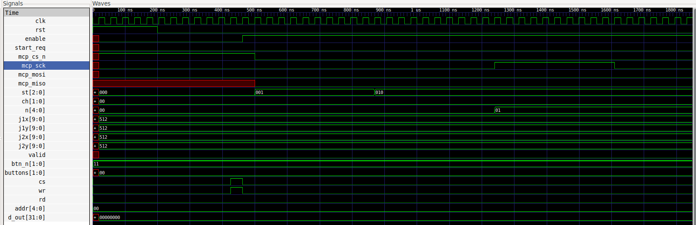

# Simulación y Testbench del Periférico de Joystick (`perip_joystick`)

Este documento detalla paso a paso cómo preparar, configurar y ejecutar la simulación unitaria del periférico **`perip_joystick.v`** mediante su banco de pruebas **`tb_perip_joystick.v`** antes de integrarlo al SoC con el procesador FemtoRV32.

---

## 1. Archivos necesarios para correr el testbench

El testbench `tb_perip_joystick.v` realiza una verificación unitaria completamente aislada: emula internamente al procesador FemtoRV32 (mediante tareas síncronas de lectura y escritura en el bus), al conversor ADC externo **MCP3008** (esclavo SPI Modo 0) y a los pulsadores físicos activos en bajo. Por ello, **no necesita el resto del SoC** para ejecutarse.

| Archivo | Requisito | Ruta sugerida | Función |
| :--- | :---: | :--- | :--- |
| **`tb_perip_joystick.v`** | **Obligatorio** | `sim/tb_perip_joystick.v` | Banco de pruebas que genera el reloj de $27\text{ MHz}$, aplica el reset, modela el MCP3008 y comprueba automáticamente los registros del periférico. |
| **`perip_joystick.v`** | **Obligatorio** | `rtl/perip_joystick.v` | Módulo hardware bajo prueba (*DUT*). El testbench lo instancia internamente (`perip_joystick dut (...)`); sin este archivo la compilación con `iverilog` falla. |
| **`Makefile`** | **Opcional** *(recomendado)* | `Makefile` (raíz) | Automatiza la limpieza de temporales, compilación, ejecución de la simulación y apertura de GTKWave. |
| **`tb_perip_joystick.gtkw`** | **Opcional** | `tb_perip_joystick.gtkw` | Archivo de configuración de GTKWave que guarda las señales elegidas, su orden y su formato numérico (decimal/hexadecimal). |
| **`SOC.v`, `femtorv32_quark.v`, `chip_select.v`, `top.v`, `.cst`** | **No requeridos** | — | Solo son necesarios para la integración y síntesis del SoC completo en la Tang Nano 9K, no para esta prueba unitaria. |

### Requisito dentro de `tb_perip_joystick.v`

Para que Icarus Verilog genere el archivo de formas de onda (`.vcd`) compatible con GTKWave, el bloque `initial` de `tb_perip_joystick.v` debe contener estas dos directivas al comienzo:

```verilog
initial begin
    $dumpfile("ondas_joystick.vcd");
    $dumpvars(0, tb_perip_joystick);
    // ... resto de la secuencia de pruebas ...
```

---

## 2. Configuración explícita del `Makefile`

Si vas a añadir esta simulación unitaria a tu propio `Makefile` (o crear uno dedicado para el módulo), debes incluir explícitamente las siguientes variables y reglas para compilar con **Icarus Verilog** (`iverilog` / `vvp`) y visualizar las ondas en **GTKWave**:

```makefile
# ==============================================================================
# VARIABLES DE SIMULACIÓN DEL PERIFÉRICO DE JOYSTICK
# ==============================================================================
top    = perip_joystick
DESIGN = rtl/perip_joystick.v
tb    ?= sim/tb_perip_joystick.v

# IMPORTANTE: usar una carpeta temporal distinta a 'sim/' para no borrar el testbench
S      = build_sim
TBN    = $(basename $(notdir $(tb)))
VCD    = ondas_joystick.vcd

# ==============================================================================
# REGLAS DE SIMULACIÓN (Icarus Verilog + GTKWave)
# ==============================================================================
.PHONY: sim iverilog-compile vvp-simulate wave clean-sim

sim: clean-sim iverilog-compile vvp-simulate wave

iverilog-compile:
	mkdir -p $(S)
	iverilog -g2005 -o $(S)/$(TBN).vvp -s $(TBN) $(tb) $(DESIGN)

vvp-simulate:
	cd $(S) && vvp -n $(TBN).vvp

wave:
	@gtkwave $(S)/$(VCD) $(wildcard $(TBN).gtkw) &

clean-sim:
	rm -rf $(S)
```

### Explicación de cada línea importante

* **`DESIGN = rtl/perip_joystick.v`**: Define la ubicación del archivo Verilog del periférico. *(Si lo colocas en la raíz junto al `Makefile`, cámbialo a `DESIGN = perip_joystick.v`).*
* **`tb ?= sim/tb_perip_joystick.v`**: Apunta a la ruta del testbench.
* **`S = build_sim`**: Directorio exclusivo para los artefactos temporales de simulación (`.vvp` y `.vcd`).
  > **Advertencia crítica:** Nunca asignes `S = sim` si tu testbench está guardado dentro de la carpeta `sim/`. Como la regla `sim` ejecuta `clean-sim` (`rm -rf $(S)`) antes de compilar, borraría permanentemente tu archivo `tb_perip_joystick.v`.
* **`TBN = $(basename $(notdir $(tb)))`**: Extrae automáticamente el nombre base del testbench (`tb_perip_joystick`) para nombrar el binario `.vvp` y buscar el archivo `.gtkw`.
* **`VCD = ondas_joystick.vcd`**: Debe coincidir exactamente con el nombre escrito en la directiva `$dumpfile("ondas_joystick.vcd");` dentro del testbench.
* **`iverilog -g2005 -o $(S)/$(TBN).vvp -s $(TBN) $(tb) $(DESIGN)`**: Compila el testbench junto con el periférico bajo el estándar Verilog-2005, fijando `tb_perip_joystick` como módulo raíz (`-s`) y guardando el ejecutable en `build_sim/tb_perip_joystick.vvp`.
* **`cd $(S) && vvp -n $(TBN).vvp`**: Ejecuta la simulación dentro de `build_sim/` en modo no interactivo (`-n`), de manera que el archivo `ondas_joystick.vcd` se genere ordenadamente dentro de la carpeta temporal.
* **`@gtkwave $(S)/$(VCD) $(wildcard $(TBN).gtkw) &`**: Abre GTKWave en segundo plano con las ondas generadas y carga automáticamente `tb_perip_joystick.gtkw` si existe en la carpeta.
* **`clean-sim`**: Elimina los archivos temporales antes de compilar de nuevo o antes de hacer `git push`.

---

## 3. Instrucciones de ejecución en consola

> **Aviso obligatorio — Entorno OSS CAD Suite:**  
> Antes de ejecutar cualquier comando `make`, **debes activar manualmente el entorno de OSS CAD Suite** en tu terminal actual. El `Makefile` no carga este entorno de forma automática y necesita que `iverilog`, `vvp` y `gtkwave` estén disponibles en el `PATH`.

### Paso 1: Activar OSS CAD Suite

En tu terminal de Linux, carga el script `environment` ajustando la ruta al directorio donde instalaste la suite en tu equipo:

```bash
source ~/gitPackages/digital-logic-design-tools/oss-cad-suite-2026-07-24/environment
```

Verifica que el *prompt* de tu terminal muestre el prefijo `(OSS CAD Suite)` (o confirma ejecutando `which iverilog`).

### Paso 2: Correr la simulación con `make`

Ubícate en la carpeta raíz del proyecto (donde está el `Makefile`) y ejecuta:

```bash
make sim
```

### Salida esperada en consola

El testbench valida secuencialmente el modo continuo (`ENABLE = 1`), la lectura sincronizada de los pulsadores (`BUTTONS`) y el disparo de barrido único (`START = 1` con autolimpieza). Al finalizar, la terminal debe mostrar exactamente:

```text
OK    J1_X = 512
OK    J1_Y = 1023
OK    J2_X = 0
OK    J2_Y = 291
OK    BUTTONS = 1
OK    J1_X tras START = 100
OK    START se limpio solo
PASS: perip_joystick
```

Acto seguido se abrirá automáticamente la ventana de **GTKWave** con el archivo `build_sim/ondas_joystick.vcd`.

### Otros comandos útiles

* **Reabrir GTKWave sin volver a compilar:**
  ```bash
  make wave
  ```
* **Limpiar temporales de simulación:**
  ```bash
  make clean-sim
  ```
* **Ejecución manual (sin `Makefile`):**
  ```bash
  iverilog -g2005 -o tb.vvp sim/tb_perip_joystick.v rtl/perip_joystick.v
  vvp -n tb.vvp
  gtkwave ondas_joystick.vcd &
  ```

---

## 4. Prueba de funcionamiento y análisis de la simulación

*(Asegúrate de colocar la imagen `Simulacion.png` en el mismo directorio que este archivo `.md`, o ajusta la ruta relativa según la estructura de tu repositorio).*



### Análisis detallado de las formas de onda (`Simulacion.png`)

La captura corresponde a la ventana inicial de **`0 ns` a `1850 ns`** ($1.85\text{ }\mu\text{s}$) en GTKWave, donde se verifica paso a paso la inicialización del periférico, la escritura de control desde el bus del procesador y el cumplimiento estricto de los tiempos de arranque del protocolo **SPI Modo 0** hacia el MCP3008:

1. **Reloj del sistema (`clk`) y Reset síncrono (`rst`):**
   * `clk` oscila de forma constante con un periodo de $37\text{ ns}$ ($\approx 27\text{ MHz}$), replicando el cristal de la Tang Nano 9K.
   * `rst` permanece en alto (`1`) desde $0\text{ ns}$ hasta $200\text{ ns}$. Desde el primer flanco de subida de reloj, todos los registros internos pasan de estado indefinido (rojo) a sus valores seguros de reset: `enable = 0`, `start_req = 0`, `mcp_cs_n = 1`, `mcp_sck = 0`, `mcp_mosi = 0`, `st = 000` (`S_IDLE`), `ch = 00`, `n = 00`, `valid = 0` y los cuatro ejes centrados en su punto medio (`j1x = j1y = j2x = j2y = 512`).
   * A los $200\text{ ns}$, `rst` baja a `0` y el módulo queda en reposo (`S_IDLE`) esperando órdenes del procesador.

2. **Escritura desde el bus de la CPU (`cs`, `wr`, `addr`, `enable`):**
   * Alrededor de los $425\text{ ns}$–$462\text{ ns}$, el testbench ejecuta `bus_write(5'h00, 32'h1)`: las señales `cs` y `wr` suben simultáneamente durante exactamente $1$ ciclo de reloj mientras `addr[4:0] = 00` (`OFS_CTRL`) y `rd = 0`.
   * En el flanco de subida de reloj siguiente ($\approx 462\text{ ns}$), el registro interno `enable` pasa de `0` a `1`, habilitando el modo de muestreo continuo.

3. **Inicio de transacción SPI y tiempo de establecimiento ($t_{SUCS}$):**
   * En el ciclo inmediatamente posterior ($\approx 500\text{ ns}$), la máquina de estados detecta `enable = 1`, baja `mcp_cs_n` a `0` para seleccionar el MCP3008 y transita de `st = 000` (`S_IDLE`) a `st = 001` (`S_SETUP`).
   * En ese mismo instante ($\approx 500\text{ ns}$), el modelo conductual del MCP3008 detecta el flanco de bajada de `mcp_cs_n` e inicializa la línea `mcp_miso` saliendo de estado indefinido (rojo) a `0`.
   * El estado `S_SETUP` (`001`) dura exactamente $10$ ciclos de reloj ($370\text{ ns}$, desde $\approx 500\text{ ns}$ hasta $\approx 870\text{ ns}$), momento en que la FSM pasa a `st = 010` (`S_BIT`).
   * Al entrar a `S_BIT`, el divisor espera un medio periodo adicional ($370\text{ ns}$) antes del primer flanco de subida de reloj. Esto produce un tiempo real de establecimiento $t_{SUCS} \approx 740\text{ ns}$ (de $500\text{ ns}$ a $1240\text{ ns}$), superando ampliamente el mínimo de $100\text{ ns}$ exigido por el *datasheet* del MCP3008.

4. **Primer pulso de reloj SPI (`mcp_sck`, `n[4:0]`, `mcp_mosi`):**
   * En $\approx 1240\text{ ns}$ ocurre el primer flanco de subida de `mcp_sck` (`0` $\rightarrow$ `1`). En ese instante el contador de pulsos `n[4:0]` se incrementa de `00` a `01`, confirmando la captura de la primera muestra de la trama de $24$ bits sobre el canal `ch = 00` (`CH0` / `J1_X`).
   * `mcp_sck` permanece en alto desde $\approx 1240\text{ ns}$ hasta $\approx 1610\text{ ns}$ ($370\text{ ns}$ de medio periodo, equivalente a un periodo completo de $740\text{ ns}$), validando una frecuencia SPI exacta de:
     $$f_{\text{SCLK}} = \frac{27\text{ MHz}}{2 \times 10} = 1.35\text{ MHz}$$
   * Durante este primer pulso, `mcp_mosi` se mantiene en `0` porque los primeros $7$ bits de la palabra de transmisión (`tx_w[23:17]`) son ceros previos al bit de inicio (`1`) que se envía en el pulso $8$.

5. **Estado de los pulsadores (`btn_n`, `buttons`) y registros de salida:**
   * Los pulsadores físicos externos en reposo (`btn_n[1:0] = 11`, activos en bajo) aparecen correctamente sincronizados e invertidos en `buttons[1:0] = 00`.
   * La bandera `valid` permanece en `0` y los registros `j1x..j2y` conservan su valor inicial de `512` mientras transcurre el primer barrido completo de los cuatro canales ($\approx 76\text{ }\mu\text{s}$), tras el cual la consola confirma la captura exacta de `512`, `1023`, `0`, `291` y el estado `PASS: perip_joystick`.

### Resumen de tiempos verificados en la captura

| Parámetro / Evento | Valor medido en `Simulacion.png` | Requisito del MCP3008 ($3.3\text{ V}$) | Estado |
| :--- | :---: | :---: | :---: |
| Fin de reset (`rst` $\rightarrow$ `0`) | $200\text{ ns}$ | — | Correcto |
| Activación de `enable` por bus (`OFS_CTRL`) | $\approx 462\text{ ns}$ | $1$ ciclo de escritura | Correcto |
| Duración de `S_SETUP` (`st = 001`) | $370\text{ ns}$ ($10$ ciclos) | $\ge 100\text{ ns}$ | Cumple |
| Tiempo real $t_{SUCS}$ (`mcp_cs_n` $\downarrow$ a 1.er `mcp_sck` $\uparrow$) | $\approx 740\text{ ns}$ | $\ge 100\text{ ns}$ | Cumple con holgura |
| Ancho en alto de `mcp_sck` ($t_{HI}$) | $370\text{ ns}$ ($1240$–$1610\text{ ns}$) | $\ge 125\text{ ns}$ | Cumple ($1.35\text{ MHz}$) |
| Conteo de flancos (`n[4:0]`) | `00` $\rightarrow$ `01` en 1.er `mcp_sck` $\uparrow$ | $24$ pulsos por canal | Correcto |