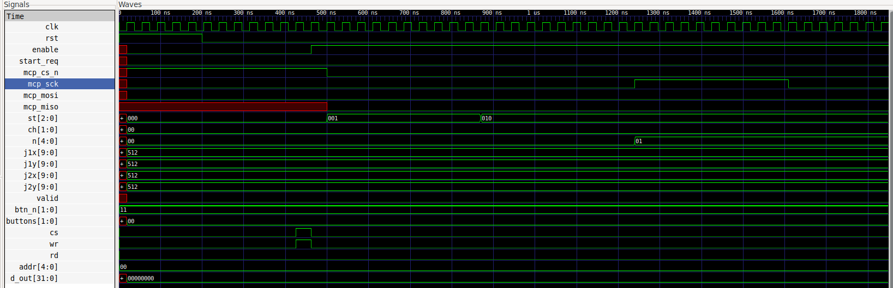

# Grupo 2 ·  SPI

Receptor del Joystick: recibe las teclas que presiona el jugador y se las entrega al procesador.

## Integrantes

- Miguel Pardo
- Crsitian Silva
- Sebastian Ochoa
- Arturo Tello

## Qué hace este grupo

Nuestro grupo implementa el periférico de joystick analógico de la consola de videojuegos. Su función es leer la posición del joystick (ejes X e Y) y el estado de su pulsador, y dejar esa información disponible para el procesador FemtoRV, que la usa para controlar el juego (mover al personaje, navegar menús, etc.).

El joystick entrega dos voltajes analógicos, uno por eje, entre 0 y 3.3 V. Como la FPGA Tang Nano solo trabaja con señales digitales, usamos un conversor analógico-digital MCP3008 con 4 canales (10 bits, resolución de ≈ 3.22 mV por paso). El ADC se comunica con la FPGA por SPI en modo 0, donde la FPGA actúa como maestro y el MCP3008 como esclavo.

- Dispositivo(s): Joystick conectado a MCP3008
- Protocolo: SPI
- Dirección base en el mapa de memoria: `0x43_0000`

## Tareas

- [ ] Estudiar el protocolo SPI y la trama del MCP3008
- [ ] Definir los registros del receptor
- [ ] Diseñar el receptor en Verilog
- [ ] Definir la asignación de cada jugador
- [ ] Escribir el testbench
- [ ] Probar en la placa

# 1. Terminología básica

En esta sección se explican los principales conceptos que se utilizan en el desarrollo del periférico. La idea es conocer primero los componentes, las señales y los términos relacionados con la comunicación entre dispositivos, para entender con mayor facilidad el funcionamiento del sistema y las etapas de implementación.

## 1.1. Descripción general del proyecto

El proyecto consiste en desarrollar un periférico que permita conectar dos s analógicos a un procesador FemtoRV implementado en una FPGA Tang Nano.

Cuando se mueve un , sus ejes generan señales de voltaje que cambian según la posición de la palanca. Estas señales llegan al conversor MCP3008, que se encarga de transformarlas en valores digitales. Después, la FPGA recibe los datos mediante comunicación SPI y los guarda en registros para que el procesador pueda consultarlos.

## 1.2. Componentes principales

Antes de explicar la comunicación entre los dispositivos, es importante identificar la función que cumple cada uno dentro del proyecto.

| Término | Descripción |
|---|---|
| ** analógico** | Es una palanca que permite detectar movimientos en dos direcciones, X y Y. Cada eje tiene un potenciómetro que modifica su voltaje dependiendo de la posición. En nuestro caso trabajamos con un rango de 0 a 3,3 V, por lo que en el centro se espera un valor cercano a 1,65 V. También cuenta con un botón que funciona como interruptor. |
| **Señal analógica** | Es una señal cuyo valor puede cambiar de manera continua dentro de un rango determinado. Por ejemplo, el voltaje que entrega un  cuando se mueve. |
| **Señal digital** | Es una señal que representa información mediante dos niveles lógicos, 0 y 1. Estos niveles permiten que los circuitos digitales procesen y transmitan información. |
| **FPGA (Tang Nano)** | Es un dispositivo que permite configurar circuitos digitales según las necesidades del proyecto. La utilizamos para implementar el periférico y controlar la comunicación con el ADC. |
| **ADC (conversor analógico-digital)** | Es un circuito que convierte una señal analógica, como un voltaje, en un valor numérico que puede procesar un sistema digital. |
| **MCP3008** | Es el conversor ADC que utilizamos. Tiene ocho canales de entrada y una resolución de 10 bits. Se comunica con la FPGA mediante SPI. |
| **FemtoRV** | Es un procesador basado en la arquitectura RISC-V. En nuestro sistema ejecuta el programa del juego y obtiene la información de los s leyendo los registros del periférico. |
| **SoC (System on Chip)** | Es un sistema que integra un procesador y diferentes periféricos dentro de un mismo chip. En este proyecto, estos elementos se implementan en la FPGA. |
| **Periférico** | Es un módulo que realiza una función específica y se comunica con el procesador. En nuestro caso, permite obtener la posición de los s y el estado de sus botones. |

## 1.3. Bits, resolución y representación de los datos

Como el MCP3008 convierte voltajes en números, necesitamos entender cómo se representan esos valores y qué significa trabajar con una resolución de 10 bits.

| Término | Descripción |
|---|---|
| **Bit** | Es la unidad más pequeña de información digital y puede tomar el valor de 0 o 1. |
| **Byte** | Es un conjunto de 8 bits. |
| **10 bits** | Significa que el resultado de una conversión puede representarse mediante 1024 valores diferentes, desde 0 hasta 1023. |
| **Resolución** | Indica el cambio de voltaje correspondiente a un paso del ADC. Si utilizamos una referencia de 3,3 V, cada paso equivale aproximadamente a 3,22 mV. |
| **Ejemplo de conversión** | Con una referencia de 3,3 V, una entrada de 0 V produce un valor de 0; una de 1,65 V produce aproximadamente 512, y una cercana a 3,3 V produce 1023. |
| **MSB (Most Significant Bit)** | Es el bit de mayor peso dentro de un número binario. En el formato de lectura que usamos, es el primer bit del resultado que transmite el ADC. |
| **LSB (Least Significant Bit)** | Es el bit de menor peso. En nuestro caso, corresponde al último bit del resultado transmitido. |
| **B9 a B0** | Son los diez bits que forman el resultado de la conversión. B9 es el más significativo y B0 el menos significativo. |
| **VREF (voltaje de referencia)** | Es el voltaje que establece el rango de medición del ADC. Para nuestro diseño utilizamos 3,3 V. |
| **Muestreo** | Es el momento en el que el ADC toma el valor de la señal analógica para realizar la medición. |
| **Conversión** | Es el proceso mediante el cual el ADC transforma el voltaje medido en un número digital de 10 bits. |

## 1.4. Comunicación SPI

Para intercambiar información entre la FPGA y el MCP3008 utilizamos el protocolo SPI. Este permite transmitir datos de manera serial, es decir, un bit a la vez.

La FPGA controla la comunicación y selecciona el canal que necesita leer, mientras que el MCP3008 realiza la conversión y devuelve el resultado.

| Término | Descripción |
|---|---|
| **SPI (Serial Peripheral Interface)** | Es un protocolo de comunicación serial que permite intercambiar datos entre dispositivos electrónicos. |
| **Maestro** | Es el dispositivo que controla la comunicación y genera la señal de reloj. En nuestro caso es la FPGA. |
| **Esclavo** | Es el dispositivo que responde a las instrucciones del maestro. En este proyecto corresponde al MCP3008. |
| **SCLK (Serial Clock)** | Es la señal de reloj que sincroniza la transmisión de datos. La genera la FPGA. |
| **CS (Chip Select)** | Es la señal que permite seleccionar el ADC. Cuando está en 0, el MCP3008 puede recibir instrucciones. Cuando vuelve a 1, termina la comunicación. |
| **MOSI / DIN** | Es la línea por la que la FPGA envía los bits de configuración al MCP3008, como la selección del canal que desea medir. |
| **MISO / DOUT** | Es la línea por la que el MCP3008 envía a la FPGA los bits correspondientes al resultado de la conversión. |
| **Flanco de subida** | Es el instante en que una señal digital cambia de 0 a 1. |
| **Flanco de bajada** | Es el instante en que una señal digital cambia de 1 a 0. |
| **Modo 0 (CPOL = 0, CPHA = 0)** | Es una configuración de SPI en la que el reloj permanece en 0 cuando no está transmitiendo datos. La información se lee en el flanco de subida y se actualiza en el de bajada. |
| **Alta impedancia (Hi-Z)** | Es un estado en el que una salida deja de controlar eléctricamente la línea. El MCP3008 utiliza este estado en DOUT cuando no está transmitiendo datos. |

## 1.5. Estructura de la trama SPI

Cada vez que necesitamos conocer el valor de un eje del , la FPGA inicia una comunicación con el MCP3008. Primero envía los bits que indican qué canal debe medir y después recibe el resultado.

Para nuestro diseño consideramos una secuencia de 17 pulsos de reloj, suficientes para enviar la configuración y recibir los 10 bits de la conversión.

| Término | Descripción |
|---|---|
| **Trama** | Es la secuencia de bits que se transmite durante una comunicación. Incluye la configuración del ADC y los datos de respuesta. |
| **Start bit** | Es un bit con valor 1 que indica al MCP3008 el inicio de una solicitud. |
| **SGL/DIFF** | Permite seleccionar el tipo de medición. Con valor 1 se utiliza el modo de entrada individual (*single-ended*), que mide cada canal respecto a tierra. Con valor 0 se utiliza el modo diferencial. En nuestro diseño usamos el valor 1. |
| **D2, D1 y D0** | Son tres bits que permiten seleccionar uno de los ocho canales del MCP3008. Por ejemplo, 000 corresponde a CH0 y 001 a CH1. |
| **Canales CH0 a CH7** | Son las ocho entradas analógicas disponibles. Para los dos s utilizamos cuatro canales, del CH0 al CH3, uno por cada eje. |
| **Periodo de muestreo** | Es el intervalo durante el cual el ADC adquiere el valor del voltaje de entrada. Después de recibir los bits de selección, necesita un ciclo adicional de reloj para completar esta etapa. |
| **Null bit** | Es un bit con valor 0 que aparece antes de los diez bits del resultado. No forma parte del valor de la conversión, por lo que la FPGA debe ignorarlo. |

Después del bit nulo, el MCP3008 envía el resultado comenzando por B9 y terminando en B0. Una vez recibidos los diez bits, la FPGA puede finalizar la comunicación y almacenar el valor obtenido.

## 1.6. Parámetros de tiempo del MCP3008

Para que la comunicación funcione correctamente, debemos respetar los tiempos establecidos por el fabricante en el *datasheet* del MCP3008.

Estos parámetros determinan la velocidad a la que podemos transmitir información y los intervalos mínimos que deben existir entre algunas señales.

| Parámetro | Descripción |
|---|---|
| **fCLK (frecuencia de SCLK)** | Indica la velocidad del reloj utilizado en la comunicación. El fabricante especifica un máximo de 1,35 MHz para una alimentación de 2,7 V y de 3,6 MHz para 5 V. Como nuestro sistema funciona a 3,3 V, utilizamos 1,35 MHz como límite conservador de diseño. |
| **tHI / tLO** | Son los tiempos mínimos durante los cuales SCLK debe mantenerse en nivel alto y bajo. Según el *datasheet*, ambos deben ser de al menos 125 ns. |
| **tSUCS** | Es el tiempo mínimo que debe transcurrir entre la activación de CS y el primer flanco de subida del reloj. Su valor mínimo es 100 ns. |
| **tCSH** | Es el tiempo mínimo durante el cual CS debe permanecer en alto antes de iniciar una nueva comunicación. El valor indicado es 270 ns. |
| **ns (nanosegundo)** | Es una unidad de tiempo equivalente a una milmillonésima parte de un segundo. |
| **µs (microsegundo)** | Es una unidad de tiempo equivalente a una millonésima parte de un segundo. |
| **MHz (megahercio)** | Es una unidad de frecuencia que representa un millón de ciclos por segundo. |
| **ksps (kilomuestras por segundo)** | Indica cuántos miles de muestras puede realizar un ADC cada segundo. El MCP3008 tiene una capacidad especificada de 75 ksps a 2,7 V y 200 ksps a 5 V. |
| **Divisor de reloj** | Es un circuito que permite obtener una frecuencia menor a partir del reloj principal de la FPGA. Por ejemplo, podemos dividir un reloj de 27 MHz para generar el SCLK que necesita el MCP3008. |

En nuestro caso, no necesitamos realizar conversiones a una velocidad tan alta, ya que los movimientos de los s son relativamente lentos. Lo importante es que las lecturas se realicen con suficiente frecuencia para detectar los cambios de posición sin retrasos perceptibles durante el juego.

## 1.7. Conceptos para la implementación del periférico

Finalmente, hay algunos términos que utilizaremos cuando comencemos a desarrollar el circuito en Verilog y a conectarlo con el procesador FemtoRV.

| Término | Descripción |
|---|---|
| **Registro** | Es un conjunto de bits que permite almacenar información dentro de un circuito digital. Utilizaremos registros para conservar los valores de los ejes y otros datos del periférico. |
| **Mapa de memoria** | Es la organización de las direcciones que utiliza el procesador para acceder a la memoria y a los periféricos. |
| **Dirección base (`0x43_0000`)** | Es la dirección asignada a nuestro periférico dentro del mapa de memoria del sistema. A partir de ella se definen las posiciones donde el procesador podrá consultar los datos. |
| **Verilog** | Es un lenguaje de descripción de hardware que utilizamos para diseñar los circuitos digitales que se implementarán en la FPGA. |
| **FSM (máquina de estados finitos)** | Es una forma de organizar el funcionamiento de un circuito mediante estados definidos. En nuestro diseño permite controlar los pasos de comunicación SPI, desde la activación de CS hasta la recepción de los datos. |
| **Testbench** | Es un entorno de simulación que permite comprobar el funcionamiento de un circuito antes de implementarlo físicamente. Podemos utilizarlo para simular las respuestas del MCP3008 y verificar que la FPGA interprete correctamente los datos. |

Con estos conceptos podemos entender el recorrido de la información dentro del sistema: los s generan los voltajes, el MCP3008 los convierte en números digitales y la FPGA se encarga de recibirlos y almacenarlos. Finalmente, el procesador FemtoRV consulta esos registros para utilizar los movimientos y botones dentro del juego.

## 2.1 La idea general

SPI es una conversación entre dos chips: **un maestro** que manda y **un esclavo** que obedece. Nos ayuda imaginarlo como un walkie-talkie con metrónomo:

- El maestro (la FPGA) **marca el ritmo** con un reloj (SCLK).
- En cada tick, **un bit sale del maestro hacia el esclavo** y **un bit sale del esclavo hacia el maestro**, al mismo tiempo.
- Cada chip tiene un **registro de desplazamiento**: una fila de casillas donde, en cada tick, todos los bits se corren un lugar, entra uno nuevo por un extremo y sale otro por el otro.

Después de 17 ticks, la FPGA habrá enviado su comando (solo los primeros 5 bits importan) y habrá recibido el número de 10 bits.

> **Regla de oro:** el esclavo nunca habla por su cuenta. Solo responde mientras el maestro tenga CS en bajo y mande pulsos de SCLK.

## 2.2 Las 4 líneas y cómo se conectan

La FPGA y el MCP3008 se unen con cuatro líneas:

| Línea | Dirección | Pin del MCP3008 | Conexión |
|---|---|---|---|
| **SCLK** | FPGA → ADC | 13 (CLK) | Reloj generado por la FPGA |
| **MOSI** | FPGA → ADC | 11 (DIN) | Comando que envía la FPGA |
| **MISO** | ADC → FPGA | 12 (DOUT) | Resultado que envía el ADC |
| **CS** | FPGA → ADC | 10 (CS/SHDN) | Selección del chip, activa en bajo |

Además, el chip necesita alimentación y las entradas del :

| Pin | Nombre | Conectar a |
|---|---|---|
| 16 | VDD | 3.3 V |
| 15 | VREF | 3.3 V (define que 3.3 V = 1023) |
| 14 | AGND | GND |
| 9 | DGND | GND |
| 1 a 4 | CH0 a CH3 | Ejes X e Y del  (3.3 V arriba, GND abajo, el eje al canal) |

Todos los GND deben ir unidos. Sin tierra común, SPI no funciona.

## 2.3 Reglas del modo 0: quién cambia y quién lee, y cuándo

En modo 0, SCLK **descansa en 0**. En cada pulso hay dos momentos:

| Momento | Qué pasa |
|---|---|
| **Flanco de subida** (0 → 1) | Se **leen** los bits: el ADC lee MOSI y la FPGA lee MISO. |
| **Flanco de bajada** (1 → 0) | Se **cambian** los bits: la FPGA pone el siguiente bit en MOSI y el ADC pone el siguiente bit en MISO. |

Con esta división nadie lee una línea mientras está cambiando. Cada bit se prepara en la bajada y se lee estable en la subida siguiente. El primer bit (start) tiene que estar ya puesto en MOSI antes del primer flanco de subida, por eso lo colocamos justo al bajar CS.

## 2.4 Límites de tiempo que tenemos que respetar

Estos valores salen del datasheet de Microchip MCP3004/3008:

- Velocidad de SCLK: 3.6 MHz como máximo a 5 V y 1.35 MHz a 2.7 V. Como trabajamos a 3.3 V, usamos **≤ 1.35 MHz**, que es el valor seguro.
- SCLK en alto y en bajo: al menos 125 ns cada uno.
- De bajar CS al primer flanco de subida (tSUCS): al menos 100 ns.
- CS en alto entre conversiones (tCSH): al menos 270 ns.
- Con SCLK ≈ 0.85 MHz el semiperiodo es ~590 ns, lo que cumple con holgura todos los mínimos.

## 2.5 Una transacción completa, pulso a pulso

Llamamos **transacción** a una conversación completa: CS baja, se envían 17 pulsos y CS sube.

**Estado de reposo (siempre antes y después):** CS = 1, SCLK = 0, MOSI = 0.

**Secuencia que planteamos:**

1. **Bajamos CS** a 0 y esperamos ≥ 100 ns (en la práctica, 1 o 2 ciclos del reloj de sistema).
2. **Ponemos el primer bit** (el start = 1) en MOSI.
3. **Repetimos 17 veces:** subimos SCLK y leemos MISO, luego bajamos SCLK y ponemos en MOSI el siguiente bit.
4. **Después del pulso 17**, dejamos SCLK en 0.
5. **Subimos CS** a 1 y lo mantenemos ≥ 270 ns antes de la siguiente transacción.
6. **Guardamos** el número de 10 bits recibido en el registro del canal.

### Trama de 17 pulsos

| Pulso | DIN (FPGA → ADC) | DOUT (ADC → FPGA) |
|---|---|---|
| 1 | Start = 1 | Alta impedancia |
| 2 | SGL/DIFF = 1 | Alta impedancia |
| 3 | D2 | Alta impedancia |
| 4 | D1 | Alta impedancia |
| 5 | D0 | Alta impedancia |
| 6 | no importa | Alta impedancia (muestreo) |
| 7 | no importa | Null bit = 0 |
| 8 a 17 | no importa | B9, B8, …, B0 |

### Comandos CH0 a CH3 (single-ended)

Los 4 bits del comando son `{SGL/DIFF, D2, D1, D0}`.

| Canal | Comando | Segundo byte (formato de 3 bytes) |
|---|---|---|
| CH0 | `1000` | `0x80` |
| CH1 | `1001` | `0x90` |
| CH2 | `1010` | `0xA0` |
| CH3 | `1011` | `0xB0` |

## 2.6 Ejemplo completo: leer el eje Y del jugador 1 (CH1)

Para verlo con números, suponemos que el eje mide **2.18 V**. Como 2.18 / 3.22 mV ≈ 677, el ADC debe devolver **677 = `10 1010 0101` en binario (0x2A5)**.

El comando para CH1 es `SGL/DIFF=1, D2=0, D1=0, D0=1`.

| Pulso | FPGA pone en MOSI | ADC pone en MISO | Qué hace la FPGA con lo recibido |
|---|---|---|---|
| 1 | **1** (start) | alta impedancia | Ignora |
| 2 | **1** (SGL/DIFF) | alta impedancia | Ignora |
| 3 | **0** (D2) | alta impedancia | Ignora |
| 4 | **0** (D1) | alta impedancia | Ignora |
| 5 | **1** (D0) | alta impedancia | Ignora |
| 6 | no importa | alta impedancia (muestreo) | Ignora |
| 7 | no importa | 0 (null bit) | Descarta |
| 8 | no importa | **1** (B9) | Guarda |
| 9 | no importa | **0** (B8) | Guarda |
| 10 | no importa | **1** (B7) | Guarda |
| 11 | no importa | **0** (B6) | Guarda |
| 12 | no importa | **1** (B5) | Guarda |
| 13 | no importa | **0** (B4) | Guarda |
| 14 | no importa | **0** (B3) | Guarda |
| 15 | no importa | **1** (B2) | Guarda |
| 16 | no importa | **0** (B1) | Guarda |
| 17 | no importa | **1** (B0) | Guarda |

Los bits guardados, en orden de llegada, son `1010100101`, es decir, 677. Los capturamos con un registro de desplazamiento: en cada pulso útil hacemos `resultado = {resultado[8:0], bit_recibido}`. Como B9 llega primero, termina en la posición más alta.

## 2.7 Variante de 3 bytes (24 pulsos)

Muchas librerías de microcontroladores hacen lo mismo en 3 bytes completos:

| Byte | Se envía | Se recibe |
|---|---|---|
| 1 | `0x01` (7 ceros y el start) | Ignorar |
| 2 | `0x90` para CH1 (`1 001 0000`) | Sus 2 bits bajos son B9 y B8 |
| 3 | `0x00` (relleno) | B7 a B0 |

Con el ejemplo anterior: `rx2[1:0] = 10` y `rx3 = 0xA5`, así que `valor = {rx2[1:0], rx3} = 0x2A5 = 677`.

Las dos variantes dan el mismo resultado. La de 17 pulsos es más corta y la de 24 es más fácil de alinear con bytes. Vamos a elegir una y usarla siempre.

## 2.8 Leer varios canales

El MCP3008 mide **un solo canal por transacción**. Para leer X e Y de dos jugadores tenemos que hacer 4 transacciones seguidas:

1. CH0 → registro X del jugador 1.
2. CH1 → registro Y del jugador 1.
3. CH2 → registro X del jugador 2.
4. CH3 → registro Y del jugador 2.

Entre una y otra, CS sube y espera ≥ 270 ns. Luego repetimos el ciclo sin parar, y así el procesador siempre encuentra el último valor leído en los registros.

## 2.9 Cómo lo traducimos a un circuito en la FPGA

Para implementarlo necesitamos 4 bloques sencillos:

| Bloque | Función |
|---|---|
| **Divisor de reloj** | Cuenta ciclos del reloj de sistema y da un "tick" a la velocidad de SCLK (≤ 1.35 MHz). |
| **Contador de pulsos** | Cuenta de 0 a 16 para saber en qué bit de la trama vamos. |
| **Registros de desplazamiento** | Uno envía el comando por MOSI y otro captura los 10 bits por MISO. |
| **FSM (máquina de estados)** | Coordina todo con la secuencia: `IDLE → CS_BAJA → ENVIAR_Y_LEER_17_PULSOS → CS_SUBE → ESPERA → SIGUIENTE_CANAL`. |

Una buena práctica que vamos a seguir es **no usar SCLK como reloj interno** de la FPGA. Mantenemos todo en el reloj de sistema y generamos SCLK como una señal normal que cambia cuando llega el tick del divisor. Así evitamos problemas de sincronización.

## 2.10 Errores comunes y cómo reconocerlos

Esta tabla nos servirá para depurar cuando probemos el diseño:

| Síntoma | Causa probable |
|---|---|
| Siempre lee 0 | MISO desconectado, CS nunca baja, o el comando está mal formado. |
| Siempre lee 1023 | VREF o VDD sin alimentar, o MISO flotante en alto. |
| Valores a la mitad o al doble de lo esperado | Un bit de desfase: se leyó un pulso antes o después. Revisar dónde se descarta el null bit. |
| Valores ruidosos o erráticos | SCLK demasiado rápido, cables largos, o falta de tierra común. |
| Canal equivocado | Bits D2 D1 D0 mal ordenados. D2 sale primero. |
| Funciona en simulación, falla en la placa | Tiempos (tSUCS, tCSH) no respetados, o modo SPI equivocado. |
| Solo cambia un bit del resultado | Se está usando el flanco de bajada para leer MISO. |

**Prueba de sanidad que vamos a hacer en la placa:**

- Entrada a GND → resultado ≈ 0.
- Entrada a 3.3 V → resultado ≈ 1023.
-  centrado → resultado ≈ 512.

## 2.11 Lista de verificación antes de simular o probar

- [ ] En reposo: CS = 1, SCLK = 0.
- [ ] SCLK ≤ 1.35 MHz y semiperiodo > 125 ns.
- [ ] CS baja ≥ 100 ns antes del primer pulso.
- [ ] El start bit está en MOSI antes de la primera subida.
- [ ] MOSI cambia en las bajadas y MISO se lee en las subidas.
- [ ] Se descarta el null bit, y B9 es el primer bit guardado.
- [ ] El comando de cada canal es correcto (CH0 = `1000`, CH1 = `1001`, CH2 = `1010`, CH3 = `1011`).
- [ ] CS en alto ≥ 270 ns entre transacciones.
- [ ] Todas las tierras unidas, y VDD = VREF = 3.3 V.


# 3. Diseño

En esta sección se detalla la arquitectura interna del controlador Verilog, el funcionamiento de la máquina de estados (FSM) que gestiona la comunicación SPI y el cálculo de división de reloj.

## 3.1 Arquitectura General y Diagrama de Bloques

El módulo se compone de cuatro sub-bloques funcionales diseñados para operar de forma síncrona con el reloj principal de la FPGA y abstraer la complejidad del protocolo SPI al procesador:

**Generador de Reloj (clk_divider):** Toma el reloj del sistema de la FPGA y genera impulsos de habilitación (sclk_tick) para obtener un $SCLK \le 1.35\text{ MHz}$.

**Máquina de Estados Principal (spi_fsm):** Coordina los ciclos de lectura secuencial de los 4 canales (CH0 a CH3) y controla los tiempos de espera de Chip Select ($t_{SUCS}$ y $t_{CSH}$).

**Registros de Desplazamiento (shift_registers):** 
-Registro de Transmisión (Tx): Mantiene la trama de comandos de 5 bits (Start, SGL/DIFF, D2, D1, D0) y coloca cada bit en la línea MOSI.
-Registro de Recepción (Rx): Captura en serie los bits que entrega el ADC por la línea MISO, descartando el null bit y acumulando los 10 bits de datos (B9 a B0).

**Banco de Registros e Interfaz de Bus (reg_file):** Mantiene almacenados los valores actualizados de los ejes (J1_X, J1_Y, J2_X, J2_Y) y gestiona las lecturas/escrituras del procesador FemtoRV.

## 3.2 Diagramas y Archivos Adjuntos

Esquema detallado de bloques y diagrama de estados de la FSM: [Ver diagramas](./docs/Diagramas.md)

Especificaciones eléctricas y de tiempos del ADC: [Ver datasheet](./docs/Datasheet_MCP3008.md)


_(Diagrama de bloques, diagrama de flujo, cálculos. Guardar los archivos en `docs/`.)_

## 4. Registros

El periférico `perip_joystick.v` se integra al bus MMIO del procesador **FemtoRV32** a partir de la dirección base **`0x0043_0000`** (rango útil `0x0043_0000` a `0x0043_001C`), habilitado por la señal `cs[3]` en `chip_select.v`. Implementa **8 registros de 32 bits** alineados a palabra (offsets de 4 en 4 bytes, decodificados con `mem_addr[4:0]`). Los valores de 10 bits del ADC ocupan `bits [9:0]` y el resto se lee en `0`.

### 4.1 Mapa de registros (Base `0x0043_0000`)

| Dirección | Offset | Registro | Acceso | Descripción de bits |
| :---: | :---: | :--- | :---: | :--- |
| `0x0043_0000` | `0x00` | **`CTRL`** | R/W | `bit 0 = ENABLE` (`1`: barrido continuo de los 4 canales). `bit 1 = START` (`1`: dispara 1 barrido único y se autolimpia al terminar). |
| `0x0043_0004` | `0x04` | **`STATUS`** | R | `bit 0 = BUSY` (`1`: conversión SPI en curso). `bit 1 = VALID` (`1`: al menos 1 barrido completo listo). |
| `0x0043_0008` | `0x08` | **`J1_X`** | R | `bits [9:0]`: Lectura de 10 bits (`0..1023`) del canal `CH0` (Eje X Joystick 1). Valor tras reset: `512`. |
| `0x0043_000C` | `0x0C` | **`J1_Y`** | R | `bits [9:0]`: Lectura de 10 bits (`0..1023`) del canal `CH1` (Eje Y Joystick 1). Valor tras reset: `512`. |
| `0x0043_0010` | `0x10` | **`J2_X`** | R | `bits [9:0]`: Lectura de 10 bits (`0..1023`) del canal `CH2` (Eje X Joystick 2). Valor tras reset: `512`. |
| `0x0043_0014` | `0x14` | **`J2_Y`** | R | `bits [9:0]`: Lectura de 10 bits (`0..1023`) del canal `CH3` (Eje Y Joystick 2). Valor tras reset: `512`. |
| `0x0043_0018` | `0x18` | **`BUTTONS`** | R | `bit 0 = SW_J1`, `bit 1 = SW_J2` (lógica positiva: `1` = presionado, `0` = suelto; sincronizados e invertidos internamente desde `btn_n`). |
| `0x0043_001C` | `0x1C` | **`CLKDIV`** | R/W | `bits [7:0]`: Divisor SPI ($f_{\text{SCLK}} = \frac{f_{\text{clk}}}{2 \cdot \text{CLKDIV}}$; por defecto `10` $\rightarrow 1.35\text{ MHz}$ con reloj de $27\text{ MHz}$). |

### 4.2 Funcionamiento e integración con el SoC

* **Arranque seguro tras reset:** El módulo inicia apagado (`ENABLE = 0`, `VALID = 0`) con los cuatro ejes centrados en `512`. El firmware debe escribir `1` en `0x0043_0000` (`CTRL.ENABLE`) para activar el muestreo automático y esperar a que `STATUS[1]` (`VALID`) pase a `1` ($\approx 76\text{ }\mu\text{s}$ para el primer barrido de los 4 canales).
* **Barrido autónomo:** La FSM realiza secuencialmente la lectura de `CH0`, `CH1`, `CH2` y `CH3` mediante tramas SPI Modo 0 de **24 pulsos** y actualiza `J1_X`, `J1_Y`, `J2_X` y `J2_Y` de forma transparente para el procesador.
* **Pulsadores sincronizados:** Las entradas físicas `joy_sw_n[1:0]` (activas en bajo) pasan por un sincronizador anti-metaestabilidad de doble flip-flop (`btn_ff1` $\rightarrow$ `btn_ff2`) y se invierten internamente antes de exponerse en `BUTTONS`.
* **Puntos clave de instanciación en `SOC.v`:** Conectar `.rst(!resetn)` (el SoC usa reset activo en bajo y `perip_joystick` activo en alto), `.addr(mem_addr[4:0])`, `.cs(cs_chip3)` y enrutar `joy_dout` a `.chip3_dout(joy_dout)` en `chip_select.v`.

> Para ver el código de integración completo en `SOC.v`, `chip_select.v`, `top.v`, `Makefile` y el ejemplo de lectura en C, consultar la guía detallada en [`./Codigo/rtl/README.md`](./Codigo/rtl/README.md).

---

## 5. Pines

El módulo expone **6 pines físicos** en `top.v` para la **Tang Nano 9K** (4 líneas SPI Modo 0 hacia el MCP3008 y 2 entradas digitales para los pulsadores `SW` de los joysticks KY-023), todos configurados en bancos de **$3.3\text{ V}$ (`LVCMOS33`)**.

| Señal (`top.v` / `.cst`) | Pin FPGA | Conector / Destino | Nota |
| :--- | :---: | :--- | :--- |
| **`mcp_cs_n`** | `PIN_CS` *(libre $3.3\text{ V}$)* | MCP3008 Pin 10 (`CS/SHDN`) | Salida activa en bajo. `IO_TYPE=LVCMOS33 PULL_MODE=UP`. |
| **`mcp_sck`** | `PIN_SCK` *(libre $3.3\text{ V}$)* | MCP3008 Pin 13 (`CLK`) | Salida reloj SPI Modo 0 ($1.35\text{ MHz}$ por defecto). `IO_TYPE=LVCMOS33`. |
| **`mcp_mosi`** | `PIN_MOSI` *(libre $3.3\text{ V}$)* | MCP3008 Pin 11 (`DIN`) | Salida de comandos FPGA $\rightarrow$ ADC. `IO_TYPE=LVCMOS33`. |
| **`mcp_miso`** | `PIN_MISO` *(libre $3.3\text{ V}$)* | MCP3008 Pin 12 (`DOUT`) | Entrada de datos ADC $\rightarrow$ FPGA. `IO_TYPE=LVCMOS33 PULL_MODE=UP`. |
| **`joy_sw_n[0]`** | `PIN_SW1` *(libre $3.3\text{ V}$)* | Joystick 1 (KY-023) Pin `SW` | Entrada activa en bajo. `IO_TYPE=LVCMOS33 PULL_MODE=UP`. No negar en `top.v`. |
| **`joy_sw_n[1]`** | `PIN_SW2` *(libre $3.3\text{ V}$)* | Joystick 2 (KY-023) Pin `SW` | Entrada activa en bajo. `IO_TYPE=LVCMOS33 PULL_MODE=UP`. No negar en `top.v`. |

### Restricciones físicas para el archivo `.cst`

* **Alimentación estricta a $3.3\text{ V}$:** Tanto el MCP3008 (`VDD` y `VREF`) como los potenciómetros de los joysticks deben alimentarse a $3.3\text{ V}$ (nunca a $5\text{ V}$) con tierra común (`AGND` = `DGND` = `GND`).
* **Pines a evitar:** No asignar pines reservados por `clk` (pin 52), `btn` (pines 3 y 4), `led`, `uart_tx`/`uart_rx` (pines 17 y 18), pantalla HUB75, audio ni pines de arranque/MSPI.
* **Sintaxis para `nextpnr-himbaechel`:** Escribir cada directiva `IO_LOC` e `IO_PORT` en líneas separadas (plantilla completa en [`./Codigo/rtl/README.md`](./Codigo/rtl/README.md)). Los `PIN_*` se reemplazan por los números físicos libres al integrar el `.cst` final del SoC.

---

## 6. Simulación

La verificación funcional del periférico se realizó de forma unitaria con **`Codigo/sim/tb_perip_joystick.v`** y **`Codigo/rtl/perip_joystick.v`**. El testbench genera un reloj de $27\text{ MHz}$, emula las lecturas y escrituras síncronas del bus del FemtoRV32, modela conductualmente el ADC **MCP3008** (SPI Modo 0) y simula los pulsadores físicos activos en bajo.

### 6.1 Cómo ejecutar el testbench

Con el entorno **OSS CAD Suite** activado previamente en la terminal (`source /ruta/a/tu/oss-cad-suite/environment`), se puede correr la simulación desde `grupo2-joystick/` con:

```bash
iverilog -g2005 -o tb_joy.vvp Codigo/sim/tb_perip_joystick.v Codigo/rtl/perip_joystick.v
vvp -n tb_joy.vvp
gtkwave ondas_joystick.vcd &
```

*(También está documentada la regla portable `make sim-joystick` para integrarla en cualquier `Makefile` dentro de [`./Codigo/sim/README.md`](./Codigo/sim/README.md).)*

### 6.2 Qué se verificó

1. **Verificación automática en consola:** El testbench valida el barrido continuo (`ENABLE = 1`), la lectura sincronizada de los pulsadores (`BUTTONS`) y el disparo de barrido único (`START = 1` con autolimpieza), arrojando la salida:

   ```text
   OK    J1_X = 512
   OK    J1_Y = 1023
   OK    J2_X = 0
   OK    J2_Y = 291
   OK    BUTTONS = 1
   OK    J1_X tras START = 100
   OK    START se limpio solo
   PASS: perip_joystick
   ```

2. **Análisis de tiempos y protocolo SPI Modo 0 en GTKWave:**



| Parámetro / Evento | Valor medido en `Simulacion.png` | Requisito del MCP3008 ($3.3\text{ V}$) | Estado |
| :--- | :---: | :---: | :---: |
| Fin de reset (`rst` $\to$ `0`) | $200\text{ ns}$ (ejes inicializados en `512`) | — | Correcto |
| Activación de `enable` por bus (`CTRL`) | $\approx 462\text{ ns}$ | $1$ ciclo de escritura | Correcto |
| Duración de `S_SETUP` (`st = 001`) | $370\text{ ns}$ ($10$ ciclos de $27\text{ MHz}$) | $\ge 100\text{ ns}$ | Cumple |
| Tiempo real $t_{SUCS}$ (`mcp_cs_n` $\downarrow$ a 1.er `mcp_sck` $\uparrow$) | $\approx 740\text{ ns}$ | $\ge 100\text{ ns}$ | Cumple con holgura |
| Ancho en alto de `mcp_sck` ($t_{HI}$) | $370\text{ ns}$ ($f_{\text{SCLK}} = 1.35\text{ MHz}$) | $\ge 125\text{ ns}$ | Cumple |
| Trama SPI y barrido completo | $24$ pulsos por canal ($\approx 76\text{ }\mu\text{s}$ los 4 canales) | SPI Modo 0 | Correcto |

> Para ver la guía completa de señales recomendadas en GTKWave, configuración de `Makefile` y el análisis pulso a pulso de la captura, consultar [`./Codigo/sim/README.md`](./Codigo/sim/README.md).
_(Cómo correr el testbench y qué se verificó. Archivos en `sim/`.)_

## 7. Avances

| Fecha | Avance |
| --- | --- |
| | |

## 8. Pendientes y problemas

-
