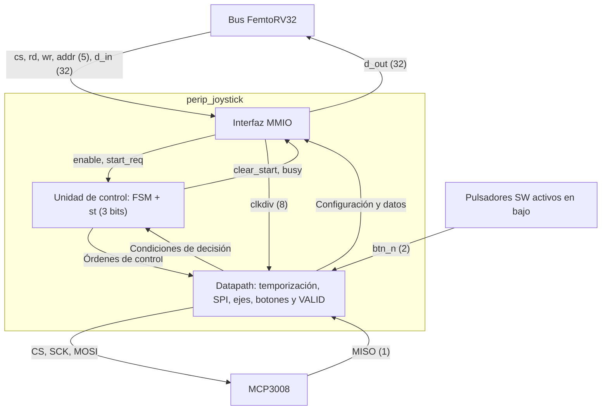
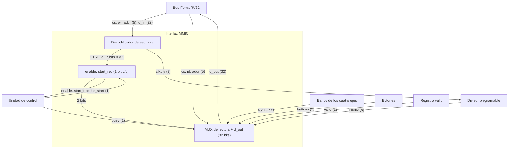
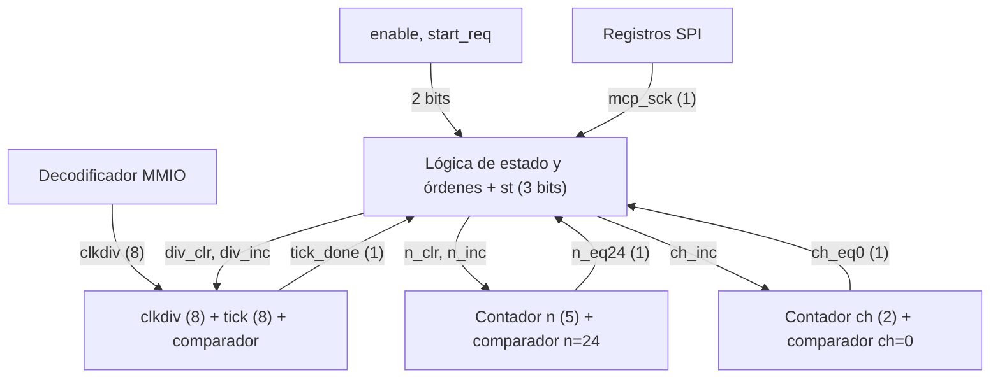
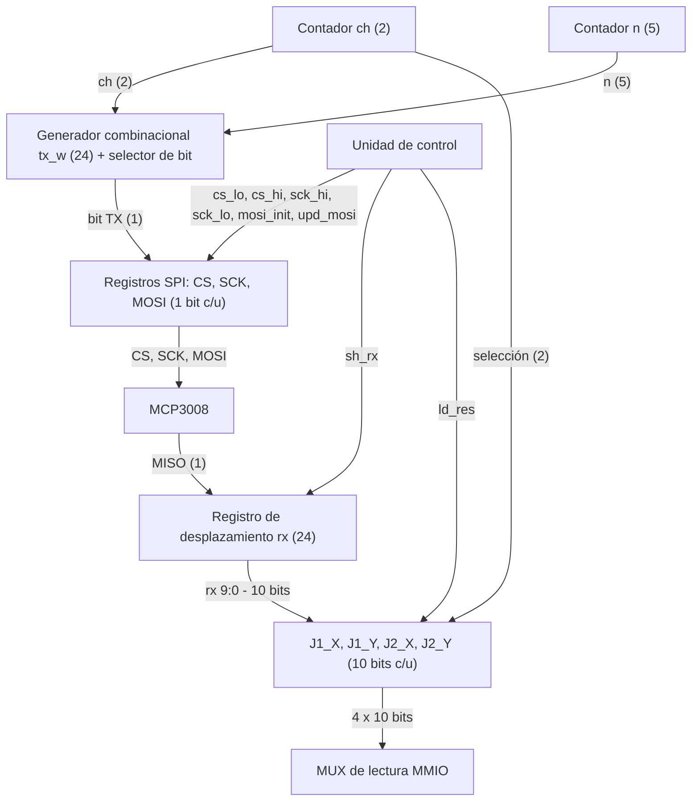
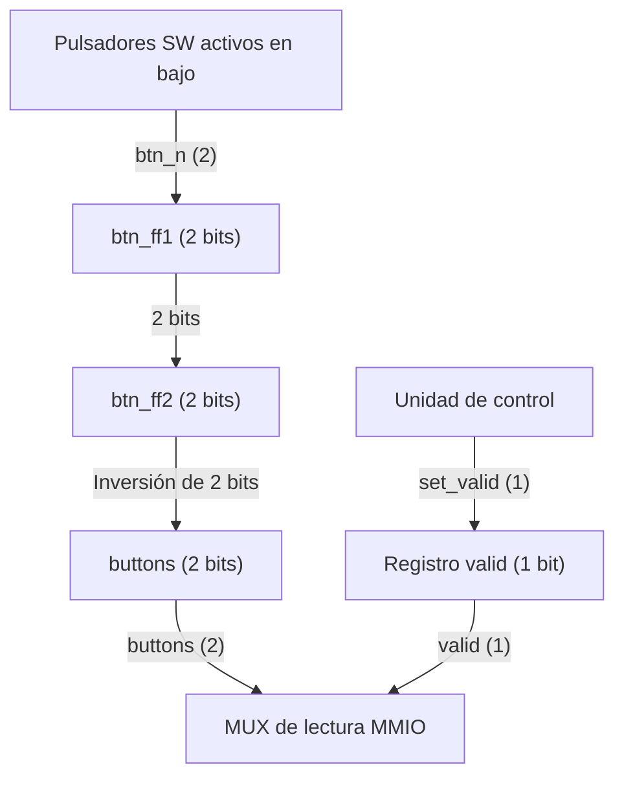
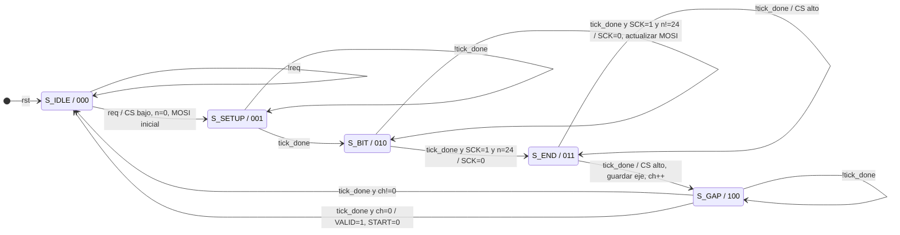

## A.7. Arquitectura de control y datapath

El periférico se divide funcionalmente en una unidad de control y una ruta de datos. La primera determina las operaciones que deben ejecutarse y el siguiente estado; la segunda almacena los datos, genera las señales SPI, cuenta los pulsos y suministra las condiciones de decisión. El adaptador MMIO permite configurar el periférico y consultar los resultados. Los tres bloques son síncronos con `clk` (27 MHz), con reset síncrono activo en alto. La separación es funcional: el RTL original agrupa varias operaciones en un mismo bloque `always`.

### A.7.1. Vista general

**Figura A.7a. Vista general.** El procesador configura el periférico a través de MMIO. El control organiza las operaciones y el datapath realiza la adquisición. Las figuras siguientes amplían estos mismos bloques; las etiquetas repetidas representan conexiones al mismo recurso, no hardware adicional. Todos los registros funcionan con `clk` (27 MHz) y reset síncrono activo en alto; por claridad no se repiten las líneas de reloj y reset en cada figura.

### A.7.2. Interfaz MMIO

**Figura A.7b. Interfaz con el procesador.** El decodificador permite escribir CTRL y CLKDIV. El MUX selecciona la información que corresponde a la dirección de lectura y la registra en `d_out` de 32 bits. `enable` solicita barridos continuos; escribir un 1 en el bit START activa `start_req` para solicitar un barrido, y `clear_start` lo limpia al finalizarlo. `busy` es combinacional y vale 1 cuando `st != S_IDLE`.

### A.7.3. Control, temporización y contadores

**Figura A.7c. Temporización y decisiones.** `tick` cuenta los ciclos del reloj y genera `tick_done` cuando `tick == clkdiv - 1`. Con `clkdiv=10`, la frecuencia SPI es 27 MHz / (2 × 10) = 1,35 MHz. `n` cuenta los 24 flancos de subida y `ch` selecciona los cuatro canales (00, 01, 10, 11). El control recibe las salidas de los comparadores y el nivel de SCK para decidir cuándo avanzar. Cada orden conceptual tiene un bit.

### A.7.4. Transmisión SPI, recepción y almacenamiento de ejes

**Figura A.7d. Ruta de adquisición analógica.** `ch` selecciona el canal y `n` selecciona el bit de la palabra combinacional `tx_w`. Los registros SPI transmiten el comando al MCP3008. En cada flanco de subida se captura MISO y se desplaza `rx`. Terminados los 24 pulsos, `ld_res` permite guardar `rx[9:0]` en el registro indicado por `ch`: CH0 = J1_X, CH1 = J1_Y, CH2 = J2_X, CH3 = J2_Y. El banco entrega los cuatro valores al MUX de lectura; no significa que se envíen los 40 bits simultáneamente al procesador.

### A.7.5. Pulsadores y bandera VALID

**Figura A.7e. Entradas digitales y estado de adquisición.** Los pulsadores se sincronizan con `clk` mediante dos etapas y su valor se invierte y registra en `buttons` (1 = presionado). No dependen de la FSM SPI; el sincronizador no elimina el rebote mecánico. `valid` se activa cuando finaliza el primer barrido de los cuatro canales y permanece activo hasta el reset. No indica una muestra nueva en cada barrido.

**Nota de implementación:** las órdenes de las figuras son nombres conceptuales de operaciones existentes en el RTL; no son nuevos puertos o señales físicas declaradas individualmente. La separación es funcional y `mcp_sck` es una salida registrada, no un reloj interno. No se modificó el código Verilog.

### Recursos de la ruta de datos

| Recurso | Ancho (bits) | Función |
|---|---:|---|
| `clkdiv`, `tick` | 8 cada uno | Divisor programable y contador de semiperiodo. |
| `n` | 5 | Cuenta los flancos de subida de 0 a 24. |
| `ch` | 2 | Selección del canal, módulo 4. |
| `tx_w` | 24 | Palabra combinacional de transmisión; no es un registro de desplazamiento TX. |
| `rx` | 24 | Registro de desplazamiento de recepción; solo `rx[9:0]` se conserva. |
| `mcp_cs_n`, `mcp_sck`, `mcp_mosi` | 1 cada uno | Salidas registradas del maestro SPI. |
| `j1x`, `j1y`, `j2x`, `j2y` | 10 cada uno | Último resultado por canal. |
| `btn_ff1`, `btn_ff2`, `buttons` | 2 cada uno | Sincronización e inversión de los pulsadores, con salida registrada. |
| `valid` | 1 | Indicador retenido de que terminó al menos un barrido. |
| `d_out` | 32 | Registro de salida MMIO. |

Los registros `enable` y `start_req` pertenecen a la interfaz de órdenes; `st[2:0]` es el registro de estado de la unidad de control. `busy` es una señal combinacional (`st != S_IDLE`).

### Órdenes de control hacia el datapath

Cada orden tiene ancho lógico de un bit. Las órdenes agrupadas en una fila son independientes.

| Orden | Transferencia u operación | Condición de activación (sin reset) |
|---|---|---|
| `div_clr` | `tick ← 0` | `S_IDLE` o `tick_done` |
| `div_inc` | `tick ← tick + 1` | Fuera de `S_IDLE` y sin `tick_done` |
| `cs_hi` | `mcp_cs_n ← 1` | `S_END` o `S_IDLE` sin solicitud |
| `cs_lo` | `mcp_cs_n ← 0` | `S_IDLE` con solicitud |
| `n_clr`, `mosi_init` | `n ← 0`; `mcp_mosi ← tx_w[23]` | `S_IDLE` con solicitud |
| `sck_hi`, `sh_rx`, `n_inc` | `mcp_sck ← 1`; `rx ← {rx[22:0], mcp_miso}`; `n ← n+1` | `S_BIT`, `tick_done=1`, `mcp_sck=0` |
| `sck_lo` | `mcp_sck ← 0` | `S_IDLE` o `S_BIT`, `tick_done=1`, `mcp_sck=1` |
| `upd_mosi` | `mcp_mosi ← tx_w[23-n]` | `S_BIT`, `tick_done=1`, `mcp_sck=1`, `n!=24` |
| `ld_res`, `ch_inc` | Eje seleccionado ← `rx[9:0]`; `ch ← ch+1` módulo 4 | `S_END`, `tick_done=1` |
| `set_valid`, `clear_start` | `valid ← 1`; `start_req ← 0` | `S_GAP`, `tick_done=1`, `ch=0` |

### Condiciones que recibe el control

| Condición | Ancho | Expresión o fuente |
|---|---:|---|
| `enable` | 1 | CTRL[0] |
| `start_req` | 1 | CTRL[1] |
| `tick_done` | 1 | `tick == clkdiv - 1` |
| `n_eq24` | 1 | `n == 24` |
| `ch_eq0` | 1 | `ch == 0` |
| `mcp_sck` | 1 | Nivel registrado del reloj SPI |

La solicitud de inicio es `enable || start_req || !ch_eq0`. La palabra de transmisión se construye como `{8'h01, 1'b1, 1'b0, ch, 12'b0}`. Con `clkdiv=10`, SCLK vale 27 MHz / (2 × 10) = 1,35 MHz. Los botones no dependen de la FSM SPI: se actualizan en cada ciclo de `clk`.

## A.8. Máquina de estados finitos (FSM)

La FSM tiene cinco estados codificados en tres bits. Reutiliza la misma secuencia para cada canal, en lugar de duplicar máquinas de estados para los dos joysticks. La siguiente figura muestra transiciones condicionadas por el estado actual, el contador de tiempo y las condiciones del datapath. Las transferencias se ejecutan en el flanco de subida de `clk`, no en un dominio de reloj SPI independiente.

**Figura A.8.** FSM única del controlador SPI. `req = enable || start_req || (ch != 0)`. El reset síncrono lleva a `S_IDLE` desde cualquier estado. Las codificaciones no usadas `101`, `110`, `111` también retornan a `S_IDLE` por la rama `default` del RTL.

### Tabla de transición y operaciones

| Estado actual | Condición | Estado siguiente | Operaciones principales |
|---|---|---|---|
| `S_IDLE` 000 | Sin solicitud | `S_IDLE` | CS=1, SCK=0 |
| `S_IDLE` 000 | Con solicitud | `S_SETUP` | CS=0, SCK=0, n=0, MOSI=tx_w[23] |
| `S_SETUP` 001 | `tick_done=0` | `S_SETUP` | Conservar señales SPI |
| `S_SETUP` 001 | `tick_done=1` | `S_BIT` | Habilitar la fase de transferencia |
| `S_BIT` 010 | `tick_done=0` | `S_BIT` | Conservar señales SPI |
| `S_BIT` 010 | `tick_done=1`, SCK=0 | `S_BIT` | SCK=1, desplazar rx, incrementar n |
| `S_BIT` 010 | `tick_done=1`, SCK=1, n!=24 | `S_BIT` | SCK=0, seleccionar MOSI siguiente |
| `S_BIT` 010 | `tick_done=1`, SCK=1, n=24 | `S_END` | SCK=0 |
| `S_END` 011 | `tick_done=0` | `S_END` | CS=1 |
| `S_END` 011 | `tick_done=1` | `S_GAP` | CS=1, almacenar rx[9:0] según ch, incrementar ch |
| `S_GAP` 100 | `tick_done=0` | `S_GAP` | Mantener la pausa |
| `S_GAP` 100 | `tick_done=1`, ch!=0 | `S_IDLE` | Conservar VALID y START |
| `S_GAP` 100 | `tick_done=1`, ch=0 | `S_IDLE` | VALID=1, START=0 |

### Interpretación y restricciones de la versión actual

- Cada conversión contiene 24 pulsos completos. Se permanece en `S_BIT` durante todos ellos; no se requieren 24 estados ni una FSM por canal. Al cerrar CH3, el contador de dos bits vuelve a cero.
- `BUSY` baja durante `S_IDLE`, incluso entre canales del mismo barrido; no representa un barrido completo en curso.
- `VALID` permanece alto después del primer barrido y solo se borra con reset. No es una bandera de nueva muestra. Los ejes se escriben individualmente, no como un conjunto atómico de cuatro valores.
- `START` se limpia al completar el barrido; una orden nueva coincidente con su limpieza puede perderse. Para un barrido único inequívoco, solicitarlo cuando `ENABLE=0` y `ch=0` en reposo.
- `CLKDIV` no tiene protección frente a escrituras durante una transferencia ni valores demasiado pequeños. Para documentar este diseño se conserva el valor por defecto 10; conviene restringir el software o corregir el RTL en una revisión futura.
- El banco de pruebas publicado reporta PASS. No se ha reproducido la simulación en esta revisión; se debe comprobar la cobertura de las transiciones con Icarus Verilog y GTKWave.

