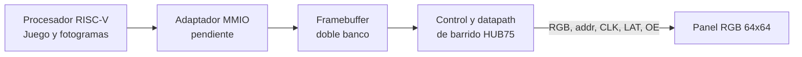
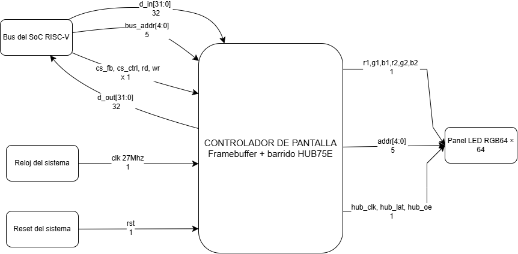
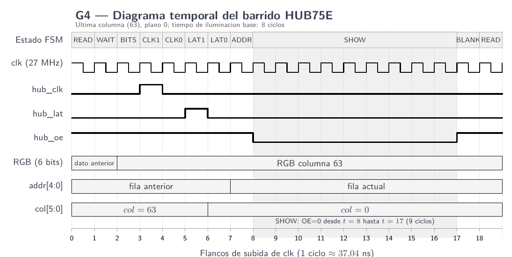

# G4 — Controlador de pantalla RGB 64×64 (HUB75E)

**Proyecto final de Electrónica Digital 1 — Consola con FPGA Tang Nano 9K y procesador RISC-V (FemtoRV32)**  
**Estado:** prototipo de barrido y carga de imágenes en `PRUEBA_2_video`; documentación e integración al SoC en desarrollo.

## Integrantes del equipo de pantalla

- Gisela Barrera Florez
- Sandra Amaya Betancourt
- Erika Briyith Hueso Castro
- Sebastian Cespedes
- Juan Jose Mora
- Luis Felipe Cardenas

La lista proviene de la documentación del equipo de pantalla (grupos 4 y 5). No asigna autoría ni responsabilidades individuales sobre el RTL o las pruebas.

## 1. Objetivo del módulo

Diseñar y documentar el **controlador de visualización** de una matriz LED RGB de **64 × 64 píxeles** con interfaz **HUB75E**. En la consola final, el procesador ejecutará el juego y escribirá sus **fotogramas** en una memoria de imagen (*framebuffer*). El controlador G4 leerá esos píxeles y generará continuamente las señales de barrido del panel.

Se distinguen dos etapas:
- **Prototipo `PRUEBA_2_video`:** un PC envía imágenes por UART; la FPGA las recibe, las almacena y las muestra. Esta ruta sirve para estudiar y probar el hardware.
- **Consola final:** los fotogramas vendrán del procesador FemtoRV32 mediante un adaptador **MMIO** pendiente de integración. No se necesita un PC ni una UART dedicada para mostrar el juego; la UART común del SoC puede destinarse a depuración.

> El prototipo permite analizar el controlador HUB75, pero todavía no demuestra la integración MMIO ni sustituye la verificación eléctrica del panel.

## 2. Hardware y señales

| Elemento | Característica |
|---|---|
| FPGA | Tang Nano 9K; `clk` de 27 MHz en el prototipo |
| Pantalla | RGB 64×64; conector identificado como HUB75E |
| Barrido en el RTL | 64 columnas, 32 parejas de filas y 8 planos de bits |
| Framebuffer de Prueba 2 | Dos bancos de píxeles RGB888 (24 bits por píxel) |
| Alimentación | Fuente adecuada para el panel, externa a los GPIO de la FPGA; masa común |

| Señal de salida | Ancho | Función |
|---|---:|---|
| `r1, g1, b1, r2, g2, b2` | 6 × 1 bit | Bits RGB de dos píxeles, uno de cada mitad |
| `addr[4:0]` | 5 bits | Selección de la pareja de filas |
| `hub_clk` | 1 bit | Desplazamiento de los datos RGB por columnas |
| `hub_lat` | 1 bit | Transferencia de los datos desplazados a la salida |
| `hub_oe` | 1 bit | Habilitación de iluminación, activa en bajo |

`hub_clk` es una **salida de sincronización del panel**, no el reloj principal `clk` de la FPGA. A diferencia de `baud_tick` de UART, el pulso se entrega físicamente al periférico.

**Pendiente físico:** la documentación del panel identifica un contacto `NC` en una posición donde HUB75E convencional usa `D`. No se debe asumir equivalencia sin comprobar el conexionado; ver [pinout fotografiado](docs/06-pinout-fotografiado.md).

## 3. Arquitectura del controlador

### Consola final (propuesta de integración)



Las regiones **`0x48_0000`** (imagen) y **`0x4C_0000`** (control) son propuestas del mapa de memoria; todavía no están implementadas como interfaz MMIO en la Prueba 2.

### Prototipo de Prueba 2 (implementado)

```text
PC / video2panel.py
       │ UART
       ▼
    uart_rx → img_loader → framebuffer (2 bancos)
                                   │
                         hub75_datapath ↔ hub75_control
                                   │ RGB + addr + CLK + LAT + OE
                                   ▼
                              Panel HUB75E
```

`hub75_top.v` reúne el framebuffer, la FSM, el datapath y el cambio de banco. `tang_nano_9k_top.v` conecta estos módulos con los pines de la placa y la UART del experimento.

## 4. Funcionamiento del barrido

1. Se leen dos píxeles para la misma columna: uno de la mitad superior y otro de la inferior.
2. El datapath elige un bit de cada canal RGB según el plano de color actual (seis bits simultáneos).
3. `hub_clk` desplaza esos datos; la operación se repite para las **64 columnas**.
4. `hub_lat` transfiere los datos cargados, `addr` selecciona las filas y `hub_oe = 0` permite iluminarlas.
5. Al finalizar el tiempo de iluminación, `hub_oe = 1` apaga la salida y se avanza a la siguiente fila o plano.

La FSM del código posee **10 estados**: `S_READ`, `S_WAIT`, `S_BITS`, `S_CLK1`, `S_CLK0`, `S_LAT1`, `S_LAT0`, `S_ADDR`, `S_SHOW` y `S_BLANK`. El datapath mantiene los contadores de columna, fila, plano y temporización.

El **refresco del panel** ocurre continuamente; la **actualización de fotogramas del juego** dependerá del procesador. Son procesos distintos.

## 5. Diagramas del controlador de pantalla G4

Los diagramas describen tanto la **interfaz propuesta para la consola RISC-V** como el **barrido implementado en `PRUEBA_2`**. Las conexiones MMIO y el cambio de banco son propuestas de integración; la FSM y las señales HUB75 se pueden contrastar con `hub75_control.v` y `hub75_datapath.v`.

### 5.1. Caja negra y características



**Figura 1. Entradas y salidas del controlador G4.** La caja negra corresponde al controlador de la FPGA, no al panel físico. El procesador generará los fotogramas del juego y escribirá sus píxeles mediante una interfaz MMIO todavía pendiente. El controlador convertirá los datos en señales HUB75E.

**Interfaz prevista con el SoC:**

| Señal | Dirección y ancho | Significado |
|---|---|---|
| `clk` | Entrada, 1 bit | Reloj principal de la lógica; el prototipo utiliza 27 MHz. |
| `rst` | Entrada, 1 bit | Reinicio de control y datapath; síncrono y activo en alto en estos módulos. |
| `d_in[31:0]` | Entrada, 32 bits | Dato que escribe el procesador en el periférico. |
| `bus_addr[4:0]` | Entrada, 5 bits | Dirección **local de registro MMIO**; no debe confundirse con la dirección de fila del panel. |
| `cs_fb`, `cs_ctrl` | Entradas, 1 bit c/u | Selecciones propuestas para framebuffer y registros de control. |
| `rd`, `wr` | Entradas, 1 bit c/u | Solicitudes de lectura y escritura del procesador. |
| `d_out[31:0]` | Salida, 32 bits | Dato que el periférico devolverá al procesador. |

**Salidas físicas al panel HUB75E:**

| Señal | Ancho | Qué hace |
|---|---:|---|
| `r1`, `g1`, `b1` | 3 × 1 bit | Un bit de cada color del píxel de la mitad superior. |
| `r2`, `g2`, `b2` | 3 × 1 bit | Un bit de cada color del píxel de la mitad inferior, en la misma columna. |
| `addr[4:0]` | 5 bits | Selecciona una de 32 parejas de filas. |
| `hub_clk` | 1 bit | Pulso **enviado al panel** que desplaza los datos RGB una posición de columna; no es el reloj `clk` de la FPGA ni un `baud_tick` interno. |
| `hub_lat` | 1 bit | Transfiere los 64 valores desplazados a los registros de salida del panel; **no selecciona la fila**. |
| `hub_oe` | 1 bit | Habilita la iluminación cuando está en `0` y la deshabilita cuando está en `1`. |

Se envían **seis bits RGB en paralelo** porque se cargan dos píxeles simultáneamente: uno superior y uno inferior. Sin embargo, cada píxel se almacena con **24 bits RGB888**: ocho de rojo, ocho de verde y ocho de azul. El controlador selecciona un bit por canal según el plano actual y utiliza distintos tiempos de iluminación para representar la intensidad.

### 5.2. Diagrama de bloques y señales

El diagrama divide el sistema en **framebuffer, datapath y FSM**. El framebuffer almacena colores; el datapath mantiene contadores y selecciona bits RGB; la FSM determina cuándo se realizan las operaciones. El adaptador MMIO permitirá que el procesador escriba fotogramas, pero todavía no está implementado en el RTL consultado.

```mermaid
flowchart LR
    SOC[SoC RISC-V]
    PANEL[Panel HUB75E 64x64]
    subgraph G4[Controlador G4]
        MMIO[Adaptador MMIO<br/>PENDIENTE]
        BANK[Gestor doble buffer<br/>PROPUESTO]
        FB[Framebuffer RGB888<br/>framebuffer.v]
        DP[Datapath<br/>hub75_datapath.v]
        FSM[FSM de 10 estados<br/>hub75_control.v]
    end
    SOC -->|"d_in y control MMIO"| MMIO
    MMIO -->|"d_out[31:0]"| SOC
    MMIO -.->|"we, waddr[11:0], wdata[23:0]"| FB
    MMIO -.->|"cuadro completo: por definir"| BANK
    BANK -.->|"wr_bank, disp_bank"| FB
    DP -->|"fb_addr_top, fb_addr_bot (12 bits c/u)"| FB
    FB -->|"pix_top, pix_bot (24 bits c/u)"| DP
    FSM -->|"load_rgb, inc/clr de contadores, load_addr"| DP
    DP -->|"col_last, row_last, plane_last, timer_done"| FSM
    DP -->|"RGB (6 bits), addr (5 bits)"| PANEL
    FSM -->|"hub_clk, hub_lat, hub_oe"| PANEL
    classDef pendiente stroke:#b7791f,stroke-width:2px,stroke-dasharray:4 4;
    class MMIO,BANK pendiente;
```



**Figura 2. Comunicación entre los bloques internos.** Las conexiones punteadas representan funcionalidades previstas para la integración, no módulos Verilog comprobados.

**Datos y direcciones:**

| Señal | Ancho | Función |
|---|---:|---|
| `we` | 1 bit | Habilitación de escritura propuesta desde MMIO. |
| `waddr[11:0]` | 12 bits | Dirección de escritura de uno de los 4096 píxeles. |
| `wdata[23:0]` | 24 bits | Valor RGB888 del píxel que se escribirá. |
| `fb_addr_top`, `fb_addr_bot` | 12 bits c/u | Direcciones de lectura de dos píxeles simultáneos: filas `row` y `row+32`, misma columna. |
| `pix_top`, `pix_bot` | 24 bits c/u | Dos píxeles que entrega la memoria al datapath. |
| `wr_bank`, `disp_bank` | 1 bit c/u | Banco de escritura y de visualización previstos para un futuro doble buffer. |

En el código consultado, `framebuffer.v` declara una memoria RGB888 inicializada mediante `image.hex` y la lee de forma **síncrona** en cada flanco positivo de `clk`. No tiene entradas `we`, `waddr`, `wdata` ni selector de banco. Estas señales del diagrama representan el **diseño por implementar**, no interfaces ya existentes.

**Órdenes de la FSM al datapath (todas de 1 bit):**

| Señal | Operación |
|---|---|
| `load_rgb` | Guarda los seis bits del plano de color seleccionado. |
| `inc_col` / `clr_col` | Incrementa o reinicia la columna (`col`). |
| `inc_row` / `clr_row` | Incrementa o reinicia la pareja de filas (`row`). |
| `inc_plane` / `clr_plane` | Incrementa o reinicia el plano RGB (`plane`). |
| `load_addr` | Registra `addr ← row` para seleccionar la fila del panel. |
| `inc_timer` / `clr_timer` | Incrementa o reinicia el contador de iluminación (`timer`). |

**Condiciones del datapath hacia la FSM (1 bit cada una):**

| Señal | Vale 1 cuando… | Consecuencia |
|---|---|---|
| `col_last` | `col = 63` | La FSM termina las columnas y genera el pulso `hub_lat`. |
| `row_last` | `row = 31` | Se debe cambiar de plano o reiniciar el recorrido. |
| `plane_last` | `plane = 7` | Se completó el último plano. |
| `timer_done` | `timer = T_BASE << plane` | La FSM finaliza la iluminación y desactiva la salida. |

La idea es que **la FSM decide** qué operación se necesita y **el datapath la ejecuta**, actualizando registros al siguiente flanco ascendente de `clk`.

### 5.3. Diagrama de tiempos del barrido HUB75E



**Figura 3. Última columna y período de visualización de una pareja de filas (plano 0).** Un flanco de `clk` equivale aproximadamente a 37,04 ns con el reloj de 27 MHz. La figura amplía la última columna (`col = 63`), en lugar de repetir las 64 columnas.

| Flanco | Estado después del flanco | Operación observada |
|---|---|---|
| 0–1 | `S_READ` → `S_WAIT` | Se solicita y recibe el último par de píxeles de memoria. |
| 2 | `S_BITS` | Se capturan los seis bits RGB del plano actual. |
| 3–4 | `S_CLK1` → `S_CLK0` | `hub_clk` pasa a 1 y luego a 0: el panel desplaza una columna. |
| 5 | `S_LAT1` | `hub_lat` sube y `hub_oe` mantiene los LED apagados. |
| 6 | `S_LAT0` | `hub_lat` baja; `col` se reinicia. |
| 7 | `S_ADDR` | Se registra la dirección de fila `addr = row`. |
| 8–16 | `S_SHOW` | `hub_oe = 0`; se ilumina mientras `timer` avanza de 0 hasta 8. |
| 17 | `S_BLANK` | `hub_oe = 1`, terminando la iluminación. |
| 18 | `S_READ` | Se continúa con la siguiente pareja de filas o plano. |

**Interpretación:** `hub_clk` genera un pulso por columna; la FSM emplea **cinco ciclos** del reloj principal por columna. Tras desplazar 64 columnas, `hub_lat` captura los datos. `addr` selecciona la pareja de filas y `hub_oe` determina durante cuánto tiempo estarán visibles. El temporizador no cambia el color almacenado, sino el intervalo de iluminación.

**Planos de color:** `plane` toma valores de 0 a 7 y selecciona cuál de los ocho bits de cada canal RGB se transmite. El plano 0 representa el bit menos significativo y el plano 7 el más significativo. El tiempo programado se calcula mediante `T_BASE × 2^plane` (en el prototipo `T_BASE = 8`). Como el contador empieza en 0 y `timer_done` se evalúa en el flanco, durante el plano 0 `hub_oe` permanece en 0 **nueve ciclos**. Así se representan distintos niveles de brillo utilizando líneas digitales de 0 o 1.

Al terminar el tiempo de visualización, la FSM apaga la salida y continúa con la siguiente fila o plano. El **refresco HUB75E** se repite continuamente aunque el videojuego todavía no haya generado un fotograma nuevo. El cambio de fotograma por MMIO es un proceso diferente que queda pendiente de integración.

### 5.4. Relación con el ASMD

La FSM implementada en `hub75_control.v` contiene **diez estados**. El ASMD describe las decisiones y transferencias entre registros que se ejecutan en esos estados. Las transferencias **T1–T14 no son catorce estados**, sino acciones y alternativas condicionadas de los diez estados.

- [ASMD y explicación de los estados](docs/diagramas/6.ASMD/06.asmd-rtl-hub75.md).
- [Tabla de transferencias T1–T14](docs/07-tabla-transferencias-hub75.md).
- [Código de Prueba 2](Prueba_de_funcionamiento/PRUEBA_2/).

La integración MMIO, la gestión de nuevos fotogramas y su verificación por simulación siguen siendo trabajos pendientes.

## 6. Código y pruebas de referencia

En `PRUEBA_2_video` se encuentran:

| Archivo | Función |
|---|---|
| `hub75_control.v` | FSM y señales de barrido |
| `hub75_datapath.v` | Contadores, direcciones y selección RGB |
| `framebuffer.v` | Memoria de imagen de dos bancos |
| `hub75_top.v` | Integración de control, datapath y memoria |
| `uart_rx.v`, `img_loader.v` | Carga experimental de imágenes por UART |
| `tang_nano_9k_top.v` | Módulo superior para la placa |
| `video2panel.py` | Envío de cuadros desde el PC para la prueba |
| `hub75_tb.v`, `video_tb.v` | Bancos de prueba |

El `Makefile` del prototipo incluye `make sim` y `make sim-video`. Los resultados de verificación deben adjuntarse como evidencia, no inferirse solamente por la existencia del código.

## 7. Trabajo pendiente

- Definir con G6 la interfaz MMIO y los registros mediante los que FemtoRV32 escribirá los píxeles.
- Verificar el cambio seguro de banco cuando llega un fotograma nuevo.
- Completar y contrastar flujo, ASMD, tabla T1–T14, FSM y simulaciones.
- Comprobar pinout, alimentación, niveles lógicos y funcionamiento físico del panel.
- Integrar y probar el controlador con un juego real, sin depender del script del PC.

## 8. Documentación complementaria

- [Índice de documentación](docs/README.md)
- [Identificación del panel](docs/01-identificacion-panel.md)
- [Interfaz HUB75E y Tang Nano 9K](docs/02-interfaz-hub75e-y-tang-nano9k.md)
- [Riesgos y pruebas](docs/03-riesgos-y-pruebas.md)
- [Plan y trazabilidad](docs/04-plan-y-trazabilidad.md)
- [Declaración de uso de IA](docs/05-declaracion-uso-ia.md)
- [Pinout fotografiado](docs/06-pinout-fotografiado.md)
- [Diagramas anteriores](docs/diagramas/README.md)
- [Fotografías y evidencias](docs/fotos/README.md)
- [Documentación de Tang Nano 9K](https://wiki.sipeed.com/hardware/en/tang/Tang-Nano-9K/Nano-9K.html)

Los diagramas antiguos deben actualizarse o identificarse como propuestas anteriores. Cada integrante debe poder explicar las transferencias, el código y las verificaciones que presente en la entrega.
