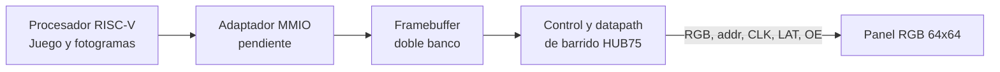
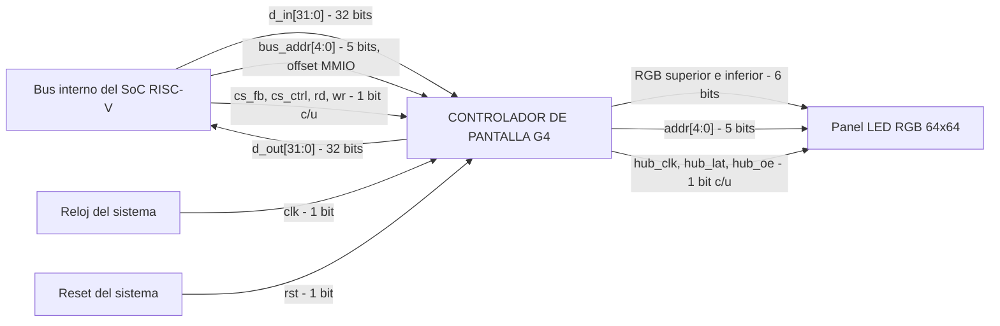
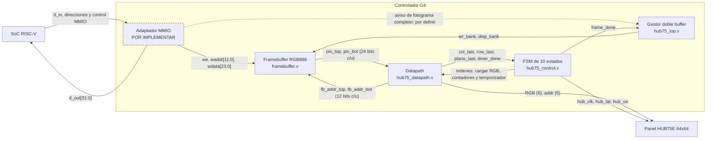

# G4 — Controlador de pantalla RGB 64×64 (HUB75E)

**Proyecto final de Electrónica Digital 1 — Consola con FPGA Tang Nano 9K y procesador RISC-V (FemtoRV32)**  
**Estado:** prototipo de barrido y carga de imágenes en `PRUEBA_2_video`; documentación e integración al SoC en desarrollo.

## Integrantes del equipo de pantalla

- Gisela Barrera Florez
- Sandra Amaya Betancourt
- Erika Briyith Hueso Castro
- Sebastian Cespedes
- Juan Jose Mora
- Luis Felipe Cardenas

La lista proviene de la documentación del equipo de pantalla (grupos 4 y 5). No asigna autoría ni responsabilidades individuales sobre el RTL o las pruebas.

## 1. Objetivo del módulo

Diseñar y documentar el **controlador de visualización** de una matriz LED RGB de **64 × 64 píxeles** con interfaz **HUB75E**. En la consola final, el procesador ejecutará el juego y escribirá sus **fotogramas** en una memoria de imagen (*framebuffer*). El controlador G4 leerá esos píxeles y generará continuamente las señales de barrido del panel.

Se distinguen dos etapas:
- **Prototipo `PRUEBA_2_video`:** un PC envía imágenes por UART; la FPGA las recibe, las almacena y las muestra. Esta ruta sirve para estudiar y probar el hardware.
- **Consola final:** los fotogramas vendrán del procesador FemtoRV32 mediante un adaptador **MMIO** pendiente de integración. No se necesita un PC ni una UART dedicada para mostrar el juego; la UART común del SoC puede destinarse a depuración.

> El prototipo permite analizar el controlador HUB75, pero todavía no demuestra la integración MMIO ni sustituye la verificación eléctrica del panel.

## 2. Hardware y señales

| Elemento | Característica |
|---|---|
| FPGA | Tang Nano 9K; `clk` de 27 MHz en el prototipo |
| Pantalla | RGB 64×64; conector identificado como HUB75E |
| Barrido en el RTL | 64 columnas, 32 parejas de filas y 8 planos de bits |
| Framebuffer de Prueba 2 | Dos bancos de píxeles RGB888 (24 bits por píxel) |
| Alimentación | Fuente adecuada para el panel, externa a los GPIO de la FPGA; masa común |

| Señal de salida | Ancho | Función |
|---|---:|---|
| `r1, g1, b1, r2, g2, b2` | 6 × 1 bit | Bits RGB de dos píxeles, uno de cada mitad |
| `addr[4:0]` | 5 bits | Selección de la pareja de filas |
| `hub_clk` | 1 bit | Desplazamiento de los datos RGB por columnas |
| `hub_lat` | 1 bit | Transferencia de los datos desplazados a la salida |
| `hub_oe` | 1 bit | Habilitación de iluminación, activa en bajo |

`hub_clk` es una **salida de sincronización del panel**, no el reloj principal `clk` de la FPGA. A diferencia de `baud_tick` de UART, el pulso se entrega físicamente al periférico.

**Pendiente físico:** la documentación del panel identifica un contacto `NC` en una posición donde HUB75E convencional usa `D`. No se debe asumir equivalencia sin comprobar el conexionado; ver [pinout fotografiado](docs/06-pinout-fotografiado.md).

## 3. Arquitectura del controlador

### Consola final (propuesta de integración)



Las regiones **`0x48_0000`** (imagen) y **`0x4C_0000`** (control) son propuestas del mapa de memoria; todavía no están implementadas como interfaz MMIO en la Prueba 2.

### Prototipo de Prueba 2 (implementado)

```text
PC / video2panel.py
       │ UART
       ▼
    uart_rx → img_loader → framebuffer (2 bancos)
                                   │
                         hub75_datapath ↔ hub75_control
                                   │ RGB + addr + CLK + LAT + OE
                                   ▼
                              Panel HUB75E
```

`hub75_top.v` reúne el framebuffer, la FSM, el datapath y el cambio de banco. `tang_nano_9k_top.v` conecta estos módulos con los pines de la placa y la UART del experimento.

## 4. Funcionamiento del barrido

1. Se leen dos píxeles para la misma columna: uno de la mitad superior y otro de la inferior.
2. El datapath elige un bit de cada canal RGB según el plano de color actual (seis bits simultáneos).
3. `hub_clk` desplaza esos datos; la operación se repite para las **64 columnas**.
4. `hub_lat` transfiere los datos cargados, `addr` selecciona las filas y `hub_oe = 0` permite iluminarlas.
5. Al finalizar el tiempo de iluminación, `hub_oe = 1` apaga la salida y se avanza a la siguiente fila o plano.

La FSM del código posee **10 estados**: `S_READ`, `S_WAIT`, `S_BITS`, `S_CLK1`, `S_CLK0`, `S_LAT1`, `S_LAT0`, `S_ADDR`, `S_SHOW` y `S_BLANK`. El datapath mantiene los contadores de columna, fila, plano y temporización.

El **refresco del panel** ocurre continuamente; la **actualización de fotogramas del juego** dependerá del procesador. Son procesos distintos.

## 5. Diagramas del controlador G4

Los diagramas siguen las primeras etapas de la metodología de la UART utilizada como referencia en el curso. Se separa la **arquitectura propuesta para la consola** de la **temporización obtenida del RTL de `PRUEBA_2_video`**.

### 5.1. Caja negra y características

La caja negra representa al **controlador G4**, no al panel. A la izquierda se muestra la interfaz que se propone conectar al SoC RISC-V; a la derecha, las señales que llegan al panel LED. El adaptador MMIO y el contrato exacto de direcciones siguen pendientes de integración con G6.



**Características:** panel de 64 × 64 píxeles, seis señales RGB (dos píxeles en paralelo), cinco bits de selección de fila y tres señales de control. El reloj de 27 MHz corresponde al prototipo y debe confirmarse como reloj del sistema integrado.

### 5.2. Diagrama de bloques y señales

El framebuffer guarda los colores; el **datapath** lee los píxeles y maneja contadores; la **FSM** decide cuándo cargar datos, desplazarlos y habilitar la iluminación. El adaptador MMIO se muestra como **pendiente** porque la Prueba 2 recibe los datos por UART y todavía no los recibe desde el procesador.



**Señales principales:** `waddr[11:0]` identifica uno de los 4096 píxeles; `wdata[23:0]` contiene su color RGB888. Las señales `col_last`, `row_last`, `plane_last` y `timer_done` informan a la FSM cuándo terminar una operación. La conexión MMIO a la memoria y el mecanismo de aviso de fotograma son una **propuesta**, no RTL existente.

### 5.3. Diagrama de tiempos del barrido HUB75E

La siguiente figura textual resume **la última columna (`col = 63`) y la iluminación de una pareja de filas en el plano 0**, según la secuencia de `hub75_control.v` de Prueba 2. Cada número es un flanco ascendente de `clk` (37,04 ns a 27 MHz); no representa un fotograma completo.

```text
Flanco de clk :   0     1     2     3     4     5     6     7     8   ...  16    17    18
Estado        : READ  WAIT  BITS  CLK1  CLK0  LAT1  LAT0  ADDR  SHOW ... SHOW BLANK  READ
hub_clk       :   0     0     0     1     0     0     0     0     0   ...   0     0     0
hub_lat       :   0     0     0     0     0     1     0     0     0   ...   0     0     0
hub_oe        :   1     1     1     1     1     1     1     1     0   ...   0     1     1
```

Primero se carga el último dato RGB y se genera un pulso de `hub_clk`. Luego `hub_lat` transfiere los datos de las 64 columnas, `addr` selecciona la pareja de filas y `hub_oe = 0` permite iluminarlas. En este ejemplo la iluminación dura **9 ciclos**; los planos siguientes utilizan tiempos mayores para representar distintas intensidades de color.

> Esta secuencia corresponde al **barrido del prototipo**, no al acceso MMIO. El diagrama de formas de onda elaborado en TikZ puede sustituir la tabla anterior cuando su imagen se incorpore al repositorio.

### 5.4. Siguientes etapas del método

| Etapa | Estado |
|---|---|
| Diagrama de flujo | Por consolidar y contrastar con el RTL |
| Clasificación control/datapath | Por formalizar |
| ASMD y transferencias T1–T14 | Por validar con el código |
| Arquitectura control/datapath | Identificada en el RTL |
| FSM de diez estados | Reconstruida desde el código |
| Testbench y simulación | Hay bancos de prueba; faltan resultados documentados |

En el **ASMD** se especifica qué registros cambian y bajo qué condiciones. **T1–T14 son transferencias u operaciones del control, no catorce estados**.

## 6. Código y pruebas de referencia

En `PRUEBA_2_video` se encuentran:

| Archivo | Función |
|---|---|
| `hub75_control.v` | FSM y señales de barrido |
| `hub75_datapath.v` | Contadores, direcciones y selección RGB |
| `framebuffer.v` | Memoria de imagen de dos bancos |
| `hub75_top.v` | Integración de control, datapath y memoria |
| `uart_rx.v`, `img_loader.v` | Carga experimental de imágenes por UART |
| `tang_nano_9k_top.v` | Módulo superior para la placa |
| `video2panel.py` | Envío de cuadros desde el PC para la prueba |
| `hub75_tb.v`, `video_tb.v` | Bancos de prueba |

El `Makefile` del prototipo incluye `make sim` y `make sim-video`. Los resultados de verificación deben adjuntarse como evidencia, no inferirse solamente por la existencia del código.

## 7. Trabajo pendiente

- Definir con G6 la interfaz MMIO y los registros mediante los que FemtoRV32 escribirá los píxeles.
- Verificar el cambio seguro de banco cuando llega un fotograma nuevo.
- Completar y contrastar flujo, ASMD, tabla T1–T14, FSM y simulaciones.
- Comprobar pinout, alimentación, niveles lógicos y funcionamiento físico del panel.
- Integrar y probar el controlador con un juego real, sin depender del script del PC.

## 8. Documentación complementaria

- [Índice de documentación](docs/README.md)
- [Identificación del panel](docs/01-identificacion-panel.md)
- [Interfaz HUB75E y Tang Nano 9K](docs/02-interfaz-hub75e-y-tang-nano9k.md)
- [Riesgos y pruebas](docs/03-riesgos-y-pruebas.md)
- [Plan y trazabilidad](docs/04-plan-y-trazabilidad.md)
- [Declaración de uso de IA](docs/05-declaracion-uso-ia.md)
- [Pinout fotografiado](docs/06-pinout-fotografiado.md)
- [Diagramas anteriores](docs/diagramas/README.md)
- [Fotografías y evidencias](docs/fotos/README.md)
- [Documentación de Tang Nano 9K](https://wiki.sipeed.com/hardware/en/tang/Tang-Nano-9K/Nano-9K.html)

Los diagramas antiguos deben actualizarse o identificarse como propuestas anteriores. Cada integrante debe poder explicar las transferencias, el código y las verificaciones que presente en la entrega.
