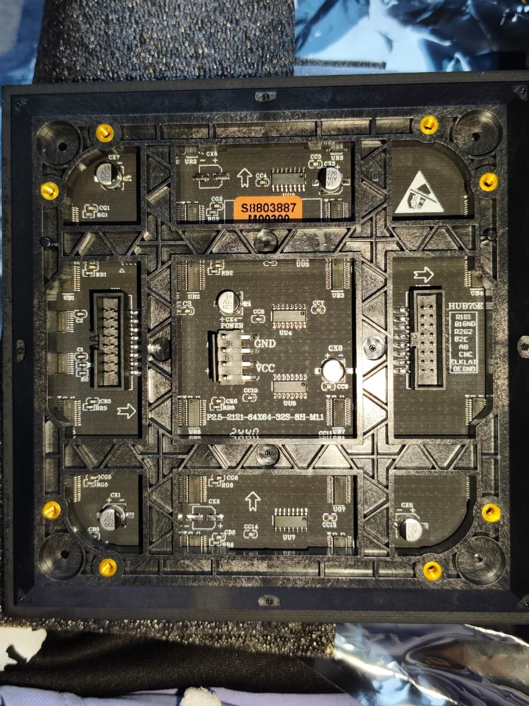
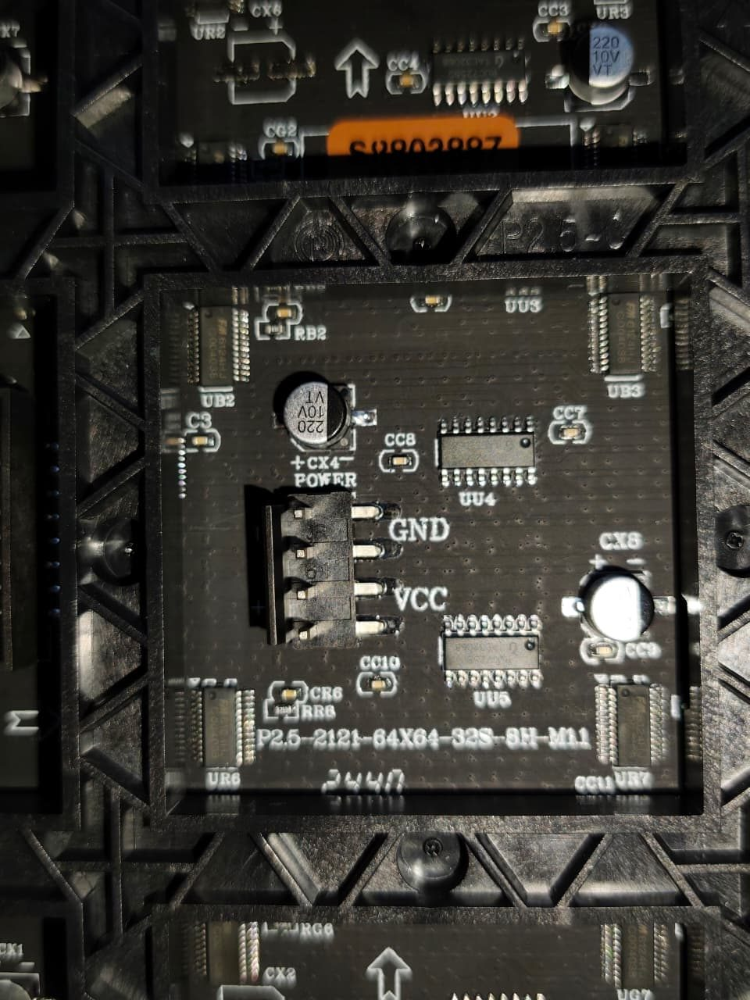
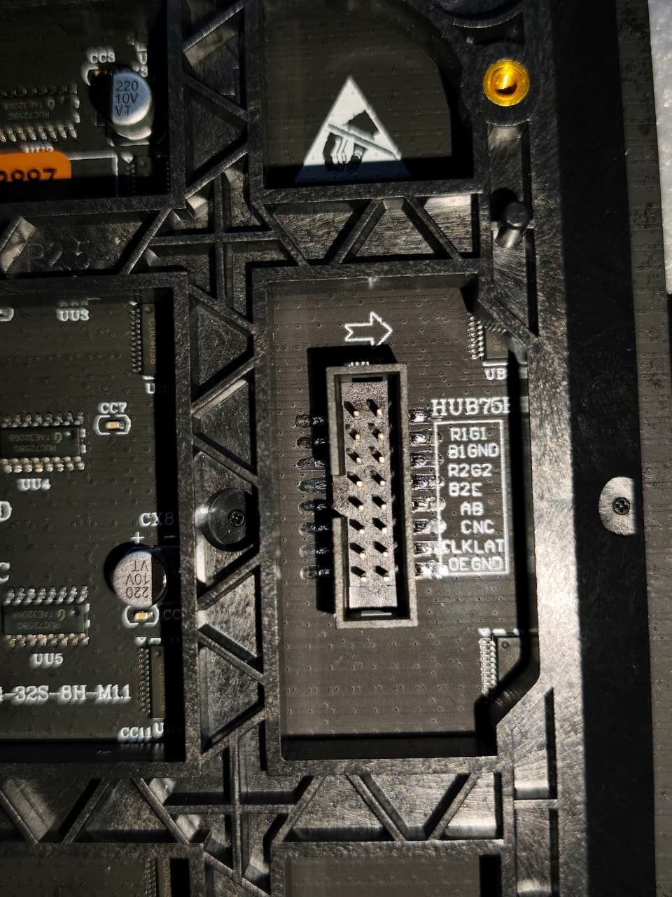

# 01 — Identificación del panel LED RGB 64×64

**Fecha:** 2026-11-07  
**Método:** inspección visual de fotografías aportadas por el equipo + contraste con documentación pública. No se tuvo acceso físico al módulo ni al proveedor.

## 1. Evidencias directas de las fotografías

| Elemento | Observación | Confianza |
|---|---|---|
| Marcaje principal | `P2.5-2121-64X64-32S-8H-M11` (el sufijo final puede ser una variante `M1.1`; confirmar) | Alta salvo sufijo |
| Resolución | `64X64` explícito | Alta |
| Paso / encapsulado | `P2.5` sugiere paso 2,5 mm; `2121` sugiere SMD2121 | Alta / probable |
| Escaneo | `32S` sugiere barrido 1/32 | **Hipótesis**, no demostrada |
| Puerto de datos | `HUB75E` impreso junto al conector 2×8 | Alta |
| Puerto de potencia | `POWER`, `GND` y `VCC` en conector separado | Alta |
| Identificador naranja | `S8803887 / M00300` | Etiqueta de trazabilidad aparente; no identifica inequívocamente fabricante |
| C.I. del controlador | Se observan varios chips de control y registros | Referencias/función exactas desconocidas |







### Transcripción aclarada del conector (dato suministrado por el equipo)

En la fotografía los rótulos aparecen muy juntos. El integrante del equipo confirmó que el conector tiene estas **ocho filas de dos contactos**:

```text
R1  G1
B1  GND
R2  G2
B2  E
A   B
C   NC
CLK LAT
OE  GND
```

**`C` y `NC` son dos designaciones distintas**, no una señal denominada `C / NC`. La expresión `C / NC` que puede parecer visible en la fotografía resulta de la proximidad de sus rótulos; la transcripción que seguiremos es `C / NC`.

**Alcance de la verificación:** la inscripción del segundo contacto de esa fila es `NC` según el equipo; esto **no equivale** a haber comprobado con multímetro que la patilla 12 esté desconectada. En la interfaz HUB75E convencional allí estaría `D` (selección de fila). Es una **incompatibilidad de serigrafía** que debe resolverse antes del cableado.

Consultar [06 — Tabla completa de pinout](06-pinout-fotografiado.md) y [07 — Evaluación del esbozo anterior](07-revision-borrador-previo.md).

## 2. Características deducidas (no medidas)

- Resolución: 64 × 64 = **4096 píxeles**.
- Tamaño nominal del área activa: 64 × 2,5 mm = **160 mm por lado**. Dimensión exterior total, profundidad y masa **no medidas**.
- Tres componentes cromáticas por píxel: R/G/B (estructura funcional esperada, por etiqueta del puerto).
- Escaneo **probable** 1/32 por la designación `32S`, sujeto a comprobar el controlador de filas y la función del contacto `NC`.
- La alimentación del panel es presumiblemente **5 V nominales** según la familia de paneles comparables; verificar en el proveedor o fuente original antes de energizar.

## 3. Referencia técnica comparable, NO ficha de este modelo

**Waveshare RGB-Matrix-P2.5-64x64:** resolución 64×64, pitch 2,5 mm, 160×160 mm, RGB, control síncrono, barrido 1/32, alimentación 5 V/4 A recomendada, hasta 20 W para **su** producto. Son especificaciones **del producto Waveshare**, no cifras medidas ni confirmadas para nuestra PCB.

- Fabricante: https://www.waveshare.com/RGB-Matrix-P2.5-64x64.htm
- Guía y tablas: https://docs.waveshare.com/RGB-Matrix-Px-64x64

No se localizó una ficha pública inequívoca para el marcaje exacto de la PCB. **No adjuntar una hoja de datos de Waveshare diciendo que corresponde a este modelo.** Es preferible enlazarla como referencia comparable e incluir las fotografías reales.

## 4. Cómo cerrar la identificación

- [ ] Registrar proveedor, enlace de compra, marca, lote y código completo del reverso.
- [ ] Fotografiar, nítidos y a nivel, los componentes marcados `UB1 ...`, `UU...` y el chip de selección de filas; transcribir sus referencias exactas.
- [ ] Localizar físicamente los dos contactos de la fila marcada `C / NC`; comprobar con multímetro, **sin alimentación**, si `NC` presenta continuidad con otras pistas, masa o CI. No interpretar una lectura aislada como prueba definitiva.
- [ ] Solicitar datasheet o diagrama eléctrico del **modelo real** al vendedor/fabricante.
- [ ] Obtener confirmación de alimentación y corriente nominales antes del primer encendido.
- [ ] Verificar cuál conector es IN y cuál OUT, mediante serigrafía/flechas y, si procede, continuidad sin alimentar.
- [ ] Registrar diámetro, dimensiones exteriores y distancia entre soportes si se diseñará un marco.

## 5. Trazabilidad

Observaciones: cinco fotografías entregadas el 2026-11-07.  
Hipótesis: equivalencia parcial con familia P2.5 64x64 HUB75E.  
Validaciones físicas: **ninguna ejecutada en esta fase**.
