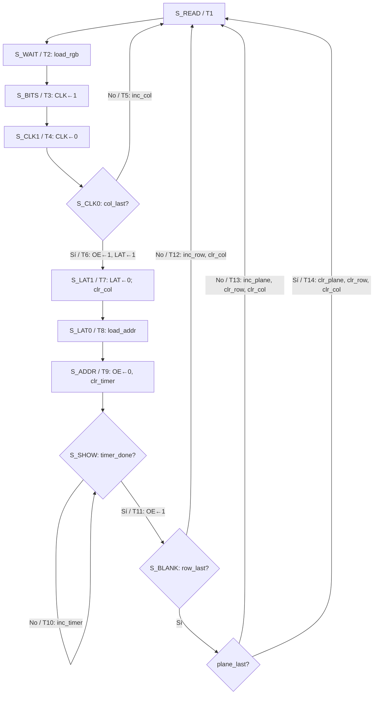

# Tabla de transferencias y señales de control — HUB75 de PRUEBA_2

**Alcance:** análisis estático del RTL existente, sin resultados de simulación ni mediciones. Complementa [ASMD del prototipo](../diagramas/asmd-rtl-hub75.md). Base: `hub75_control.v` y `hub75_datapath.v` de `grupo4-pantalla/Prueba_de_funcionamiento/PRUEBA_2/` (consulta: 24-11-2026).

## 1. Convenciones de lectura

- Cada fila **T1–T14** corresponde al comentario `Tn` del `case` original; T5/T6, T10/T11 y T12/T13/T14 son alternativas condicionales, **no catorce estados distintos**.
- Los 10 estados están codificados de 0 a 9 en cuatro bits.
- Una orden (`inc_col`, etc.) tiene efecto sobre el registro al **siguiente flanco positivo**. Las comparaciones evalúan el valor **antes** de ese flanco.
- `hub_clk_next`, `hub_lat_next` y `hub_oe_next` se transfieren a salidas registradas al siguiente flanco; `—` significa **conservar el valor anterior**, no forzar cero.
- Todas las órdenes del datapath son cero si no figuran en la fila (valores por defecto de `always @(*)`).

## 2. Tabla exhaustiva T1–T14

| T | Estado actual | Condición | Órdenes del datapath (`=1`) | Cambio de salida registrado en el flanco | Estado siguiente |
|---|---|---|---|---|---|
| T1 | `S_READ` (0) | Siempre | Ninguna | — | `S_WAIT` |
| T2 | `S_WAIT` (1) | Siempre | `load_rgb` | — | `S_BITS` |
| T3 | `S_BITS` (2) | Siempre | Ninguna | `hub_clk←1` | `S_CLK1` |
| T4 | `S_CLK1` (3) | Siempre | Ninguna | `hub_clk←0` | `S_CLK0` |
| T5 | `S_CLK0` (4) | `!col_last` | `inc_col` | — | `S_READ` |
| T6 | `S_CLK0` (4) | `col_last` | Ninguna | `hub_oe←1`, `hub_lat←1` | `S_LAT1` |
| T7 | `S_LAT1` (5) | Siempre | `clr_col` | `hub_lat←0` | `S_LAT0` |
| T8 | `S_LAT0` (6) | Siempre | `load_addr` | — | `S_ADDR` |
| T9 | `S_ADDR` (7) | Siempre | `clr_timer` | `hub_oe←0` | `S_SHOW` |
| T10 | `S_SHOW` (8) | `!timer_done` | `inc_timer` | — | `S_SHOW` |
| T11 | `S_SHOW` (8) | `timer_done` | Ninguna | `hub_oe←1` | `S_BLANK` |
| T12 | `S_BLANK` (9) | `!row_last` | `inc_row`, `clr_col` | — | `S_READ` |
| T13 | `S_BLANK` (9) | `row_last && !plane_last` | `inc_plane`, `clr_row`, `clr_col` | — | `S_READ` |
| T14 | `S_BLANK` (9) | `row_last && plane_last` | `clr_plane`, `clr_row`, `clr_col` | — | `S_READ` |

**Reset sincrónico** (fuera de T1–T14): controlador `state←S_READ`, `hub_clk←0`, `hub_lat←0`, `hub_oe←1`; datapath `col,row,plane,timer,addr,RGB←0`.

## 3. Diccionario de registros y señales

| Elemento | Ancho por defecto | Función y operación |
|---|---:|---|
| `col` | 6 bits | Columna 0..63; `inc_col` incrementa, `clr_col` pone cero |
| `row` | 5 bits | Grupo de filas 0..31; `inc_row` incrementa, `clr_row` pone cero |
| `plane` | 3 bits | Plano de bits 0..7; `inc_plane` incrementa, `clr_plane` pone cero |
| `timer` | 16 bits | Acumula ciclos visibles; `inc_timer` incrementa, `clr_timer` pone cero |
| `addr` | 5 bits | `load_addr`: copia `row` |
| `r1,g1,b1,r2,g2,b2` | 1 bit c/u | `load_rgb`: selecciona componentes del plano activo de dos píxeles |
| `hub_clk` | 1 bit | Pulso de desplazamiento para datos RGB |
| `hub_lat` | 1 bit | Pulso de captura de datos del panel |
| `hub_oe` | 1 bit | Activo en bajo: 1 apagado, 0 visible |
| `pix_top/pix_bot` | 24 bits c/u | Salidas de lectura síncrona de framebuffer RGB888 |

**Prioridades:** en `col`, `row`, `plane` y `timer`, una orden `clr_*` tiene prioridad sobre `inc_*` si ambas se activaran a la vez. En las 14 transferencias listadas no se activan ambas para un mismo contador.

## 4. Condiciones y diagrama de transferencias

## 5. Ejemplo pequeño para entender el ciclo

En una configuración de ejemplo `COLS=4`, `HALF_ROWS=2`, `PLANES=2`, las columnas se recorren como `0→1→2→3`. En cada una se ejecutan `S_READ → S_WAIT → S_BITS → S_CLK1 → S_CLK0`. Para `col=0,1,2`, `col_last=0` y se aplica **T5**. Para `col=3`, `col_last=1` y se aplica **T6**, empezando el pulso LAT. Tras la fase visible, si `row=0`, aplica **T12** (`row=1`); si `row=1` y `plane=0`, aplica **T13** (`plane=1,row=0`); si `row=1` y `plane=1`, aplica **T14** (`plane=0,row=0`).

En el RTL, `t_limit = T_BASE << plane`. La prueba existente comprueba una duración visible de `t_limit+1` ciclos por la convención de evaluación y registro; no cambiar esto sin adaptar el testbench y justificar el conteo.

## 6. Aspectos pendientes de verificar

1. Simular la tabla contra `hub75_tb.v`; registrar un PASS/FAIL real y VCD, sin inventar resultados.
2. Verificar que el pin 12 `NC` y la secuencia de dirección/LAT sean compatibles con el panel físico antes de conectarlo.
3. Establecer cómo se escribe la imagen desde CPU: el `framebuffer.v` actual solamente se inicializa desde `image.hex`, no implementa MMIO.
4. Resolver discrepancias entre RGB111 conceptual y RGB888 del prototipo.

**Nota de atribución:** esta tabla analiza archivos del proyecto y no reivindica autoría del Verilog previo. Elaboración asistida por IA; revisar el contenido técnico antes de incorporarlo al repositorio.
