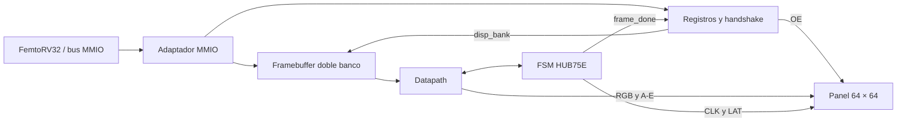

# Controlador de pantalla RGB 64 × 64 — Grupo 4

**Electrónica Digital 1 · Universidad Nacional de Colombia**  
**Proyecto:** consola de videojuegos retro en FPGA · Tang Nano 9K · FemtoRV32

## Integrantes

- Gisela Barrera Florez
- Sandra Amaya Betancourt
- Erika Briyith Hueso Castro
- Sebastian Cespedes
- Juan Jose Mora
- Luis Felipe Cardenas

## 1. Objetivo

Implementar un periférico de visualización para un panel HUB75E de 64 × 64 píxeles, capaz de recibir imágenes del procesador mediante MMIO y generar autónomamente las señales de barrido.

## 2. Arquitectura

El periférico integra un adaptador MMIO, un decodificador de registros, una memoria de imagen de doble banco, una unidad de control y un datapath. La FSM de diez estados coordina la lectura de píxeles, la transmisión de seis bits RGB por columna, la captura con LAT, el direccionamiento de filas y la habilitación mediante OE. El barrido se realiza de forma continua e independiente del software.



| Característica | Prototipo de imágenes y video | Interfaz MMIO |
|---|---|---|
| Resolución | 64 × 64 | 64 × 64 |
| Formato | RGB888 (24 bits/píxel) | RGB111 (3 bits/píxel) |
| Entrada de imagen | Imagen inicial / UART, según prueba | Escrituras de palabra del procesador |
| Planos de color | 8 | 1 |
| Memoria de imagen | Según prototipo | Dos bancos de 4096 píxeles |

RGB111 permite ocho colores y reduce la memoria lógica de los dos bancos a 24 576 bits. La ocupación física debe determinarse mediante síntesis.

## 3. Comunicación con el procesador

| Dirección | Registro o región | Acceso |
|---|---|---|
| `0x00480000`–`0x00483FFC` | 4096 píxeles RGB111, bits [2:0] | W |
| `0x004C0000` | CONTROL: DISPLAY_EN [0], START [1] | R/W |
| `0x004C0004` | STATUS: DISPLAY_EN [0], BUSY [1], DONE [2], FRONT_VALID [3] | R |
| `0x004C0008` | FRAMES: contador de barridos completos | R |

El software espera BUSY=0, escribe el cuadro completo y solicita START. El controlador intercambia los bancos en el límite del barrido, desactiva BUSY y activa DONE. Los píxeles no se copian entre bancos. FRONT_VALID habilita la visualización después del primer intercambio; FRAMES cuenta los barridos físicos, no los cuadros producidos por el juego.

## 4. Interfaz física

| Señal | Función |
|---|---|
| R1, G1, B1 / R2, G2, B2 | Bits de color de las mitades superior e inferior |
| A–E (`hub_addr[4:0]`) | Selección de pareja de filas |
| `hub_clk` | Desplazamiento de los datos |
| `hub_lat` | Captura de los datos desplazados |
| `hub_oe` | Habilitación de las salidas, activa en bajo |

Se utiliza un reloj de sistema nominal de 27 MHz. La alimentación del panel es externa a los GPIO y requiere masa común. La serigrafía NC/D y los niveles eléctricos se describen en la documentación de hardware.

## 5. Validación

El banco de pruebas integral de la interfaz MMIO se ejecuta con Icarus Verilog:

```bash
cd integracion_mmio
make sim
```

```text
PASS: MMIO CONTROL/STATUS/FRAMES, START/BUSY/DONE, doble buffer y barrido RGB111; filas=96 LAT=160 frames=4
```

Resultado obtenido el 25 de noviembre de 2026. Verifica el periférico con un maestro de prueba, no con el procesador real. La síntesis y prueba física de esta configuración integrada se mantienen como verificaciones del sistema.

## 6. Documentación y archivos

- [Interfaz MMIO, mapa de registros e instrucciones de integración](integracion_mmio/README.md).
- [Explicación de los módulos Verilog](integracion_mmio/explicacion/README.md).
- [Documentación técnica](docs/README.md).
- [Diagramas del controlador](docs/diagramas/README.md).