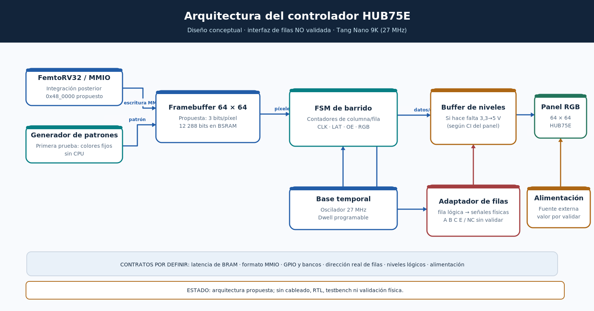

# Diagrama 01 — Arquitectura del periférico de pantalla

## Objetivo

Mostrar cómo conectar conceptualmente una fuente de píxeles, un controlador de barrido HUB75E y una matriz LED RGB 64×64. **Es una propuesta H2, no un diseño implementado.**

## Explicación de cada bloque

| Bloque | Función | Entradas y salidas previstas |
|---|---|---|
| Generador de patrones | Entrega colores fijos o alternantes para verificar el panel sin CPU. | Coordenadas o peticiones de píxel → RGB111. |
| FemtoRV32/MMIO | Escribe píxeles y configura registros; se integrará después de la prueba autónoma. | Bus del SoC → comandos y escritura de memoria. |
| Framebuffer | Mantiene los valores de los 4096 píxeles. Se propone BSRAM interna. | Dirección y dato de escritura; dirección de lectura → píxel. |
| FSM de barrido | Solicita píxeles, envía 64 columnas por grupo, produce `CLK`, `LAT`, `OE` y avanza fila. | `clk_27m`, reset, dato válido, `RGB` → señales temporizadas y pedidos de lectura. |
| Base temporal | Deriva contadores y tiempos a partir de 27 MHz sin asumir un PLL obligatorio. | Reloj de placa → habilitadores y contador dwell. |
| Adaptador de filas | Convierte una **fila lógica** en las señales y secuencia específicas del panel. | `fila_logica`, petición → GPIO reales y `row_ready` (por definir). |
| Adaptador de niveles | Adecua las salidas de 3,3 V a la entrada del panel solo si su documentación eléctrica lo requiere. | GPIO FPGA → entradas panel. |
| Fuente externa | Alimenta la matriz independientemente de la FPGA. | Tensión/corriente **pendientes de confirmar** → `VCC`,`GND`. |
| Panel | Desplaza y captura datos RGB según señales de control. | RGB1/RGB2, CLK, LAT, OE y selección física de filas. |

## Separación de responsabilidades

El controlador autónomo de barrido mantiene el refresco periódico de la pantalla incluso si FemtoRV32 está ejecutando otras instrucciones. La CPU solamente modifica la imagen en memoria: **no debe generar cada pulso HUB75E mediante sondeo de software**. Esta separación reduce latencias e interrupciones visuales.

Para una primera demostración, se puede prescindir de CPU/MMIO y usar una ROM/generador de patrones. Después se intercala el framebuffer y se establece el contrato de bus de integración.

## Riesgos todavía abiertos

- **Pin NC:** la placa marca `C / NC`, no `C / D`; está prohibido asumir que NC corresponde a D en la conexión real. El bloque adaptador de filas es provisional.
- **Compatibilidad eléctrica:** los pines de la FPGA no alimentan los LED; deben verificarse las entradas del panel y la necesidad de buffers.
- **Memoria:** la capacidad teórica no garantiza la posibilidad de leer los dos píxeles por columna y escribir desde la CPU en el mismo ciclo; definir puertos o arbitraje.
- **GPIO:** el número de señales y los bancos disponibles se revisarán en el esquemático/cst de la placa.

**Criterio de revisión del diagrama:** cada flecha debe corresponder a una señal o interfaz cuya anchura, reloj, latencia y propietario se especifique antes del RTL final.
