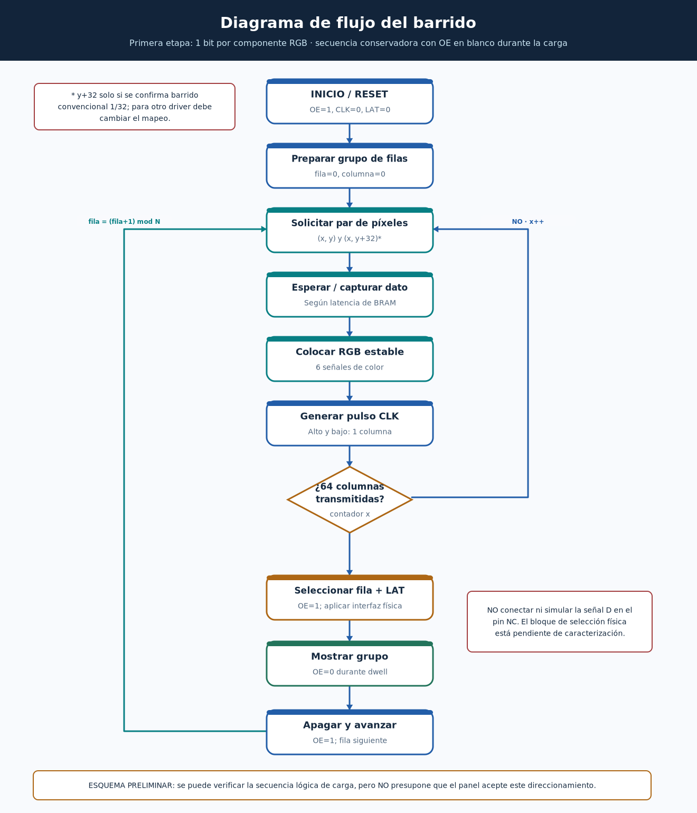

# Diagrama 02 — Flujo operativo del barrido

## Qué representa

El procedimiento de actualización de **un grupo lógico de filas** en una matriz RGB multiplexada. El ejemplo de lectura en paralelo `(x,fila)` y `(x,fila+32)` solo corresponde al **modelo convencional 1/32**, todavía no confirmado en la pantalla fotografiada.

## Descripción de los pasos

1. **INICIO/RESET:** colocar `OE=1` (salida deshabilitada), `CLK=0`, `LAT=0`; limpiar contadores.
2. **PREPARAR:** seleccionar una fila lógica y comenzar por la columna 0; mantener panel apagado durante la carga.
3. **SOLICITAR DATOS:** pedir al framebuffer los colores de los canales RGB superiores e inferiores. Si la memoria tiene latencia, no usar un dato antiguo.
4. **CAPTURAR/COLOCAR RGB:** esperar dato válido y estabilizar los seis bits antes del flanco ascendente de CLK.
5. **PULSAR CLK:** aplicar el pulso de desplazamiento; repetir hasta completar **exactamente 64 flancos ascendentes** por grupo.
6. **BLANQUEAR Y SELECCIONAR FILA:** mantener `OE=1`, solicitar al adaptador de filas la dirección del grupo y esperar `row_ready`; el método físico aún no está definido.
7. **LAT:** producir el pulso de captura de datos una vez que la dirección esté estable, si el panel identificado admite esta secuencia.
8. **MOSTRAR:** llevar `OE` a 0 durante `dwell_count` ciclos, con `CLK=0` y `LAT=0`.
9. **AVANZAR:** volver `OE=1`, incrementar la fila lógica y repetir; el número de filas N se parametriza y se validará con la placa.

## Condiciones de decisión y bucles

- Después de cada columna: si quedan columnas, incrementar `x` y volver a pedir datos.
- Cuando se completan las 64 columnas: pasar al cambio de grupo de filas.
- Cuando termina `dwell_count`: finalizar la visualización actual y avanzar a `fila=(fila+1)%N`.
- Si `row_ready=0`: **no** activar `LAT` ni `OE=0`; mantener apagada la pantalla mientras se resuelve la selección de fila.

## Qué verificaremos en simulación

- 64 flancos de CLK por actualización de un grupo.
- RGB estable antes de cada flanco de subida.
- Un pulso LAT después de los 64 pulsos y tras `row_ready`.
- `OE=1` durante todo el cambio de dirección y durante el latch.
- Recorrido de `N` grupos y retorno al cero; sin columnas omitidas ni pulsos extra.

**Límite:** el diagrama explica el algoritmo de una implementación propuesta. No puede darse por compatible con este módulo físico hasta caracterizar la selección de filas y los drivers.
