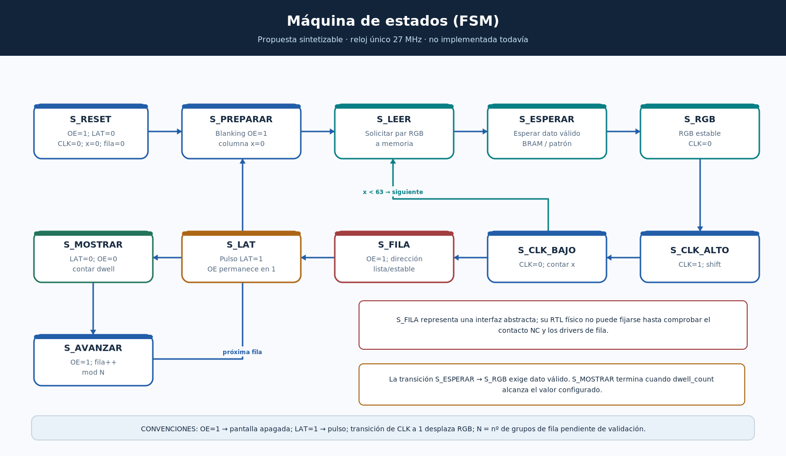

# Diagrama 03 — Máquina de estados de control (FSM)



## Para qué existe

Una FSM síncrona ordena las señales digitales para evitar que `LAT`, `CLK`, `OE` y la selección de fila cambien en momentos peligrosos. Se propone un único dominio de reloj `clk_27m` y contadores de habilitación. **No se ha codificado el RTL ni generado una forma de onda.**

## Estados propuestos

| Estado | Acciones / salidas | Condición de transición |
|---|---|---|
| `S_RESET` | `OE=1`, `LAT=0`, `CLK=0`; inicializar columna y fila | Fin del reset → `S_PREPARAR` |
| `S_PREPARAR` | `OE=1`, columna=0, contador temporal limpio | → `S_LEER` |
| `S_LEER` | Solicitar a memoria píxel superior/inferior de columna actual | Petición registrada → `S_ESPERAR` |
| `S_ESPERAR` | Mantener `CLK=0`, `OE=1`; esperar respuesta | `pixel_valid=1` → `S_RGB`; si no, permanecer |
| `S_RGB` | Registrar 6 datos de color y mantenerlos estables | → `S_CLK_ALTO` |
| `S_CLK_ALTO` | `CLK=1`, desplazamiento de una columna | → `S_CLK_BAJO` |
| `S_CLK_BAJO` | `CLK=0`; actualizar contador de columnas | Si quedan datos → `S_LEER`; con 64 pulsos completados → `S_FILA` |
| `S_FILA` | `OE=1`; entregar fila lógica al adaptador físico | `row_ready=1` → `S_LAT`; si no, permanecer |
| `S_LAT` | Pulso `LAT=1` con `OE=1`; terminación ordenada antes de mostrar | → `S_MOSTRAR` |
| `S_MOSTRAR` | `LAT=0`, `OE=0`, cuenta tiempo visible | Fin de `dwell` → `S_AVANZAR` |
| `S_AVANZAR` | `OE=1`; fila lógica = `(fila+1)%N` | → `S_PREPARAR` |

**Aclaración de conteo:** es necesario decidir si `col` representa la columna *actual* (0..63) o el número de pulsos *ya enviados* (0..64). El RTL y el testbench deberán usar **una sola convención** para que la condición de 64 pulsos no produzca errores de una columna.

## Interfaces mínimas para implementar

```verilog
// Contrato propuesto, NO implementación existente:
// clk_27m, rst, pixel_rgb_top[2:0], pixel_rgb_bottom[2:0], pixel_valid
// pixel_x[5:0], row_logical[4:0] (si N=32), pixel_req
// row_req, row_ready (adaptador de filas aún desconocido)
// hub_r1,g1,b1,r2,g2,b2,hub_clk,hub_lat,hub_oe
```

Las salidas de datos se especifican con 6 bits por columna para el caso RGB111. `row_logical[4:0]` **no equivale** a asignar físicamente A–E: es solo un valor interno del barrido hipotético de 32 grupos.

## Invariantes de seguridad para testbench

1. Reset fuerza `OE=1`.
2. Nunca `OE=0` en `S_LEER`, `S_ESPERAR`, `S_RGB`, `S_CLK_ALTO`, `S_CLK_BAJO`, `S_FILA` o `S_LAT`.
3. `LAT` permanece en cero salvo en el estado de captura definido.
4. `CLK` no conmuta durante `LAT`, `S_FILA` o `S_MOSTRAR`.
5. Contador de 64 flancos por grupo, ningún grupo se omite.
6. Si `row_ready=0`, no se enciende el panel.

## Mejoras posteriores

- Superponer carga del siguiente grupo con visualización del actual para ganar brillo (requiere reestructurar la FSM).
- Agregar BCM/PWM multibit para intensidades RGB.
- Gestionar doble buffer o arbitraje y sincronización entre CPU y barrido.

La FSM actual prioriza **sencillez y capacidad de verificación** sobre rendimiento.
