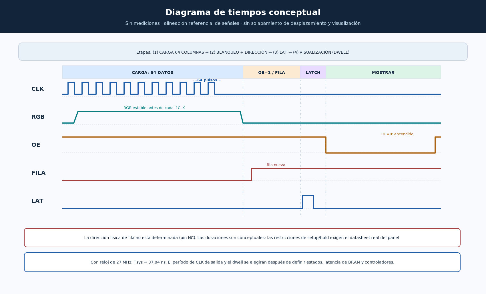

# Diagrama 04 — Temporización conceptual de HUB75E



## Cómo leerlo

El eje horizontal indica el **orden temporal**, no una escala de nanosegundos validada. Se representan algunos pulsos de `CLK` como ejemplo de una ráfaga que en la propuesta contiene **64 flancos ascendentes**. Las señales son lógicas ilustrativas, no obtenidas de GTKWave ni de un osciloscopio.

| Señal | Convención de referencia | Comportamiento en el dibujo |
|---|---|---|
| `RGB1`, `RGB2` | Seis bits en paralelo | Deben estar estables antes del flanco de subida de `CLK`. |
| `CLK` | Flanco ascendente desplaza los datos | Repite los pulsos durante la carga de 64 columnas y luego queda bajo. |
| `OE` | **Activo en bajo** | `1` = apagado/blanking; `0` = visible durante el dwell. |
| `FILA` | Dirección lógica, no asignación física a A–E | Cambia y se estabiliza con OE=1 antes de LAT. |
| `LAT` | Pulso de captura | Pulso con OE=1, después de la carga y dirección estable. |

La secuencia dibujada busca evitar errores visuales, aunque los controladores de panel pueden exigir órdenes de señal diferentes. En particular, **el contacto `NC` impide garantizar que el método convencional de selección de filas sea aplicable**.

## Cálculos reproducibles para el reloj de la Tang Nano 9K

- Oscilador de referencia: `f_sys = 27 000 000 Hz`.
- Periodo: `T_sys = 1 / f_sys ≈ 37,037 ns`.
- Si un pulso de `CLK` se compone de **un ciclo alto y uno bajo** (supuesto de diseño), entonces `f_CLK = 13,5 MHz` como máximo ideal del generador sencillo; **no** es una frecuencia confirmada para el panel.
- En la FSM propuesta, `S_LEER`, `S_ESPERAR`, `S_RGB`, `S_CLK_ALTO` y `S_CLK_BAJO` implican un **mínimo ilustrativo** de 5 ciclos FPGA por columna si `pixel_valid` llega con esa latencia: `t_carga ≥ 64 × 5 × 37,037 ns ≈ 11,85 μs`. Puede ser mayor si hay espera de memoria.

En general, con `N` grupos de fila y sin PWM:

```text
T_grupo = (64·C_col + C_aux + C_dwell) / 27e6
f_refresco = 27e6 / [N·(64·C_col + C_aux + C_dwell)]
```

Donde `C_col` son los ciclos efectivos por columna, `C_aux` cubre dirección y captura, y `C_dwell` mide cuánto tiempo permanece encendida una fila. **Son parámetros por escoger tras la simulación y caracterización.**

### Ejemplo numérico exclusivamente de planificación

Si se **supusieran** `N=32`, `C_col=5`, `C_aux=8`, `C_dwell=5000`:

- `T_dwell ≈ 185,19 μs`.
- `T_grupo = 5328 / 27e6 ≈ 197,33 μs`.
- `f_refresco = 27e6 / (32 × 5328) ≈ 158,36 Hz`.

**Este valor no es una medición ni garantiza ausencia de parpadeo**: no incluye tiempos adicionales del driver real, adaptadores, requisitos de blanking ni el comportamiento óptico del módulo.

## Pruebas que generarán el diagrama real de tiempos

1. Simular la FSM con `iverilog` y generar VCD.
2. Abrir GTKWave y visualizar `clk_27m`, `pixel_valid`, `hub_clk`, seis líneas RGB, `row_req`, `row_ready`, `LAT`, `OE`, `col` y `fila`.
3. Contar 64 flancos ascendentes de `hub_clk` entre capturas LAT.
4. Medir el tiempo efectivo de blanking y dwell por grupo; contrastar con los cálculos.
5. Probar eléctricamente el panel solo después de verificar tensión, dirección de filas, niveles y pines.

## Referencias externas

- Sipeed: https://wiki.sipeed.com/hardware/en/tang/Tang-Nano-9K/Nano-9K.html
- Introducción al barrido HUB75: https://docs.waveshare.com/LED
