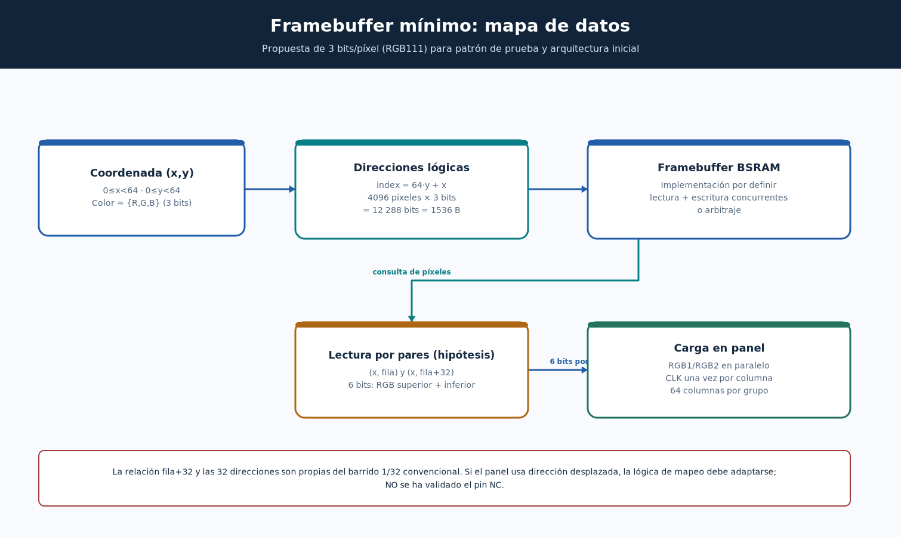

# Diagrama 05 — Framebuffer RGB111 y lectura de píxeles



## Objetivo

Separar el **almacenamiento de la imagen** de la **lógica de refresco**. La CPU o el generador de patrones escribe colores en memoria; el periférico los lee periódicamente y convierte esos valores en señales HUB75E.

## Formato mínimo propuesto

Para la primera etapa, cada píxel tiene un bit por componente:

| R | G | B | Color resultante |
|---|---|---|---|
| 0 | 0 | 0 | Negro |
| 1 | 0 | 0 | Rojo |
| 0 | 1 | 0 | Verde |
| 0 | 0 | 1 | Azul |
| 1 | 1 | 1 | Blanco |

Con tres bits existen ocho combinaciones de color, sin intensidades intermedias.

Para una imagen de 64×64:

```text
Píxeles = 64 × 64 = 4096
Bits totales = 4096 × 3 = 12 288 bits
Bytes equivalentes = 12 288 / 8 = 1536 bytes
Dirección lógica de un píxel: index = y·64 + x
```

Esto es **capacidad lógica mínima de datos**, no necesariamente el tamaño asignado a BRAM por la síntesis, que puede redondearse según anchuras y bloques físicos disponibles.

## Dos píxeles en paralelo (si el panel es 1/32 convencional)

Para cada columna `x` y una dirección lógica `r` en 0..31, se leen dos píxeles:

- Canal superior: `(x,r)` → `R1 G1 B1`.
- Canal inferior: `(x,r+32)` → `R2 G2 B2`.

**Ejemplo:** columna 10 y grupo de fila 8 significan píxeles `(10,8)` y `(10,40)`; sus índices lógicos son 522 y 2570 respectivamente. Este par de filas **no está verificado** para nuestro modelo de PCB.

Se podría organizar una RAM de `2048 palabras × 6 bits` para leer ambos colores por columna en un solo acceso. Otra opción es usar dos bancos o dos lecturas; cada alternativa cambia la latencia de la FSM. El ancho de memoria y el arbitraje se deben fijar antes de escribir RTL.

## CPU y acceso al bus

Las bases de mapa `0x48_0000` (framebuffer) y `0x4C_0000` (control) aparecen en la planificación del repositorio oficial, **pero no existe aún un periférico MMIO validado**. Falta acordar:

1. Registros, anchos y latencias de bus.
2. Cómo se empaquetan los píxeles en palabras de 32 bits.
3. Arbitraje entre acceso de CPU y lectura de barrido.
4. Si se necesitan dos buffers para evitar tearing.
5. Cómo se sincronizan escritura y cambio de frame.

## Verificación futura

Inicializar la memoria con un patrón de cuadrantes rojo/verde/azul/blanco y comprobar con el testbench que los valores RGB salen en el orden esperado. Las fotografías de la prueba real irán en `../fotos/04_evidencia_funcionamiento/`, **solo después de ejecutarla**.
