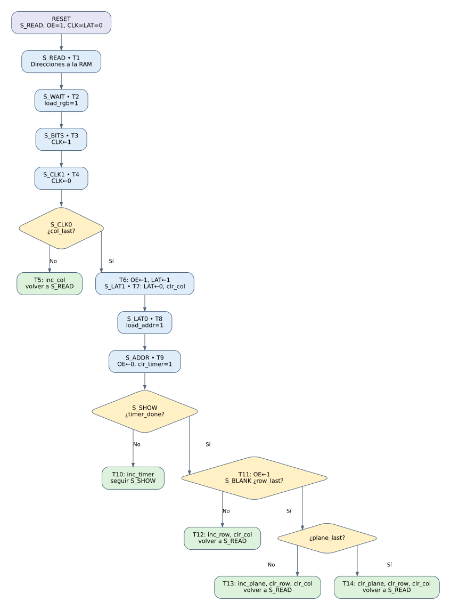

# ASMD del controlador HUB75 — correspondencia con RTL de PRUEBA_2

**Alcance:** documentación de diseño del prototipo disponible en `grupo4-pantalla/Prueba_de_funcionamiento/PRUEBA_2/`. No describe una validación física del panel. Este ASMD **no sustituye** el diagrama conceptual `03-fsm.md`: lo complementa con la implementación existente. Revisado contra `hub75_control.v`, `hub75_datapath.v`, `hub75_top.v` y `framebuffer.v` (consulta: 24-11-2026).

## 1. Propósito

Una ASMD (Algorithmic State Machine with Datapath) reúne estados, decisiones y operaciones sobre registros. En este diseño, `hub75_control` determina las órdenes y mantiene registradas `hub_clk`, `hub_lat`, `hub_oe`; `hub75_datapath` contiene los registros `col`, `row`, `plane`, `timer`, `addr`, los 6 bits RGB y comparadores.



**Archivo editable:** [asmd-rtl-hub75.drawio](asmd-rtl-hub75.drawio). Cada bloque del diagrama representa una operación que se aplica en el próximo flanco positivo del reloj (salvo las decisiones, que leen señales combinacionales antes del flanco).

## 2. Parámetros por defecto del RTL

| Parámetro | Valor | Significado |
|---|---:|---|
| `COLS` | 64 | Columnas; `col` tiene 6 bits, recorre 0..63 |
| `HALF_ROWS` | 32 | Grupos de dos filas hipotéticos; `row` tiene 5 bits |
| `PLANES` | 8 | Planos de bit; `plane` recorre 0..7 |
| `T_BASE` | 8 | Tiempo base de visualización, en ciclos del reloj de sistema |
| `TIMER_W` | 16 | Ancho del contador de tiempo |
| `pix_top`, `pix_bot` | 24 bits c/u | Formato RGB888; no es RGB111 |
| `fb_addr` | 12 bits | `{mitad, row[4:0], col[5:0]}` |

**Precaución:** el panel físico tiene el contacto 12 serigrafiado `NC` según la documentación de reconocimiento. La asociación lógica `addr` con A–E y un barrido convencional 1/32 es hipótesis del prototipo, **no un pinout validado**.

## 3. ASMD paso a paso

1. **Reset:** `state=S_READ`, `col=row=plane=timer=0`, `hub_clk=0`, `hub_lat=0`, `hub_oe=1`. El módulo superior además aplica un `power-on reset` interno durante los primeros 15 ciclos.
2. **S_READ:** presenta continuamente las direcciones combinacionales `fb_addr_top={0,row,col}`, `fb_addr_bot={1,row,col}`; avanza a `S_WAIT`. La RAM síncrona lee en el flanco.
3. **S_WAIT:** activa `load_rgb=1` y registra los seis bits del plano actual a partir de `pix_top` y `pix_bot`. Avanza a `S_BITS`.
4. **S_BITS:** solicita `hub_clk_next=1`. En el flanco siguiente `hub_clk` sube; avanza a `S_CLK1`.
5. **S_CLK1:** solicita `hub_clk_next=0`. En el flanco siguiente baja el reloj del panel; avanza a `S_CLK0`.
6. **S_CLK0:** si `col_last=0`, incrementa `col` y vuelve a `S_READ`; si `col_last=1`, solicita `hub_oe_next=1`, `hub_lat_next=1` y avanza a `S_LAT1`.
7. **S_LAT1:** solicita `hub_lat_next=0`, `clr_col=1` y avanza a `S_LAT0`.
8. **S_LAT0:** activa `load_addr=1` (`addr←row`) y avanza a `S_ADDR`.
9. **S_ADDR:** solicita `hub_oe_next=0`, activa `clr_timer=1` y avanza a `S_SHOW`.
10. **S_SHOW:** mientras `timer_done=0`, incrementa `timer` y permanece; cuando `timer_done=1`, solicita `hub_oe_next=1` y avanza a `S_BLANK`.
11. **S_BLANK:** si no es la última fila, `row←row+1`; si es última fila y no último plano, `plane←plane+1`, `row←0`; si ambos son últimos, `plane←0`, `row←0`. En todos los casos `col←0` y avanza a `S_READ`.

## 4. Señales de condición y operaciones

```verilog
col_last   = (col   == COLS - 1);
row_last   = (row   == HALF_ROWS - 1);
plane_last = (plane == PLANES - 1);
t_limit    = T_BASE << plane;
timer_done = (timer == t_limit);
fb_addr_top = {1'b0,row,col};
fb_addr_bot = {1'b1,row,col};
```

Con `load_rgb=1`, el datapath captura `R=bit[16+plane]`, `G=bit[8+plane]`, `B=bit[plane]` de cada palabra RGB888. Las órdenes por defecto del controlador son cero y los registros conservan su valor cuando no hay habilitación. Las señales de control al panel son **registradas**, no salidas combinacionales instantáneas del estado.

## 5. Diferencias respecto del diseño conceptual de fase H2

| Aspecto | H2 conceptual | Prototipo de `PRUEBA_2` |
|---|---|---|
| Profundidad | RGB111 | RGB888, 8 planos temporales |
| Lectura | `pixel_valid` como propuesta | RAM síncrona y ciclo `S_WAIT`, sin `pixel_valid` |
| Secuencia de dirección/LAT | Dirección antes de `LAT` | `LAT` antes de `load_addr` |
| FSM | Estados abstractos de planificación | 10 estados codificados `S_READ`..`S_BLANK` |
| Control de CPU | MMIO por definir | Imagen ROM inicializada con `.hex`, sin puerto CPU de escritura |

**Revisión pendiente:** la secuencia dirección/LAT debe compararse con la hoja técnica real del panel. Este documento representa el comportamiento del RTL, no certifica que sea eléctricamente correcto.

## 6. Cómo comprobarlo (pendiente de ejecución por quien contribuya)

En `grupo4-pantalla/Prueba_de_funcionamiento/PRUEBA_2/` se incluye `hub75_tb.v`, un banco de pruebas con dimensiones reducidas. Puede simularse con Icarus Verilog; registrar comandos, resultado real y señales VCD en un commit posterior. **Este commit solo documenta el diseño y no afirma PASS de simulación ni funcionamiento físico.**

## 7. Fuente y alcance de contribución

Archivos fuente del equipo: `hub75_control.v`, `hub75_datapath.v`, `hub75_top.v`, `framebuffer.v` en `PRUEBA_2`. Diagramación y redacción preparadas con asistencia de IA para **revisión humana**. La autoría de la implementación Verilog se conserva como la que ya consta en el historial Git; este documento no se la atribuye a quien agregue el ASMD.
