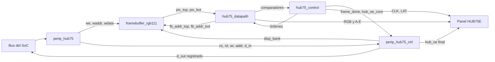

# Interfaz MMIO del controlador HUB75E

**Proyecto:** consola retro en FPGA · Electrónica Digital 1 · Tang Nano 9K / FemtoRV32.  
**Validación:** simulación RTL del periférico completo con Icarus Verilog. La validación con el SoC FemtoRV32 y la síntesis de esta configuración constituyen etapas de integración del sistema.

## 1. Objetivo y alcance

El módulo superior `perip_hub75` es capaz de recibir píxeles del procesador, intercambiar los bancos de imagen al final de un barrido y generar las señales HUB75E. La arquitectura reutiliza la FSM de diez estados y el datapath del prototipo de video. La interfaz MMIO usa RGB111 (ocho colores, un plano) en vez de RGB888 para reducir memoria y seguir el formato reportado por el Grupo 6. El barrido es autónomo: no requiere UART ni órdenes por cada pulso CLK/LAT.

## 2. Archivos y arquitectura

| Archivo | Función |
|---|---|
| `rtl/perip_hub75.v` | Interfaz superior, validación de offsets, instancias y adaptación RGB111 a los puertos de 24 bits del datapath. |
| `rtl/perip_hub75_ctrl.v` | Decodificación local, CONTROL, STATUS, FRAMES y handshake. |
| `rtl/framebuffer_rgb111.v` | Dos bancos de 4096 píxeles; dos RAM separadas por mitades. |
| `rtl/hub75_control.v` | FSM de barrido; `frame_done` al finalizar la última pareja de filas del último plano. |
| `rtl/hub75_datapath.v` | Contadores, temporización, direcciones de memoria y seis señales RGB. |
| `sim/perip_hub75_tb.v` | Maestro de prueba, modelo lógico del panel y comprobaciones autocorrectivas. |
| `Makefile` | Compilación con Icarus Verilog, simulación y VCD. |



**Explicación de los módulos:** [guía de lectura del RTL](explicacion/README.md).

## 3. Contrato de bus con el Grupo 6

| Puerto | Dirección | Ancho | Función |
|---|---|---:|---|
| `clk`, `rst` | Entrada | 1 c/u | Reloj común de 27 MHz; reset síncrono activo en alto (OE se fuerza alto también durante reset). |
| `cs_fb`, `cs_ctrl` | Entrada | 1 c/u | Selección externa de regiones `0x0048` y `0x004C` en `mem_addr[31:16]`; mutuamente excluyentes. |
| `addr` | Entrada | 16 | Offset **en bytes** (`mem_addr[15:0]`), no índice de píxel. |
| `rd`, `wr` | Entrada | 1 c/u | Pulsos excluyentes de un ciclo. |
| `d_in` | Entrada | 32 | Dato de escritura. |
| `d_out` | Salida | 32 | Lectura de registros, registrada en flanco positivo. Sin lectura válida vuelve a cero en el siguiente flanco. |
| `r1,g1,b1,r2,g2,b2` | Salida | 1 c/u | Seis bits de color al panel. |
| `hub_addr` | Salida | 5 | A–E del panel, no dirección MMIO. |
| `hub_clk`, `hub_lat`, `hub_oe` | Salida | 1 c/u | Desplazamiento, captura y habilitación activa en bajo. |

El módulo superior extiende el contrato común de 5 bits a 16 bits porque se direccionan 4096 píxeles. El decodificador local de control conserva los 5 bits. El SoC debe garantizar accesos de palabra alineados y completos (`mem_wmask == 4'b1111` para escritura); no hay máscara de bytes, `ready`, `stall` ni respuesta de error. El multiplexor global debe conservar la selección hasta que la lectura registrada esté disponible. Las escrituras de píxeles durante BUSY se ignoran, no se reintentan automáticamente.

### Instanciación en el SoC

Ejemplo de conexión a las señales de FemtoRV32; los nombres externos corresponden al contrato de bus.

```verilog
wire cs_fb   = (mem_addr[31:16] == 16'h0048);
wire cs_ctrl = (mem_addr[31:16] == 16'h004C);
wire [31:0] hub75_rdata;
perip_hub75 u_hub75 (
    .clk(clk), .rst(!resetn),
    .cs_fb(cs_fb), .cs_ctrl(cs_ctrl),
    .addr(mem_addr[15:0]),
    .rd(mem_rstrb && !(|mem_wmask)),
    .wr(mem_wmask == 4'b1111 && !mem_rstrb),
    .d_in(mem_wdata), .d_out(hub75_rdata),
    .r1(r1), .g1(g1), .b1(b1), .r2(r2), .g2(g2), .b2(b2),
    .hub_addr(hub_addr), .hub_clk(hub_clk),
    .hub_lat(hub_lat), .hub_oe(hub_oe)
);
```

Conectar `hub75_rdata` al multiplexor de lectura del SoC; seleccionar la respuesta correspondiente a la solicitud registrada. Usar el decodificador global existente si ya proporciona `cs_fb` y `cs_ctrl`. No compilar a la vez los módulos homónimos de PRUEBA_2 o del prototipo UART.

## 4. Mapa de memoria y registros

| Dirección | Registro | Acceso | Descripción |
|---|---|---|---|
| `0x00480000`–`0x00483FFC` | Píxeles | W | 4096 palabras, solo bits [2:0] = {R,G,B}. |
| `0x004C0000` | CONTROL | R/W | bit 0 DISPLAY_EN; bit 1 START (orden, se lee 0). |
| `0x004C0004` | STATUS | R | bit 0 DISPLAY_EN, bit 1 BUSY, bit 2 DONE, bit 3 FRONT_VALID. |
| `0x004C0008` | FRAMES | R | Contador de 32 bits de barridos completos, módulo 2^32. |

Los bits reservados se leen en cero. CONTROL tras reset = `0x01`, STATUS = `0x01`, FRAMES = 0. La RAM no se inicializa con reset; FRONT_VALID=0 mantiene la salida apagada hasta el primer intercambio. FRAMES cuenta barridos incluso con DISPLAY_EN=0; no cuenta cuadros del juego ni solicitudes START.

### Decodificación

- `sel_ctrl = cs_ctrl && !cs_fb && (addr[15:5] == 0)`; evita que `0x004C0020` se confunda con CONTROL.
- El decodificador local genera `bus_read = cs && rd && !wr`, `bus_write = cs && wr && !rd`, `wr_control` para `0x00`, y `rd_control`, `rd_status`, `rd_frames` para `0x00`, `0x04`, `0x08` respectivamente.
- `we = !rst && cs_fb && !cs_ctrl && wr && !rd && !busy && (addr[15:14] == 0) && (addr[1:0] == 0)`.
- El índice del píxel es `addr[13:2] = 64*y+x`. El bit 11 distingue mitad superior/inferior. Por ejemplo, (0,0) = `0x00480000`, (0,32) = `0x00482000` y (63,63) = `0x00483FFC`.
- Lecturas de framebuffer, offsets no implementados y escrituras a STATUS/FRAMES no modifican la memoria ni los registros de control; la salida de lectura del periférico devuelve cero si no hay registro seleccionado.

## 5. Handshake y doble buffer

El banco visible (`disp_bank`) es leído por el barrido; el banco posterior (`~disp_bank`) recibe las escrituras. Cada cuadro contiene 12 288 bits (1,5 KiB); dos cuadros requieren 24 576 bits (3 KiB) útiles. La ocupación física de BSRAM debe medirse mediante síntesis.

1. Esperar BUSY=0 y escribir los 4096 píxeles del cuadro posterior.
2. Escribir CONTROL=3 para habilitar la visualización y solicitar START. START=1 con BUSY=0 se acepta en el flanco positivo: BUSY pasa a 1 y DONE a 0. START no se almacena.
3. Mientras BUSY=1, las escrituras de píxeles se bloquean y las nuevas órdenes START se ignoran. DISPLAY_EN sí se actualiza con toda escritura válida a CONTROL.
4. Cuando `busy && frame_done` es verdadero antes del flanco, se invierte `disp_bank`, BUSY pasa a 0, DONE a 1 y FRONT_VALID a 1. No se copian píxeles entre bancos.
5. DONE permanece en 1 hasta otro START aceptado o reset. FRONT_VALID significa que ocurrió un intercambio, **no** que los 4096 píxeles hayan sido escritos correctamente: esa responsabilidad es del firmware.

Si START coincide con `frame_done` estando libre, queda pendiente hasta el siguiente barrido. Si coincide con la terminación de un swap anterior, se ignora porque BUSY era 1. La FSM no se detiene cuando DISPLAY_EN=0: `hub_oe = hub_oe_core | ~display_en | ~front_valid | rst`.

| Evento | STATUS (hex, con DISPLAY_EN=1) |
|---|---|
| Reset | 01 |
| Primer START aceptado | 03 |
| Primer intercambio completo | 0D |
| Siguiente START aceptado | 0B |
| Siguiente intercambio completo | 0D |

### Interfaz de software

Ejemplo de acceso ordenado a MMIO con un único escritor; su ejecución sobre FemtoRV32 requiere validación.

```c
#include <stdint.h>
#define FB     ((volatile uint32_t *)0x00480000u)
#define CTRL   (*(volatile uint32_t *)0x004C0000u)
#define STATUS (*(volatile uint32_t *)0x004C0004u)
#define FRAMES (*(volatile uint32_t *)0x004C0008u)
#define BUSY   (1u << 1)
#define DONE   (1u << 2)

void mostrar_cuadro(const uint8_t pixeles[4096]) {
    while (STATUS & BUSY) {}
    for (unsigned i = 0; i < 4096; ++i)
        FB[i] = (uint32_t)(pixeles[i] & 7u);
    CTRL = 3u;
    while ((STATUS & (BUSY | DONE)) != DONE) {}
}
```

El firmware debe escribir START al finalizar cada cuadro. Sin el primer intercambio, el panel permanecerá apagado. No se debe escribir el siguiente cuadro mientras BUSY=1.

## 6. Barrido del panel

Se conserva la FSM `S_READ → S_WAIT → S_BITS → S_CLK1 → S_CLK0 → S_LAT1 → S_LAT0 → S_ADDR → S_SHOW → S_BLANK`, con repetición por columna y fila. En S_WAIT se captura el dato síncrono del framebuffer; después se emiten 64 pulsos de HUB_CLK, LAT, dirección de fila y habilitación OE. `frame_done = (state == S_BLANK) && row_last && plane_last`. La instancia fija `PLANES=1` y convierte cada bit RGB a 0x00/0xFF para reutilizar el datapath de 24 bits, sin aumentar la profundidad de color. El parámetro T_BASE vale 1024 por defecto; el testbench lo reduce a 8 y usa reloj de 100 MHz para acelerar la prueba.

Los diagramas de barrido, control y comunicación se reúnen en el [índice de diagramas](../docs/diagramas/README.md).

## 7. Verificación reproducible

Desde esta carpeta:

```bash
make clean
make sim
make vcd
gtkwave build/perip_hub75_tb.vcd
```

Resultado de la simulación en Linux Mint (25/11/2026):

```text
PASS: MMIO CONTROL/STATUS/FRAMES, START/BUSY/DONE, doble buffer y barrido RGB111; filas=96 LAT=160 frames=4
sim/perip_hub75_tb.v:187: $finish called at 532820000 (1ps)
```

El banco de pruebas llena ambos bancos con patrones distintos, verifica selección de regiones, accesos inválidos, lectura de registros, bloqueo durante BUSY, conteo FRAMES, cambio de banco solo en el límite de barrido y los 64 pulsos RGB antes de LAT. Comprueba ambos bancos y el efecto de DISPLAY_EN. El maestro es un estímulo de simulación, **no** el núcleo FemtoRV32. Se observaron advertencias sobre unidades temporales de módulos sin `timescale`; el testbench sí define su escala y completó sin fallos. Las formas de onda pueden reproducirse con `make vcd`.

## 8. Alcance de la validación

La simulación verifica el periférico y su protocolo MMIO mediante un maestro de prueba. No acredita todavía la ejecución del firmware en FemtoRV32, la ocupación física de recursos BSRAM/LUT, el cierre temporal a 27 MHz ni la visualización física de esta configuración. Estas verificaciones corresponden a la integración del SoC. La conexión eléctrica del panel debe respetar la alimentación, niveles lógicos y pinout documentados.
