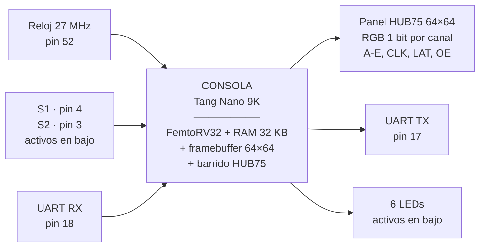
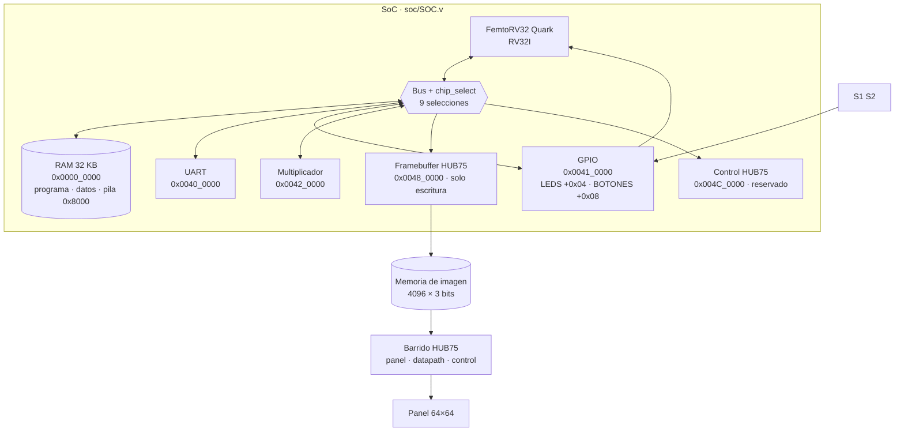
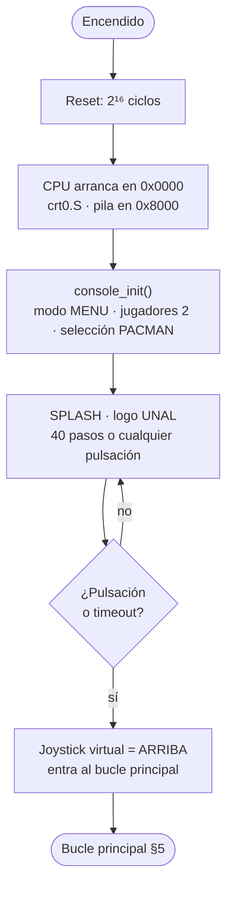
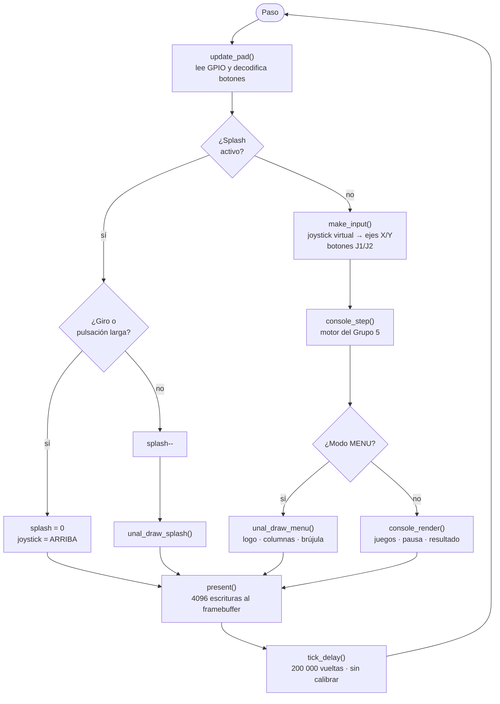
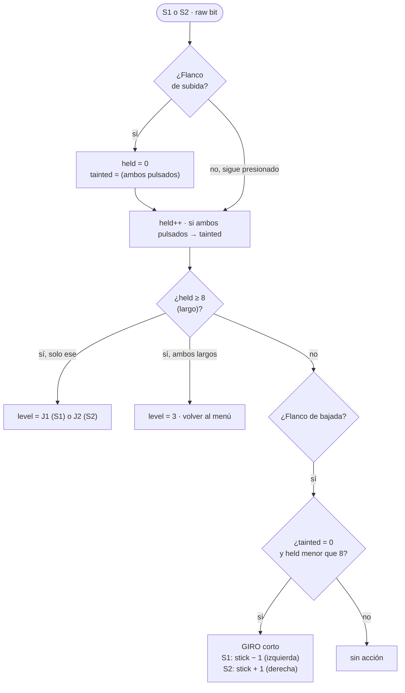
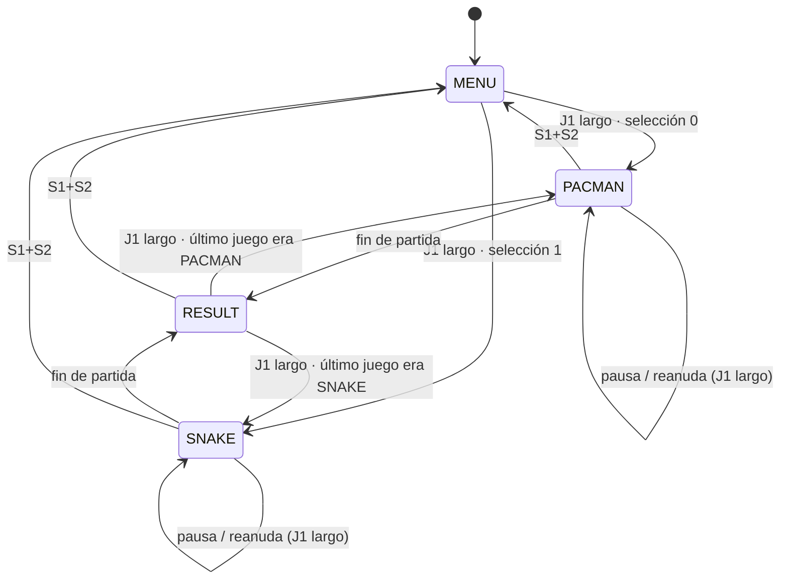
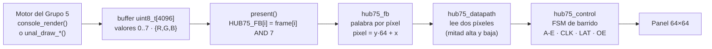

# Consola · Arquitectura, cajas negras y flujos

Todo lo de aquí sale del código real (`soc/top.v`, `soc/SOC.v`, `rtl/`, `soc/firmware/`). Si el diagrama y el código no coinciden, manda el código y se corrige el diagrama.

---

## 0. En una línea

FemtoRV32 a 27 MHz corre el motor de PAC-MAN y Snake del Grupo 5. Escribe 4096 píxeles en un framebuffer por MMIO. Un barrido HUB75 saca esa imagen a un panel 64×64. Hoy los botones S1 y S2 hacen de joystick.

---

## 1. Caja negra

Lo que ve el mundo de afuera. Nada más.

| Entrada | Pin | Qué hace hoy |
|---|---|---|
| `clk` | 52 | Reloj del sistema. Sin PLL. |
| `btn[0]` S1 | 4 | Gira el joystick virtual a la izquierda (corto) · J1 (largo) |
| `btn[1]` S2 | 3 | Gira el joystick virtual a la derecha (corto) · J2 (largo) |
| `uart_rx` | 18 | Entrada del puerto serie. El firmware no la usa todavía. |

| Salida | Pin | Qué hace hoy |
|---|---|---|
| `hub_r1…b2`, `hub_addr[4:0]`, `hub_clk`, `hub_lat`, `hub_oe` | 25–53 | Imagen del panel |
| `uart_tx` | 17 | Salida del UART del SoC (Lab 4). El firmware no escribe nada todavía. |
| `led[5:0]` | 10–16 | Lo que pida el firmware en el registro `LEDS` |

Reset de encendido: 2¹⁶ ciclos (≈ 2,4 ms), luego corre el programa desde `0x0000`.

---

## 2. Diagrama de bloques

Notas de bloque:

- **RAM 32 KB.** El programa cabe con holgura: el firmware compilado ocupa 12 064 bytes.
- **Framebuffer.** Una palabra de 32 bits por píxel, pero solo se usan los bits `[2:0]` = `{R,G,B}`. Así entra en BSRAM.
- **Barrido.** Va por su cuenta: la CPU no lo sincroniza. Por eso puede verse un corte de cuadro mientras se dibuja (sin doble buffer).
- **Sin timer.** El paso del juego es un bucle de retardo sin calibrar (ver §5).

---

## 3. Mapa de memoria

| Dirección | Bloque | Acceso | Estado |
|---|---|---|---|
| `0x0000_0000`–`0x0000_7FFF` | RAM 32 KB | R/W | Simulado y en placa |
| `0x0040_0000` | UART | R/W | Del Lab 4 |
| `0x0041_0000` +`0x04` | GPIO · LEDS | R/W | Del Lab 4 |
| `0x0041_0000` +`0x08` | GPIO · BOTONES | R | Del Lab 4 · sincronizado en 2 flancos |
| `0x0042_0000` | Multiplicador | R/W | Del Lab 4 |
| `0x0048_0000`–`0x0048_3FFC` | Framebuffer HUB75 | **W** | Simulado (4096 escrituras) |
| `0x004C_0000` | Control HUB75 | — | Reservado: lectura `0`, escritura ignorada |

Conflicto abierto: `docs/contratos-MMIO.md` del Grupo 5 propone `0x410000` y `0x420000` para otros periféricos. Ver `integracion-lab4-grupos4-5.md`.

---

## 4. Flujo de arranque

---

## 5. Bucle principal · un paso de lógica

Es el `for(;;)` de `soc/firmware/main.c`. Un paso = leer botones, avanzar la lógica, dibujar, presentar, esperar.

Dos cosas que muerden:

1. **El splash consume la pulsación.** Quien entra al menú con un giro no le da al motor del juego ninguna orden.
2. **`present()` escribe los 4096 píxeles en cada paso**, aunque el cuadro no cambie.

---

## 6. Botones como joystick virtual

Los joysticks reales (Grupo 2) no están conectados. Mientras tanto, los dos pulsadores simulan el joystick. Es la parte más delicada: se decodifica por pasos, no por tiempo real.

### Tabla de giros

Orden de la rueda: `ARRIBA → DERECHA → ABAJO → IZQUIERDA → ARRIBA`.

| Desde | S2 corto (derecha) | S1 corto (izquierda) |
|---|---|---|
| ARRIBA | DERECHA | IZQUIERDA |
| DERECHA | ABAJO | ARRIBA |
| ABAJO | IZQUIERDA | DERECHA |
| IZQUIERDA | ARRIBA | ABAJO |

### Eje que recibe el motor

| Estado del stick | `x[0]` | `y[0]` |
|---|---|---|
| ARRIBA | 512 | 0 |
| ABAJO | 512 | 1023 |
| IZQUIERDA | 0 | 512 |
| DERECHA | 1023 | 512 |

Centro 512, zona muerta ±128 del motor. Jugador 2 siempre centrado.

### Qué hace cada botón por modo

| Modo | S1 corto | S2 corto | S1 largo | S2 largo | S1 + S2 |
|---|---|---|---|---|---|
| Splash | — | — | sale del splash | sale del splash | sale del splash |
| Menú | gira | gira | inicia el juego elegido | — | nada (se enmascara) |
| Juego | gira (cambia rumbo) | gira | pausa / reanuda | reinicia | vuelve al menú |
| Pausa | gira (ignorado por el motor) | gira | continúa | reinicia | vuelve al menú |
| Resultado | gira | gira | repite | — | vuelve al menú |

---

## 7. Máquina de estados del motor

Estados del `Console` del Grupo 5 (`console.h`). El splash está fuera: vive en `main.c`.

En el menú, la selección y el número de jugadores se cambian con los giros:

| Giro hasta… | Efecto en el menú |
|---|---|
| ARRIBA | selección = PACMAN |
| ABAJO | selección = SNAKE |
| IZQUIERDA | jugadores = 1 |
| DERECHA | jugadores = 2 |

---

## 8. Ruta del píxel

De la lógica del juego a un LED del panel.

Formato lógico: `bit2=R · bit1=G · bit0=B`. Ocho colores. El hardware expande cada bit a `0x00`/`0xFF`.

---

## 9. Recursos de la FPGA

Última síntesis con `make syn` (Tang Nano 9K, GW1NR-9):

| Recurso | Usado | Disponible | Nota |
|---|---|---|---|
| BSRAM | 20 | 26 | 76 %. Es el recurso que aprieta. |
| Frecuencia máxima | 57,8 MHz | — | La placa corre a 27 MHz. Margen de sobra. |
| Simulación | PASS | — | 4096 escrituras al framebuffer en 2 000 000 de ciclos. |

---

## 10. Estado: qué está probado y qué no

| Cosa | Estado |
|---|---|
| Firmware compila sin avisos nuevos | ✅ |
| SoC simula y escribe el cuadro completo | ✅ |
| Bitstream síntesis + place & route | ✅ |
| Bitstream cargado en la placa (CRC OK) | ✅ |
| Lógica de botones en host (5 casos) | ✅ |
| Menú y splash sin letras fuera del margen de 4 px (host) | ✅ |
| **Imagen real en el panel** | ⏳ pendiente de confirmación visual del equipo |
| Temporización: `FRAME_DELAY_LOOPS` y `BTN_LONG_STEPS` | ❌ sin calibrar |
| Joysticks MCP3008 (Grupo 2) | ❌ no conectados |
| Sonido (Grupo 3) | ❌ no conectado |
| Récords en EEPROM (Grupo 1) | ❌ no conectado |
| Timer MMIO | ❌ no existe: se usa un bucle |
| Contrato del framebuffer con el Grupo 4 | ⏳ por confirmar |

Cosas que pueden fallar en la placa, en orden de probabilidad:

1. **Temporización.** Si el paso es muy corto, un toque de menos de 8 pasos se pierde o se lee como largo. Si es muy largo, el juego va en cámara lenta.
2. **Bisel del panel.** Ya se dejó margen de 4 px. Si aún se cortan letras, el problema es de cableado o de mapeo de columnas, no de diseño.
3. **Rasgado.** Como no hay doble buffer, se puede ver un cuadro partido al dibujar.

---

## 11. Decisiones abiertas

1. **Timer.** ¿Se agrega un registro de tiempo al SoC para quitar el bucle de retardo?
2. **Joystick real.** Cuando llegue el MCP3008 del Grupo 2, `read_inputs` cambia por lectura SPI; el resto del bucle no se toca.
3. **Dirección de periféricos.** Resolver el conflicto `0x410000`/`0x420000` con el Grupo 1.
4. **Logo.** El logo es una aproximación en pixeles, como la de Lab3. ¿Se acepta, o se quiere el logo oficial en otra resolución?

---

## Referencias

- `soc/top.v` · puertos y reset · `soc/top.cst` · pines
- `soc/SOC.v` · bus y mapa de memoria
- `soc/firmware/main.c` · bucle principal y botones
- `soc/firmware/unal_menu.c` · splash y menú
- `grupo5-juego-menu/firmware/` · motor (no se modifica desde aquí)
- `docs/integracion-lab4-grupos4-5.md` · decisiones de la primera integración
- `docs/estructura-integracion.md` · visión general de la consola
