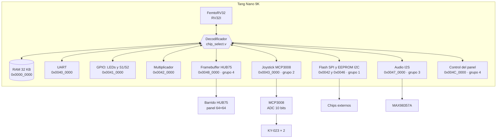
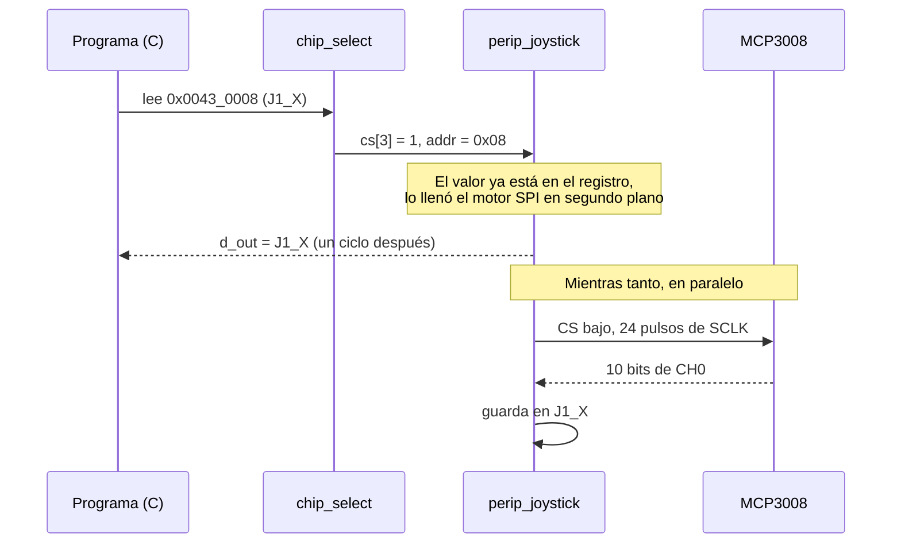
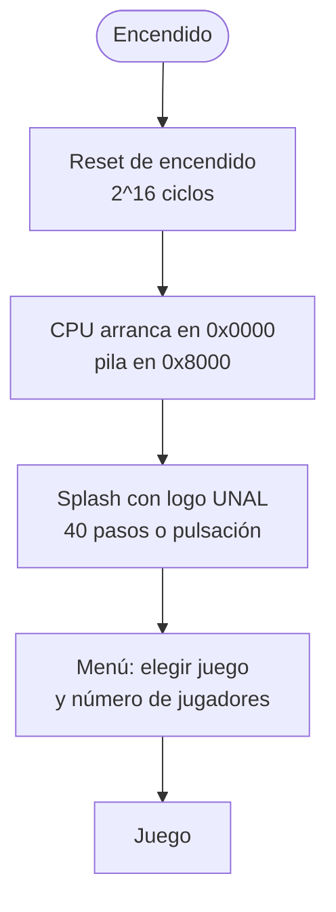
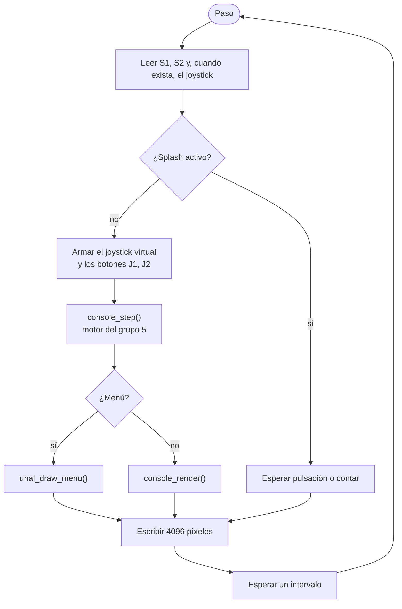
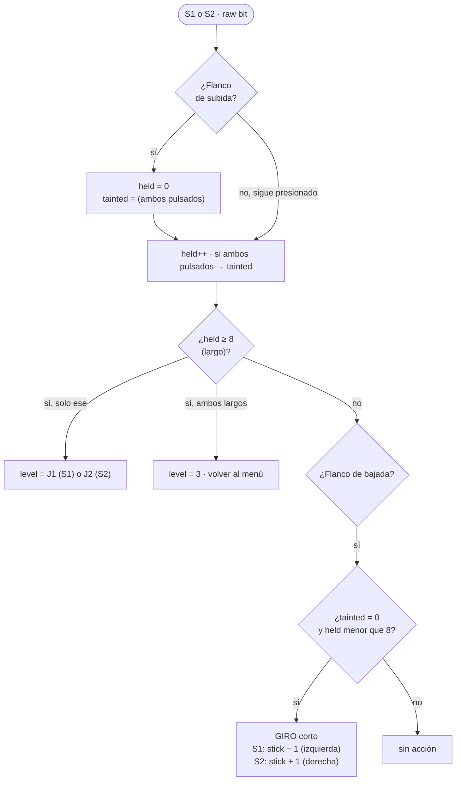
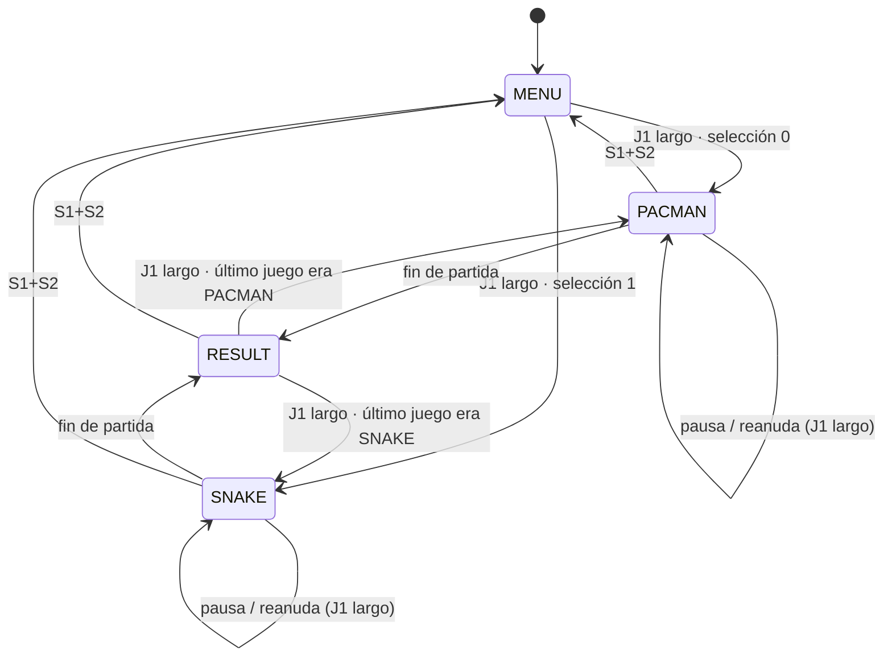
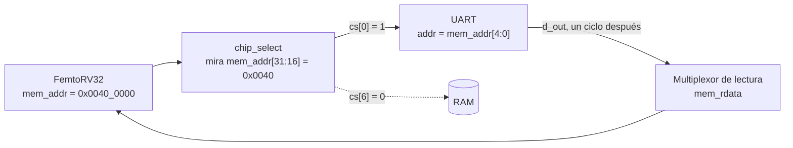
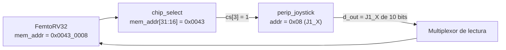
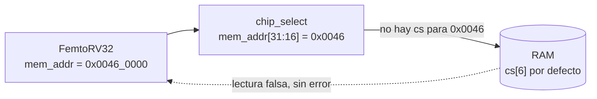

# Consola retro en FPGA: documento de integración

Proyecto final de Electrónica Digital 1, Universidad Nacional de Colombia.
Grupo 6 (Inicio e integración), con los aportes de los grupos 1 a 5.

Este documento explica cómo se une la consola: qué hace cada periférico, cómo se conecta al procesador, qué señales y direcciones usa, qué está probado y qué falta. Sirve como punto de partida para unificar el código de los seis grupos en un solo diseño.

Cuando una afirmación viene de otro documento o de una simulación, lo indicamos con la ruta del archivo.

---

## 1. Idea general

La consola tiene una FPGA Tang Nano 9K que ejecuta un procesador FemtoRV32 (RISC-V de 32 bits, conjunto RV32I). El procesador corre un programa en C con un menú y dos juegos: PAC-MAN y Snake. Los periféricos no tienen procesador propio. Se conectan al bus del procesador como posiciones de memoria: el programa escribe o lee direcciones y el hardware responde. Esto se llama E/S mapeada en memoria (MMIO).

El reloj de todo el sistema es de 27 MHz, el oscilador de la placa.

Elegimos este diseño por tres razones:

1. El procesador y el bus vienen del laboratorio 4, así que ya están probados y entendidos por todo el equipo.
2. Los juegos se escriben en C, que es más fácil de cambiar y depurar que una máquina de estados en hardware.
3. Cada grupo puede desarrollar su periférico por separado, siempre que respete el mismo contrato de bus (sección 4).

---

## 2. Caja negra de la consola

Lo que se ve desde afuera:

```mermaid
flowchart LR
    CLK["Reloj 27 MHz"] --> C
    BTN["Pulsadores S1 y S2"] --> C
    JOY["Dos joysticks KY-023<br/>ejes X, Y y botón SW"] --> C
    FLASH["Flash SPI de la placa<br/>(datos de gráficos)"] <--> C
    EE["EEPROM I2C 24LC256<br/>(récords)"] <--> C
    AMP["Amplificador MAX98357A<br/>e I2S"] <-- "audio" --- C

    C["CONSOLA<br/>Tang Nano 9K"]

    C --> PANEL["Panel LED 64×64<br/>HUB75"]
    C --> UART["UART<br/>depuración"]
    C --> LEDS["LEDs de la placa"]
```

Estado de cada entrada y salida:

| Elemento | Estado |
|---|---|
| Reloj 27 MHz, pulsadores S1 y S2, LEDs, UART | Funcionando en la placa |
| Panel LED 64×64 | Funcionando en la placa |
| Joysticks KY-023 | RTL y simulación listos (zip `fragmentos`); falta cablear |
| EEPROM I2C | RTL y simulación en el grupo 1; falta cablear y validar pines |
| Flash SPI | RTL y simulación en el grupo 1; falta validar pines y MSPI |
| Amplificador de audio | Diseño en el grupo 3; sin RTL |

---

## 3. Arquitectura y bloques



Las líneas punteadas o los bloques que aún no tienen hardware en el SoC se describen en la sección 5. El SoC actual, sin los periféricos nuevos, es el de `soc/`.

---

## 4. Contrato de bus

Todo periférico MMIO sigue el mismo contrato. Así se puede conectar cualquier módulo sin cambiar el procesador.

### 4.1 Señales del procesador

| Señal | Ancho | Significado |
|---|---|---|
| `mem_addr` | 32 | Dirección del acceso |
| `mem_rdata` | 32 | Dato que vuelve al procesador |
| `mem_rstrb` | 1 | Lectura (`rd`) |
| `mem_wdata` | 32 | Dato a escribir |
| `mem_wmask` | 4 | Máscara de bytes. Escritura cuando `|mem_wmask` es 1 (`wr`) |

### 4.2 Decodificación

`soc/chip_select.v` mira `mem_addr[31:16]` y activa un único bit de `cs[8:0]`. Cada bloque ocupa 64 KB. Cualquier dirección que no coincida con un bloque conocido cae en la RAM. Ese comportamiento viene del laboratorio 4 y es la fuente de errores más peligrosa de la integración: un periférico sin entrada en el decodificador no da error, solo lee la RAM.

### 4.3 Puertos de cada periférico

| Puerto | Ancho | Dirección |
|---|---|---|
| `clk` | 1 | Entrada, 27 MHz |
| `rst` | 1 | Entrada, activo en alto |
| `d_in` | 32 | Entrada, dato escrito |
| `cs` | 1 | Entrada, selección del bloque |
| `addr` | 5 | Entrada, desplazamiento dentro del bloque |
| `rd`, `wr` | 1 | Entradas, lectura y escritura |
| `d_out` | 32 | Salida, dato leído, registrado (un ciclo de latencia) |

Las señales del SoC usan `resetn` activo en bajo. Cada periférico recibe `rst` activo en alto. La conversión (`!resetn`) se hace una vez, en `soc/SOC.v`.

### 4.4 Secuencia de un acceso



La CPU nunca espera al ADC. Lee el último valor disponible.

---

## 5. Periféricos, uno por uno

Para cada grupo: qué hace, cómo se conecta, dónde está el código, qué diagramas existen, qué se ha probado y qué falta.

### 5.1 Grupo 1 · Memoria externa (Flash SPI y EEPROM I2C)

**Función.** Guardar los récords de los juegos en una memoria que no se borra al apagar. La Flash SPI de la placa podría guardar gráficos, aunque hoy la BRAM alcanza para el panel.

**Código.** `grupo1-memoria-externa/rtl/`:
- SPI: `perip_spi.v` (registros MMIO), `spi_control.v` (máquina de estados de 9 estados), `spi_datapath.v` (divisor, desplazamiento y recepción).
- I2C: `perip_i2c.v`, `i2c_control.v` (17 estados), `i2c_datapath.v`.

**Simulación.** `grupo1-memoria-externa/sim/`: `perip_spi_tb.v` con `flash_model.v`, y `perip_i2c_tb.v` con `eeprom_model.v`. Según su README, SPI pasa 43 comprobaciones y I2C 36, sin errores. No las volvimos a correr para este documento.

**Dirección.** SPI en `0x0042_0000`, I2C en `0x0046_0000`. La primera colisiona con el multiplicador del laboratorio 4, que el firmware no usa.

**Registros SPI.**

| Desplazamiento | Registro | Contenido |
|---|---|---|
| `0x00` | CONTROL | START, RW, COMANDO (bits 15:8), SIN_DIR, NB, MANTENER, CONTINUAR |
| `0x04` | ADDR | Dirección de 24 bits |
| `0x08` | WDATA | Byte a escribir |
| `0x0C` | RDATA | Dato leído |
| `0x10` | STATUS | `{CS_ACTIVO, DONE, BUSY}` |
| `0x14` | CLK_DIV | SCK = f_clk / (2·(CLK_DIV+1)), reset 1 |

**Registros I2C.**

| Desplazamiento | Registro | Contenido |
|---|---|---|
| `0x00` | CONTROL | START, STOP, WRITE, READ, ACK_OUT |
| `0x04` | TX_DATA | Byte a enviar |
| `0x08` | RX_DATA | Byte recibido |
| `0x0C` | STATUS | `{DONE, ACK_IN, BUSY}` |
| `0x10` | CLK_DIV | SCL = f_clk / (4·(CLK_DIV+1)), reset 124 |

**Señales de pines.** `spi_sck`, `spi_mosi`, `spi_cs_n`, `spi_miso`, `spi_wp_n`, `spi_hold_n`, `i2c_scl` (inout), `i2c_sda` (inout).

**Tiempos.** Los valores de reset de `CLK_DIV` y las simulaciones están calculados para **50 MHz**. El SoC corre a **27 MHz**. Con los valores de reset, la SPI da 6,75 MHz (válido, la Flash admite más) y la I2C da 54 kHz (válido, pero no es la frecuencia de diseño). Para 100 kHz a 27 MHz, `CLK_DIV = 67` da 99,3 kHz.

**Pines.** Los que propone el grupo (K4, J4, E6, E7, D6, E5, D5, E4) **no existen en la Tang Nano 9K**. Comprobado con nextpnr, ver sección 7.

**Diagramas** (en `grupo1-memoria-externa/docs/diagramas/`):

| Tipo | Archivo |
|---|---|
| Caja negra | `1-caja-negra/Grupo1_Caja_Negra_SPI.drawio.png`, `…_I2C.drawio.png` |
| Bloques | `2-bloques/Grupo1_Diagrama_de_Bloques.drawio.png` |
| Tiempos | `3-tiempos/Grupo1_Diagramas_de_Tiempo.drawio.png`, `3-tiempos/Grupo1_Senales_y_Tiempos.drawio.png` |
| Flujo | `4-flujo/Grupo1_Flujo_Maquina.drawio.png`, `4-flujo/Grupo1_Flujo_Controladores_HW.drawio.png` |
| ASMD y tablas | `6-asmd/Grupo1_ASMD_SPI.drawio.png`, `6-asmd/Grupo1_ASMD_I2C.drawio.png` |
| FSM | `8-maquinas-de-estado/Grupo1_FSM_SPI.drawio.png`, `…_I2C.drawio.png` |
| Integración | `9-integracion/Grupo1_Tiempos_Handshake.drawio.png` |

Formas de onda: `grupo1-memoria-externa/sim/ondas_jedec_id.png`, `ondas_handshake_inicio.png`, `ondas_handshake_fin.png`.

**Pendientes.** Reasignar pines, validar la Flash de la Nano 9K (sección 7), definir el formato de la tabla de récords y probar en la placa.

### 5.2 Grupo 2 · Joystick (MCP3008 por SPI)

**Función.** Leer dos joysticks: cuatro ejes analógicos (X e Y de cada jugador) y dos botones SW. Cada eje entrega entre 0 y 3,3 V; el MCP3008 los convierte en números de 10 bits.

**Código.** El RTL del periférico está en el zip `fragmentos.zip`, en `codigo/rtl/perip_joystick.v`, con su testbench `codigo/sim/tb_perip_joystick.v`. La carpeta `grupo2-joystick/` todavía no tiene RTL. Hay que decidir si el archivo se traslada allí.

**Simulación.** El testbench usa un modelo del MCP3008 que sigue la trama de 24 pulsos. Pasa con los cuatro ejes, los botones y el modo START. El SoC con este periférico también pasa la simulación del firmware actual (4096 escrituras, 982 píxeles).

**Dirección.** `0x0043_0000`, `cs[3]` del decodificador.

**Registros.**

| Desplazamiento | Registro | Acceso | Descripción |
|---|---|---|---|
| `0x00` | CTRL | R/W | Bit 0 ENABLE (barrido continuo), bit 1 START (un barrido) |
| `0x04` | STATUS | R | Bit 0 BUSY, bit 1 VALID |
| `0x08` | J1_X | R | CH0, 10 bits |
| `0x0C` | J1_Y | R | CH1 |
| `0x10` | J2_X | R | CH2 |
| `0x14` | J2_Y | R | CH3 |
| `0x18` | BUTTONS | R | Bit 0 J1, bit 1 J2 (1 = presionado) |
| `0x1C` | CLKDIV | R/W | Divisor de SCLK, reset 10 |

**Conexión.** MCP3008: CH0 a CH3 a los ejes, CS a `mcp_cs_n`, DIN a `mcp_mosi`, DOUT a `mcp_miso`, CLK a `mcp_sck`. VDD y VREF a 3,3 V, AGND y DGND a GND. Pines 1 a 4 para CH0 a CH3, pin 10 CS, pin 11 DIN, pin 12 DOUT, pin 13 CLK, pin 15 VREF, pin 16 VDD.

**Voltaje.** Los KY-023 deben alimentarse a 3,3 V. A 5 V, sus ejes pueden dañar las entradas del MCP3008, que trabaja a 3,3 V. Ver `fragmentos/03-conexion-joystick.md`.

**Trama SPI.** 24 pulsos de SCLK por conversión (un patrón de 3 bytes, habitual para el MCP3008). El byte 0 es `0x01` con el bit de inicio en el pulso 8. El byte 1 lleva SGL/DIFF en el pulso 9 y el canal en los pulsos 11 y 12. El ADC responde con un bit nulo en el pulso 14 y B9 a B0 en los pulsos 15 a 24. El grupo 2 había planteado 17 pulsos en su documentación. Ambos patrones son válidos; hay que acordar cuál usamos.

**Tiempos.**

| Parámetro | Valor | Fuente |
|---|---|---|
| SCLK | 1,35 MHz (27 MHz / 20) | Límite del MCP3008 a 3,3 V |
| Medio periodo | 370 ns | Cumple tHI y tLO de 125 ns |
| CS a primer pulso (tSUCS) | Medio periodo, 370 ns | Mínimo de 100 ns |
| CS en alto entre conversiones (tCSH) | Medio periodo, 370 ns | Mínimo de 270 ns |
| Conversión completa | 24 pulsos, unos 18 µs | Cálculo |

**Diagramas** (en `grupo2-joystick/docs/`): `Diagrama_de_Bloque.jpg`, `Diagrama_de_Tiempo_n.png`, `Diagramas_Joystick.png` (flujo y caja negra), y el enlace a draw.io en `Diagramas.md`.

**Pines.** Sin asignar. Dos pines para los SW y cuatro para el MCP3008, sección 7.

**Pendientes.** Llevar el RTL a su carpeta, definir el antirrebote de los SW, decidir la asignación de jugadores, probar en la placa.

### 5.3 Grupo 3 · Audio (I2S con MAX98357A)

**Función.** Reproducir efectos de sonido (menú, punto, choque, victoria) y, si se alcanza, música de fondo.

**Código.** Sin RTL. `grupo3-audio/rtl/` solo tiene `.gitkeep`.

**Protocolo.** I2S, la FPGA como maestro, el MAX98357A como esclavo.

**Tiempos.**

| Señal | Valor | Cálculo |
|---|---|---|
| BCLK | 1,35 MHz | 27 MHz / 20 |
| LRCK (fs) | 42,1875 kHz | BCLK / 32 |
| Trama | 32 ciclos de BCLK, 16 bits por canal | Mono, MSB primero |

**Dirección.** `0x0047_0000`. El README del grupo también menciona `0x1000_0020` como posible mapeo, sin decidir.

**Diagramas** (en `grupo3-audio/Diagramas/` y `docs/`): caja negra (`docs/caja_negra.png`, `Diagramas/Caja Negra Audio.png`), bloques (`Diagrama bloques Audio.jpeg`), flujo (`Diagrama de flujo.png`), ASMD (`ASMD.png`), FSM (`FSM.png`), tiempos (`DiagramaTiempos.png`, `Tiempos.png`), control y datapath (`control-datapath.png`), tabla de transferencias (`tablaT.png`).

**Pines.** Sin asignar. Hacen falta tres: BCLK, LRCK y DIN.

**Pendientes.** Definir registros y el contrato de efectos, escribir el RTL, conectar `play_sound` en el firmware.

### 5.4 Grupo 4 · Panel HUB75 y framebuffer

**Función.** Mostrar la imagen de la consola en un panel LED 64×64 de la familia HUB75E. Es una interfaz paralela y multiplexada, no SPI.

**Código.**
- En el SoC del grupo 6: `soc/top.v`, `rtl/perip_hub75.v`, `rtl/hub75/` (`hub75_fb.v`, `hub75_panel.v`, `hub75_datapath.v`, `hub75_control.v`).
- Prueba original del grupo: `grupo4-pantalla/Prueba_de_funcionamiento/PRUEBA_2/`.
- Decodificador local propuesto: `grupo4-pantalla/Prueba_de_funcionamiento/decodificador_local/rtl/perip_hub75_ctrl.v`.

**Estado.** Funciona en la placa: el menú se ve completo en el panel con el bitstream actual.

**Framebuffer.** Base `0x0048_0000`, 4096 palabras de 32 bits. El píxel `(x, y)` está en `base + 4·(y·64 + x)`. Solo se usan los bits `[2:0]` como `{R, G, B}`, lo que da 8 colores. Con 24 bits por píxel el SoC necesitaba 30 bloques de BSRAM y la FPGA tiene 26.

**Control.** Base `0x004C_0000`. El decodificador local del grupo define CONTROL (`0x00`, bit 0 DISPLAY_EN), STATUS (`0x04`) y FRAMES (`0x08`, contador de cuadros). No está integrado en el SoC. Falta exponer `frame_done` desde `hub75_control.v`.

**Barrido.** 64 columnas, 32 direcciones de fila (1/32), 8 planos de bits. Un barrido completo necesita al menos 64 × 32 = 2048 pulsos de CLK, sin contar LAT ni blanking.

**Pines.** Tabla de `PRUEBA_2/README.md`, que coincide con `soc/top.cst`:

| Pin HUB75 | Señal | Pin FPGA |
|---|---|---|
| 1, 2, 3 | R1, G1, B1 | 25, 26, 27 |
| 5, 6, 7 | R2, G2, B2 | 28, 29, 30 |
| 9, 10, 11, 12 | A, B, C, D | 33, 34, 40, 35 |
| 8 | E | 41 |
| 13, 14, 15 | CLK, LAT, OE | 42, 51, 53 |

Reloj en el pin 52 (27 MHz). Reset con S1 en el pin 4.

**Contradicción abierta.** `docs/06-pinout-fotografiado.md` y `docs/02-interfaz-hub75e-y-tang-nano9k.md` dicen que el pin 12 del conector está marcado **NC** en el panel, y que D no está confirmado. `PRUEBA_2/README.md` asigna D al pin 12 y lo conecta a la FPGA en el pin 35, y es la conexión con la que el panel muestra la imagen. La continuidad del pin 12 con multímetro, sin energía, sigue pendiente.

**Diagramas** (en `grupo4-pantalla/docs/`): caja negra (`Diagrama_cajanegra.png`, `DiagramaCajaNegra.drawio.png` en la raíz), tiempos (`DiagramaTiempos.png`), arquitectura (`diagramas/01-arquitectura.png`), flujo de barrido (`02-flujo-barrido.png`), FSM (`03-fsm.png`), temporización (`04-temporizacion.png`), framebuffer (`05-framebuffer.png`), ASMD (`diagramas/6.ASMD/asmd-rtl-hub75.png`), y tabla de transferencias T1 a T14 (`docs/07-tabla-transferencias-hub75.md`).

**Pendientes.** Resolver la fila D, decidir el buffer de nivel 74AHCT245 para las señales de 3,3 V hacia el panel de 5 V, medir la fuente de 5 V, integrar el decodificador de control y el buffer de cuadro completo.

### 5.5 Grupo 5 · Juego y menú

**Función.** Lógica del juego: menú, PAC-MAN (uno o dos jugadores) y Snake (individual o competitivo).

**Código.** `grupo5-juego-menu/firmware/`, en C sin sistema operativo, compilado para RV32I. El motor no conoce direcciones: recibe un `JoystickInput` (cuatro ejes de 10 bits, dos botones) y produce 4096 colores de 3 bits.

El menú en Verilog (`grupo5-juego-menu/rtl/menu/`) se probó y se sintetizó en `grupo6-inicio-integracion/fpga/menu_test/`, pero el SoC usa el menú del firmware. Cambiar el menú en C no requiere resintetizar.

**Adaptador.** La conexión con el hardware está en `soc/firmware/main.c` (grupo 6). Lee los botones S1 y S2 y los convierte en un joystick virtual: giros cortos para dirección, pulsaciones largas para J1 y J2, y S1 + S2 para volver al menú. Cuando llegue el joystick real, `read_inputs()` lee sus registros (ver `fragmentos/05-integracion-paso-a-paso.md`).

**Temporización.** El motor avanza un paso por llamada. En el SoC, el paso es un bucle de retardo sin calibrar (`FRAME_DELAY_LOOPS = 200000`). El grupo 5 propuso 150 ms por paso. Hace falta un temporizador MMIO para tener un tiempo fijo.

**Diagramas** (en `grupo5-juego-menu/docs/`): arquitectura (`01-arquitectura.png`), máquina de estados (`02-maquina-estados.png`), adaptador de joystick (`04-joystick-adaptador.png`), MMIO del software (`08-mmio-software.png`), temporización (`09-temporizacion-general.png`), y el archivo draw.io `diagramas-grupo5-joystick.drawio`.

**Pendientes.** Confirmar el contrato de audio (`play_sound`), el formato de récords con el grupo 1, y el temporizador.

### 5.6 Grupo 6 · Procesador, bus, UART, pulsadores y pantalla de arranque

**Función.** Unir todo: procesador, RAM, decodificador, UART, GPIO, framebuffer, firmware y archivo de pines.

**Código.** `grupo6-inicio-integracion/soc/`:
- `top.v`: envoltorio de la FPGA, con reset de encendido de 2^16 ciclos (unos 2,4 ms).
- `SOC.v`: procesador, bus y periféricos conectados.
- `chip_select.v`: decodificador.
- `top.cst`: pines.
- `cores/`: procesador, RAM, UART y multiplicador heredados del laboratorio 4.
- `firmware/`: `main.c` (bucle principal y joystick virtual), `unal_menu.c` (splash y menú), `crt0.S`, `linker.ld`, `minilib.c` y `build_firmware.sh`.

**Pantalla de arranque.** Un splash con el logo de la UNAL dura 40 pasos o hasta que se pulsa un botón. Después aparece el menú con las dos opciones de juego, la cantidad de jugadores y una brújula que muestra la dirección del joystick virtual. Todo queda dentro de un margen de 4 píxeles, porque el bisel del panel tapa los bordes.

**Secuencia de arranque.**



**Bucle principal.**



**Pulsadores como joystick virtual.** Con dos botones no hay cuatro direcciones directas. Usamos giros relativos:

| Gesto | Efecto |
|---|---|
| S1 corto | Gira el joystick virtual 90° a la izquierda |
| S2 corto | Gira 90° a la derecha |
| S1 largo (8 pasos o más) | Botón J1: iniciar, pausar, reanudar |
| S2 largo | Botón J2: reiniciar |
| S1 y S2 a la vez | Volver al menú |

La lógica se verificó en el computador con cinco casos (giro izquierda, giro derecha, pulsación larga sin giro, combinación de ambos botones y pulsación rápida combinada que no debe girar).

**Verificación del SoC.** `make sim CICLOS=2000000` en `soc/` da PASS, con 4096 escrituras al framebuffer y 982 píxeles distintos de cero. `make syn` da BSRAM 20 de 26 y frecuencia máxima de 57,8 MHz, con el reloj de la placa a 27 MHz.

**UART.** Heredada del laboratorio 4. El firmware no la usa todavía. Falta una prueba de transmisión propia.

**Diagramas** de la consola (caja negra, bloques, flujos, botones y máquina de estados): secciones 2, 3 y 5 de este documento, y el Anexo C.

---

## 6. Mapa de memoria

| Dirección | Bloque | Grupo | Estado |
|---|---|---|---|
| `0x0000_0000` a `0x0000_7FFF` | RAM 32 KB (programa, datos, pila) | 6 | Funciona |
| `0x0040_0000` | UART | 6 | Heredada, sin prueba propia |
| `0x0041_0000` | GPIO: LEDs `+0x04`, S1 y S2 `+0x08` | 6 | Funciona |
| `0x0042_0000` | Multiplicador (laboratorio 4) | 6 | Sin uso en firmware. **Conflicto con la Flash del grupo 1** |
| `0x0043_0000` | Joystick MCP3008 | 2 | RTL en zip, sin cablear |
| `0x0044_0000`, `0x0045_0000` | Libres | — | Sin asignar |
| `0x0046_0000` | EEPROM I2C | 1 | RTL listo, sin entrada en el decodificador |
| `0x0047_0000` | Audio I2S | 3 | Sin RTL, sin entrada en el decodificador |
| `0x0048_0000` a `0x0048_3FFC` | Framebuffer HUB75 | 4 | Funciona |
| `0x004C_0000` | Control HUB75 | 4 | Reservado |

Conflictos de direcciones:

1. **`0x0042_0000`.** El multiplicador del laboratorio 4 y la Flash del grupo 1. El firmware no usa el multiplicador, así que se puede liberar.
2. **`0x0043_0000`.** El grupo 2 lo asigna al joystick; el README raíz lo reserva para un teclado PS/2. Proponemos el joystick, porque el teclado no está en el enunciado.
3. **`0x0046_0000` y `0x0047_0000`.** No tienen entrada en el decodificador. Hoy caen en la RAM.

---

## 7. Pines

### 7.1 Pines en uso

| Pin | Señal | Dueño |
|---|---|---|
| 52 | Reloj 27 MHz | 6 |
| 3 | S2 | 6 |
| 4 | S1 | 6 |
| 10, 11, 13, 14, 15, 16 | LEDs | 6 |
| 17 | UART TX | 6 |
| 18 | UART RX | 6 |
| 25 a 30 | RGB del panel | 4 |
| 33, 34, 35, 40, 41 | A a E del panel | 4 |
| 42 | CLK del panel | 4 |
| 51 | LAT del panel | 4 |
| 53 | OE del panel | 4 |

### 7.2 Pines que la FPGA acepta como E/S de usuario

Comprobado con nextpnr sobre `GW1NR-LV9QN88PC6/I5`, probando los números del 1 al 88:

- **Válidos:** 3 a 11, 13 a 20, 25 a 42, 47 a 51, 53 a 57, 59 a 63, 68 a 77, 79 a 88.
- **No válidos:** 1, 2, 12, 21 a 24, 43 a 46, 52 (reloj), 58, 64 a 67, 78.

Los pines 64 a 67 probablemente son de la Flash de configuración. Los 59 a 63 y 68 a 77 podrían estar en la zona MSPI; hay que revisarlos.

### 7.3 Necesidades y disponibilidad

| Grupo | Señales nuevas | Cantidad |
|---|---|---|
| 1 | Flash SPI: CS, SCK, MOSI, MISO, WP, HOLD | 6 |
| 1 | EEPROM I2C: SCL, SDA | 2 |
| 2 | MCP3008: CS, SCK, MOSI, MISO | 4 |
| 2 | SW de los dos joysticks | 2 |
| 3 | I2S: BCLK, LRCK, DIN | 3 |
| **Total** | | **17** |

Hay 46 pines libres que nextpnr acepta, así que el número alcanza. Antes de asignarlos hay que confirmar tres cosas que no se pueden ver sin el esquemático de la Tang Nano 9K: que el pin salga a un header, en qué banco de voltaje está, y si pertenece a la Flash de configuración.

### 7.4 Pines propuestos que no existen

Grupo 1 propone K4, J4, E6, E7, D6, E5, D5 y E4. **nextpnr los rechaza**: son designaciones de un encapsulado BGA, de la Tang Primer 25K, no de la Tang Nano 9K. Hay que reasignarlos.

---

## 8. Temporización

| Elemento | Frecuencia o periodo | Observación |
|---|---|---|
| Reloj del SoC | 27 MHz | Único reloj del sistema |
| Reset de encendido | 2^16 ciclos, unos 2,4 ms | `top.v` |
| SPI Flash (grupo 1) | 6,75 MHz con `CLK_DIV = 1` | Calculado para 27 MHz |
| I2C EEPROM (grupo 1) | 54 kHz con `CLK_DIV = 124`; 99,3 kHz con `CLK_DIV = 67` | Los valores de reset son para 50 MHz |
| SPI MCP3008 (grupo 2) | 1,35 MHz | Límite a 3,3 V |
| Conversión del joystick | unos 18 µs por canal, unos 72 µs por barrido de 4 canales | Calculado |
| I2S (grupo 3) | BCLK 1,35 MHz, LRCK 42,1875 kHz | Calculado |
| Barrido del panel | al menos 2048 pulsos de CLK por cuadro | Sin contar blanking |
| Paso del juego | Bucle sin calibrar en el SoC; propuesta de 150 ms | Falta temporizador MMIO |

El procesador no tiene interrupciones. Todo se sondea.

---

## 9. Qué está probado y qué no

| Afirmación | Estado | Evidencia |
|---|---|---|
| El SoC compila y simula con el firmware | Probado | `make sim`: PASS, 4096 escrituras |
| El SoC sintetiza | Probado | `make syn`: BSRAM 20/26, 57,8 MHz |
| El bitstream carga en la placa | Probado | openFPGALoader, CRC correcto |
| El panel muestra el menú | Probado | Observado en la placa |
| El menú no tiene píxeles en el margen | Probado | Comprobación en el computador |
| Los pulsadores se decodifican bien | Probado | Cinco casos en el computador |
| Periférico del joystick | Probado en simulación | Testbench con modelo del MCP3008 |
| SoC con joystick | Simulado y sintetizado | Yosys, PASS con el firmware actual |
| Periféricos del grupo 1 | Probados en simulación | Según su README, sin volver a correrlos aquí |
| Joysticks reales | No probado | Sin hardware |
| EEPROM y Flash en la placa | No probado | Sin hardware, pines inválidos aún |
| Audio | No probado | Sin RTL |
| Fila D del panel | No resuelto | Contradicción en los documentos del grupo 4 |
| Nivel de tensión del panel | No resuelto | Falta el buffer 74AHCT245 |
| Fuente de 5 V | No medido | Pendiente |

---

## 10. Riesgos

| Prioridad | Riesgo | Efecto | Acción |
|---|---|---|---|
| 1 | Fila D del panel | Filas mal direccionadas | Medir continuidad sin energía |
| 2 | Nivel 3,3 V hacia panel de 5 V | Errores de color o parpadeo | Decidir el buffer antes de la presentación |
| 3 | Pines inválidos del grupo 1 | No sintetiza con esos pines | Reasignar con el esquemático |
| 4 | Dirección `0x0042_0000` | Choque entre multiplicador y Flash | Liberar el multiplicador |
| 5 | Dirección `0x0043_0000` | Choque joystick y teclado | Acordar con el grupo 2 |
| 6 | Periféricos sin entrada en el decodificador | Lecturas falsas sin error | Agregar `cs` en `chip_select.v` |
| 7 | Parámetros de reloj de 50 MHz | Frecuencias incorrectas | Recalcular a 27 MHz |
| 8 | Flash de la Nano 9K | Conflicto con la configuración | Usar la EEPROM para récords o revisar MSPI |
| 9 | Juego sin temporizador | Velocidad y pulsaciones incorrectas | Agregar temporizador MMIO |
| 10 | Tearing del panel | Franjas entre cuadros | Doble buffer o actualizar al final del cuadro |

---

## 11. Cómo unificar el código

El código de cada grupo vive en su carpeta. Para tener un SoC único, proponemos esta estructura en `grupo6-inicio-integracion/soc/`:

| Lugar | Contenido | Origen |
|---|---|---|
| `soc/top.v` | Envoltorio con todos los pines | Grupo 6, con puertos nuevos |
| `soc/SOC.v` | Procesador, bus y todos los periféricos | Grupo 6 |
| `soc/chip_select.v` | Decodificador con todas las direcciones | Grupo 6, con entradas nuevas |
| `soc/top.cst` | Pines de todos los grupos | Grupo 6, con los pines de cada grupo |
| `soc/rtl/` | Un archivo por periférico | Carpeta de cada grupo |
| `soc/firmware/` | Firmware y motor del juego | Grupo 6 y grupo 5 |

Orden sugerido:

1. **Cerrar el panel.** Resolver la fila D y el nivel de tensión.
2. **Corregir el decodificador.** Liberar `0x0042_0000`, decidir `0x0043_0000`, agregar `0x0046_0000` y `0x0047_0000`.
3. **Reasignar pines.** Con el esquemático de la Tang Nano 9K, asignar los 17 pines nuevos.
4. **Integrar el joystick.** Llevar `perip_joystick.v` a `grupo2-joystick/rtl/`, cambiar `SOC.v` y `top.v` según `fragmentos/codigo/soc/`, y modificar `read_inputs()`.
5. **Integrar la EEPROM y la Flash.** Con los pines reasignados.
6. **Integrar el audio.** Después de que el grupo 3 entregue su RTL.
7. **Agregar el temporizador.** Para quitar el bucle de retardo.
8. **Verificar cada paso.** `make sim` debe seguir dando PASS, y `make syn` debe cerrar sin errores de pines.

Regla para cada cambio: el archivo de simulación del SoC pasa antes de tocar la placa.

---

## 12. Anexos

Este documento incluye al final los detalles técnicos que antes estaban en archivos separados:

- **Anexo A.** Inventario de archivos por carpeta de grupo.
- **Anexo B.** Pines: método de verificación, lista completa de pines válidos y choques.
- **Anexo C.** Botones como joystick virtual y máquina de estados del motor.
- **Anexo D.** Señales, decodificación y ruta de memoria de cada acceso.

---


## Anexo A. Inventario de archivos por carpeta

Este documento recorre cada carpeta de grupo y dice qué existe hoy: documentación, RTL, simulación, pines, dirección en el bus, diagramas y tiempos. Las rutas son relativas a la raíz del repositorio. Donde un documento de grupo contradice a otro, lo señalamos en vez de elegir uno en silencio.

Fecha de la revisión: 24/11/2026, sobre el commit `5fca80d`.

### Resumen rápido

| Grupo | Periférico | RTL | Simulación | Dirección | Pines en la FPGA | Estado |
|---|---|---|---|---|---|---|
| 1 | Flash SPI y EEPROM I2C | Sí (`rtl/`) | Sí, PASS según su README | `0x42_0000` y `0x46_0000` | Propuestos con letras (K4, E6...), no existen en la Nano 9K | Falta reasignar pines y reloj |
| 2 | Joystick MCP3008 | Sí, en el zip `fragmentos` | Sí, PASS con modelo del MCP3008 | `0x43_0000` | Sin asignar | Falta llevar a su carpeta y asignar pines |
| 3 | Audio I2S | No (`rtl/` vacío) | No | `0x47_0000` | Sin asignar | Diseño y documentación |
| 4 | Panel HUB75 | Sí (PRUEBA_2 y copia en grupo 6) | Sí | `0x48_0000` y `0x4C_0000` | Asignados en `top.cst` | Funciona en la placa |
| 5 | Juego y menú | Firmware C; menú en Verilog sin usar | Sí (`make test`) | Usa el GPIO y el framebuffer | No aplica | Funciona en la placa |
| 6 | SoC, bus, UART, pulsadores | Sí | Sí | Mapa completo | Reloj, S1, S2, LEDs, UART | Funciona en la placa |

---

### Grupo 1 · Memoria externa

Carpeta: `grupo1-memoria-externa/`

#### Qué hay

| Tipo | Archivo |
|---|---|
| Descripción del grupo | `README.md` |
| Registros y diagramas de tareas | `tareas-y-actividades/README.md` |
| RTL SPI | `rtl/perip_spi.v`, `rtl/spi_control.v`, `rtl/spi_datapath.v` |
| RTL I2C | `rtl/perip_i2c.v`, `rtl/i2c_control.v`, `rtl/i2c_datapath.v` |
| Modelos de memoria | `sim/flash_model.v`, `sim/eeprom_model.v` |
| Testbenches | `sim/perip_spi_tb.v`, `sim/perip_i2c_tb.v` |
| Hojas de datos | `docs/datasheets/` (EEPROM 24LC256 en PDF) |

#### Dirección y bus

- **Flash SPI:** base `0x42_0000`. Mismo contrato que el resto del bus: `addr[4:0]`, `cs`, `rd`, `wr`, lectura registrada de un ciclo.
- **EEPROM I2C:** base `0x46_0000`.
- **Conflicto:** `0x42_0000` es hoy el multiplicador del laboratorio 4. Ver la sección 7 de este documento.

#### Registros

SPI (`rtl/perip_spi.v`):

| Desp. | Registro | Contenido |
|---|---|---|
| `0x00` | CONTROL | START, RW, COMANDO (bits 15:8), SIN_DIR, NB, MANTENER, CONTINUAR |
| `0x04` | ADDR | Dirección de 24 bits |
| `0x08` | WDATA | Byte a escribir |
| `0x0C` | RDATA | Dato leído (solo lectura) |
| `0x10` | STATUS | `{CS_ACTIVO, DONE, BUSY}` |
| `0x14` | CLK_DIV | `SCK = f_clk / (2·(CLK_DIV+1))`, reset 1 |

I2C (`rtl/perip_i2c.v`):

| Desp. | Registro | Contenido |
|---|---|---|
| `0x00` | CONTROL | START, STOP, WRITE, READ, ACK_OUT (solo escritura) |
| `0x04` | TX_DATA | Byte a enviar |
| `0x08` | RX_DATA | Byte recibido (solo lectura) |
| `0x0C` | STATUS | `{DONE, ACK_IN, BUSY}` |
| `0x10` | CLK_DIV | `SCL = f_clk / (4·(CLK_DIV+1))`, reset 124 |

#### Pines

Propuestos en `tareas-y-actividades/README.md`, sección 3. **No están en `soc/top.cst`.**

| Señal (nombre en el RTL) | Pin FPGA propuesto | Destino |
|---|---|---|
| `spi_cs_n` | E6 | Flash de la tarjeta |
| `spi_sck` | E7 | Flash de la tarjeta |
| `spi_mosi` | D6 | Flash de la tarjeta |
| `spi_miso` | E5 | Flash de la tarjeta |
| `spi_wp_n` | D5 | Flash de la tarjeta |
| `spi_hold_n` | E4 | Flash de la tarjeta |
| `i2c_scl` | K4 | EEPROM pin 6 |
| `i2c_sda` | J4 | EEPROM pin 5 |

**Advertencia.** El grupo documenta la Flash de la **Tang Primer 25K**, y nuestra placa es la Tang Nano 9K. Comprobado con nextpnr sobre `GW1NR-LV9QN88PC6/I5`: ninguno de los ocho pines propuestos existe en ese encapsulado (las designaciones con letra son de un BGA). Ver `pines-y-conflictos.md`.

#### Parámetros de reloj

Las simulaciones y los valores de reset de `CLK_DIV` están calculados para **50 MHz** (`sim/perip_i2c_tb.v` usa `always #10`, y el encabezado de `perip_i2c.v` dice 50 MHz). El SoC corre a **27 MHz**. Con los valores de reset:

- SPI: `CLK_DIV = 1` da 6,75 MHz. Funciona, porque la Flash admite más.
- I2C: `CLK_DIV = 124` da unos 54 kHz. Es válido, pero no es la frecuencia de diseño. Para 100 kHz a 27 MHz, `CLK_DIV = 67` (99,3 kHz).

#### Diagramas

Todos en `docs/diagramas/`:

| Tipo | Archivos |
|---|---|
| Caja negra | `1-caja-negra/Grupo1_Caja_Negra_SPI.drawio.png`, `1-caja-negra/Grupo1_Caja_Negra_I2C.drawio.png` |
| Bloques | `2-bloques/Grupo1_Diagrama_de_Bloques.drawio.png` |
| Tiempos | `3-tiempos/Grupo1_Diagramas_de_Tiempo.drawio.png`, `3-tiempos/Grupo1_Senales_y_Tiempos.drawio.png` |
| Flujo | `4-flujo/Grupo1_Flujo_Maquina.drawio.png`, `4-flujo/Grupo1_Flujo_Controladores_HW.drawio.png`, `4-flujo/Grupo1_Flujo_Usuario.drawio.png`, `5-flujo-clasificado/` |
| ASMD | `6-asmd/Grupo1_ASMD_SPI.drawio.png`, `6-asmd/Grupo1_ASMD_I2C.drawio.png`, tablas de transferencias en el mismo directorio |
| Control y datapath | `7-control-datapath/` |
| FSM | `8-maquinas-de-estado/Grupo1_FSM_SPI.drawio.png`, `8-maquinas-de-estado/Grupo1_FSM_I2C.drawio.png` |
| Integración | `9-integracion/Grupo1_Tiempos_Handshake.drawio.png` |

Formas de onda de simulación: `sim/ondas_jedec_id.png`, `sim/ondas_handshake_inicio.png`, `sim/ondas_handshake_fin.png`.

#### Simulación

- SPI: 43 comprobaciones, 0 errores, según `sim/README.md`.
- I2C: 36 comprobaciones, 0 errores, según el mismo README.
- Comando: `iverilog -g2012 -o perip_spi_tb.vvp sim/perip_spi_tb.v sim/flash_model.v rtl/perip_spi.v rtl/spi_control.v rtl/spi_datapath.v`

No las volvimos a correr para este inventario.

#### Pendientes del grupo (según su README)

- Diseñar y probar en la placa.
- Definir el formato de la tabla de récords.

---

### Grupo 2 · Joystick (MCP3008 por SPI)

Carpeta: `grupo2-joystick/`

#### Qué hay

| Tipo | Archivo |
|---|---|
| Descripción y registros | `README.md` (sección 4) |
| Diagramas en texto | `docs/Diagramas.md` (enlace a draw.io) |
| Hoja de datos resumida | `docs/Datasheet_MCP3008.md` |
| Diagrama de bloques | `docs/Diagrama_de_Bloque.jpg` |
| Diagrama de tiempos | `docs/Diagrama_de_Tiempo_n.png` |
| Diagrama de flujo y caja negra | `docs/Diagramas_Joystick.png`, `docs/diagram-project-g10-G2. Joystick.drawio.png` |

**No hay RTL en su carpeta.** `rtl/` y `sim/` solo tienen `.gitkeep`. El RTL propuesto por el equipo está en el zip `fragmentos.zip` (`codigo/rtl/perip_joystick.v` y su testbench).

#### Conexión al MCP3008 (según `README.md`, sección 2.2)

| Línea | Dirección | Pin del MCP3008 |
|---|---|---|
| SCLK | FPGA → ADC | 13 (CLK) |
| MOSI | FPGA → ADC | 11 (DIN) |
| MISO | ADC → FPGA | 12 (DOUT) |
| CS | FPGA → ADC | 10 (CS/SHDN) |

Alimentación: VDD (16) a 3,3 V, VREF (15) a 3,3 V, AGND (14) y DGND (9) a GND, CH0 a CH3 (pines 1 a 4) a los ejes.

#### Trama y tiempos

- 17 pulsos por conversión en su diseño (inicio, SGL/DIFF, D2, D1, D0, bit nulo y 10 bits de resultado). Ver `README.md`, sección 1.5.
- SCLK máximo 1,35 MHz a 3,3 V.
- Tiempos mínimos del datasheet: tHI y tLO de 125 ns, tSUCS de 100 ns, tCSH de 270 ns.

Nota: nuestro `perip_joystick.v` usa 24 pulsos (el patrón habitual de 3 bytes). Ambos son válidos para el MCP3008; el de 24 pulsos es más común y lo verificamos con un modelo. Hay que acordarlo con el grupo.

#### Registros (propuesta del grupo, `README.md`, sección 4)

Base `0x43_0000`:

| Desp. | Nombre | Acceso | Descripción |
|---|---|---|---|
| `0x00` | CTRL | R/W | Bit 0 ENABLE, bit 1 START |
| `0x04` | STATUS | R | Bit 0 BUSY, bit 1 VALID |
| `0x08` | J1_X | R | CH0 |
| `0x0C` | J1_Y | R | CH1 |
| `0x10` | J2_X | R | CH2 |
| `0x14` | J2_Y | R | CH3 |
| `0x18` | BUTTONS | R | Bit 0 J1, bit 1 J2 |
| `0x1C` | CLKDIV | R/W | Opcional |

#### Pines

Sin asignar. La tabla de la sección 5 del README está vacía. Los botones de los joysticks entrarían por pines digitales de la FPGA, no por el MCP3008. Falta decidir antirrebote.

#### Pendientes del grupo

- Definir registros, diseñar el receptor, escribir el testbench, probar en la placa.
- Decidir la asignación de jugadores y el antirrebote.

#### Implementación de integración (de este repositorio, no del grupo)

`fragmentos/codigo/rtl/perip_joystick.v` implementa la propuesta de registros, con su testbench `fragmentos/codigo/sim/tb_perip_joystick.v`. Es una propuesta del grupo 6; el grupo 2 debe revisarla.

---

### Grupo 3 · Audio (I2S con MAX98357A)

Carpeta: `grupo3-audio/`

#### Qué hay

| Tipo | Archivo |
|---|---|
| Descripción | `README.md` |
| Caja negra | `docs/caja_negra.png`, `Diagramas/Caja Negra Audio.png` |
| Bloques | `Diagramas/Diagrma bloques Audio.jpeg` |
| Flujo | `docs/Diagrama_de_Flujo.md` (enlace a draw.io), `Diagramas/Diagrama de flujo.png` |
| ASMD | `Diagramas/ASMD.png` |
| FSM | `Diagramas/FSM.png` |
| Tiempos | `Diagramas/DiagramaTiempos.png`, `Diagramas/Tiempos.png` |
| Control y datapath | `Diagramas/control-datapath.png` |
| Tabla de transferencias | `Diagramas/tablaT.png`, `Diagramas/clasificación.png` |
| Hoja de datos | `docs/MAX98357_ALLDATASHEET.pdf` |

**No hay RTL.** `rtl/` solo tiene `.gitkeep`.

#### Dirección y protocolo

- Base `0x47_0000`. El README también menciona `0x1000_0020` como posible mapeo, pendiente de decidir.
- I2S, maestro en la FPGA, DAC MAX98357A como esclavo.
- BCLK = 27 MHz / 20 = **1,35 MHz**.
- Frecuencia de muestreo `fs = BCLK / 32 = 42,1875 kHz`.
- Trama de 32 ciclos de BCLK, 16 bits con signo por canal, MSB primero.

#### Pines

Sin asignar. No hay ninguna tabla de pines en la documentación del grupo. Señales necesarias: `BCLK`, `LRCK`, `DIN` hacia el MAX98357A.

#### Registros

Pendiente. El grupo tiene la tarea "Definir los registros del periférico" sin marcar. La propuesta del grupo 6 es un registro de identificador de efecto (menú, punto, choque, victoria) que el hardware reproduce sin intervención de la CPU.

#### Integración actual

El firmware de la consola tiene el gancho `play_sound = NULL` en `soc/firmware/main.c`. No hay sonido.

---

### Grupo 4 · Panel HUB75 y framebuffer

Carpeta: `grupo4-pantalla/`

#### Qué hay

| Tipo | Ruta |
|---|---|
| Identificación del panel | `docs/01-identificacion-panel.md` |
| Interfaz HUB75E y Tang Nano 9K | `docs/02-interfaz-hub75e-y-tang-nano9k.md` |
| Riesgos y pruebas | `docs/03-riesgos-y-pruebas.md` |
| Plan y trazabilidad | `docs/04-plan-y-trazabilidad.md` |
| Pinout fotografiado | `docs/06-pinout-fotografiado.md` |
| Tabla de transferencias | `docs/07-tabla-transferencias-hub75.md` |
| ASMD del controlador | `docs/diagramas/6.ASMD/06.asmd-rtl-hub75.md` y `.png` |
| Diagramas | `docs/diagramas/01-arquitectura`, `02-flujo-barrido`, `03-fsm`, `04-temporizacion`, `05-framebuffer` (`.md`, `.svg`, `.png`) |
| Caja negra | `docs/Diagrama_cajanegra.png`, `DiagramaCajaNegra.drawio.png` (raíz) |
| Tiempos | `DiagramaTiempos.png` (raíz) |
| RTL de prueba funcional | `Prueba_de_funcionamiento/PRUEBA_2/` (`hub75_top.v`, `hub75_control.v`, `hub75_datapath.v`, `framebuffer.v`, `tang_nano_9k.cst`) |
| Decodificador MMIO local | `Prueba_de_funcionamiento/decodificador_local/rtl/perip_hub75_ctrl.v` |
| Video en el panel | `Video_en_pantalla/` |

#### Pines en la FPGA (PRUEBA_2, `README.md`, sección "Conexiones")

Esta tabla coincide con `soc/top.cst` del grupo 6:

| Pin HUB75 | Señal | Pin FPGA |
|---|---|---|
| 1 | R1 | 25 |
| 2 | G1 | 26 |
| 3 | B1 | 27 |
| 5 | R2 | 28 |
| 6 | G2 | 29 |
| 7 | B2 | 30 |
| 8 | E | 41 |
| 9 | A | 33 |
| 10 | B | 34 |
| 11 | C | 40 |
| 12 | D | 35 |
| 13 | CLK | 42 |
| 14 | LAT | 51 |
| 15 | OE | 53 |

Reloj 27 MHz en el pin 52. Reset con S1 en el pin 4.

#### Contradicción que hay que cerrar

- `docs/06-pinout-fotografiado.md` y `docs/02-interfaz-hub75e-y-tang-nano9k.md` dicen que el pin 12 del conector está marcado **NC** en el panel, y que D no está confirmado.
- `Prueba_de_funcionamiento/PRUEBA_2/README.md` asigna el pin 12 a **D** y lo conecta a la FPGA en el pin 35.

Ambos documentos son del mismo grupo. La prueba que dio imagen completa en la placa usa la conexión de PRUEBA_2. La medición de continuidad del pin 12 sigue pendiente.

#### Protocolo y registros

- Interfaz paralela, multiplexada, sin SPI. Ver `docs/02-interfaz-hub75e-y-tang-nano9k.md`.
- Framebuffer: 4096 píxeles, 3 bits por píxel en el SoC del grupo 6 (en PRUEBA_2 era RGB888).
- Base `0x48_0000` (framebuffer, escritura). Control `0x4C_0000`.
- Registros del decodificador local (`decodificador_local/README.md`, sección 3):

| Dirección | Registro | Acceso | Contenido |
|---|---|---|---|
| `0x4C_0000` | CONTROL | R/W | bit 0 DISPLAY_EN (reset 1) |
| `0x4C_0004` | STATUS | R | Estado de DISPLAY_EN |
| `0x4C_0008` | FRAMES | R | Contador de cuadros completos |

Este decodificador **no está integrado** en el SoC del grupo 6. El README del grupo lo marca como "propuesto". Pendiente exponer `frame_done` en la jerarquía.

#### Parámetros de barrido

- 64 columnas, 32 direcciones de fila (1/32), 8 planos de bits (`PLANES = 8`).
- Son 64 × 32 = 2048 pulsos de CLK mínimos por barrido completo, sin contar LAT ni blanking (`docs/02-interfaz-hub75e-y-tang-nano9k.md`, sección 6).

#### Tiempos

- Reloj de la FPGA: 27 MHz. Reloj del panel: el generado por la FSM.
- `T_juego` se propuso en 150 ms; no es una medición.

#### Pendientes del grupo

- Confirmar `C / NC` y la existencia del pin D (riesgo R01).
- Medir la fuente de 5 V y el consumo.
- Decidir el buffer 74AHCT245.

---

### Grupo 5 · Juego y menú

Carpeta: `grupo5-juego-menu/`

#### Qué hay

| Tipo | Ruta |
|---|---|
| Descripción | `README.md` |
| Contratos MMIO | `docs/contratos-MMIO.md` |
| Diseño | `docs/diseno.md`, `docs/fidelidad-visual.md` |
| Diagramas | `docs/01-arquitectura.png`, `docs/02-maquina-estados.png`, `docs/04-joystick-adaptador.png`, `docs/08-mmio-software.png`, `docs/09-temporizacion-general.png`, `docs/diagramas-grupo5-joystick.drawio` |
| Firmware C | `firmware/` (motor completo) |
| RTL del menú (Verilog, no usado en el SoC) | `rtl/menu/menu_render.v`, `menu_pixel.v`, `menu_text.v` |
| Testbench | `sim/tb_menu_pixel.v` |

#### Interfaz del motor (C)

El motor no conoce direcciones de memoria. Recibe un `JoystickInput` (cuatro ejes de 10 bits, dos botones) y produce 4096 colores de 3 bits. El adaptador de plataforma está en `soc/firmware/main.c` del grupo 6.

Ejes: centro 512, zona muerta ±128, `y` bajo = arriba.

#### Dirección y registros

El grupo 5 no tiene registros propios. Usa:

- Framebuffer `0x48_0000` (escritura).
- Joystick `0x43_0000` (RTL propuesto en el zip `fragmentos`, pendiente de llevar a `grupo2-joystick/`).
- Botones S1 y S2 vía GPIO `0x41_0000` (en uso hoy).

#### Temporización

- El motor avanza un paso por llamada a `console_frame`. Propuesta de 150 ms por paso.
- En el SoC, el paso es un bucle de retardo sin calibrar (`FRAME_DELAY_LOOPS = 200000`).
- Ver `docs/09-temporizacion-general.png` para el diagrama del grupo.

#### Menú en Verilog

`rtl/menu/` renderiza el menú en hardware. Se probó en `fpga/menu_test/` (grupo 6) y se sintetizó, pero el SoC final usa el menú en firmware.

---

### Grupo 6 · SoC, bus, UART y pulsadores

Carpeta: `grupo6-inicio-integracion/`

#### Qué hay

| Tipo | Ruta |
|---|---|
| SoC y bus | `soc/SOC.v`, `soc/chip_select.v`, `soc/top.v` |
| Pines | `soc/top.cst` |
| Procesador y periféricos heredados | `soc/cores/` |
| Periféricos del grupo | `rtl/perip_gpio.v`, `rtl/perip_hub75.v`, `rtl/hub75/` |
| Firmware | `soc/firmware/` |
| Testbench del SoC | `soc/sim/SOC_tb_juego.v` |
| Documentación | `docs/` (cuatro documentos, incluido este) |

#### Pines asignados (`soc/top.cst`)

| Señal | Pin |
|---|---|
| `clk` (27 MHz) | 52 |
| `btn[0]` S1 | 4 |
| `btn[1]` S2 | 3 |
| `led[5:0]` | 10, 11, 13, 14, 15, 16 |
| `uart_tx` | 17 |
| `uart_rx` | 18 |
| HUB75 (ver grupo 4) | 25 a 30, 33, 34, 35, 40, 41, 42, 51, 53 |

#### Mapa de memoria

Ver el Anexo D.

#### Simulación y síntesis

- `make sim CICLOS=2000000`: PASS, 4096 escrituras al framebuffer, 982 píxeles distintos de cero.
- `make syn`: BSRAM 20/26, frecuencia máxima 57,8 MHz.

---

## Anexo B. Pines y conflictos

Este documento responde dos preguntas: si nos alcanzan los pines de la FPGA y si ya hay choques entre grupos. La verificación se hizo con nextpnr sobre el dispositivo real de la placa, `GW1NR-LV9QN88PC6/I5` (Tang Nano 9K), no con suposiciones.

### 1. Cómo se verificó

Para cada número de pin del 1 al 88 se generó un diseño mínimo con una salida asignada a ese pin, y se corrió `nextpnr-himbaechel`. Si nextpnr acepta el pin como entrada o salida de usuario, cuenta como válido. Se repitió para todos los pines.

Esto confirma que el pin existe y puede ser E/S de usuario en ese encapsulado. **No confirma** que el pin salga al header de la placa ni a qué banco de voltaje pertenece; eso requiere el esquemático de la Tang Nano 9K, que no tenemos aquí.

### 2. Pines que la FPGA acepta como E/S de usuario

Válidos (nextpnr los acepta):

```
3 4 5 6 7 8 9 10 11 13 14 15 16 17 18 19 20 25 26 27 28 29 30 31 32 33 34 35
36 37 38 39 40 41 42 47 48 49 50 51 53 54 55 56 57 59 60 61 62 63 68 69 70 71
72 73 74 75 76 77 79 80 81 82 83 84 85 86 87 88
```

No válidos como E/S de usuario:

```
1 2 12 21 22 23 24 43 44 45 46 58 64 65 66 67 78
```

Estos son de alimentación, configuración u otros usos dedicados. Los pines 64 a 67 probablemente son la Flash de configuración (MSPI). **Pendiente confirmar** con el esquemático.

El reloj de 27 MHz está en el pin **52**, que tampoco está en la lista de E/S libres.

### 3. Pines ya usados en el proyecto

| Pin | Señal | Dueño | Dónde está |
|---|---|---|---|
| 3 | S2 (`btn[1]`) | Grupo 6 | `soc/top.cst` |
| 4 | S1 (`btn[0]`) | Grupo 6 | `soc/top.cst` |
| 10, 11, 13, 14, 15, 16 | LEDs | Grupo 6 | `soc/top.cst` |
| 17 | `uart_tx` | Grupo 6 | `soc/top.cst` |
| 18 | `uart_rx` | Grupo 6 | `soc/top.cst` |
| 25, 26, 27, 28, 29, 30 | RGB del panel | Grupo 4 | `PRUEBA_2/tang_nano_9k.cst` y `soc/top.cst` |
| 33, 34, 35, 40, 41 | Dirección A a E del panel | Grupo 4 | Igual |
| 42 | `hub_clk` | Grupo 4 | Igual |
| 51 | `hub_lat` | Grupo 4 | Igual |
| 52 | Reloj 27 MHz | Grupo 6 | Igual |
| 53 | `hub_oe` | Grupo 4 | Igual |

Los pines de Grupo 4 coinciden en todos los archivos donde aparecen. No hay choques en esta lista.

### 4. Pines propuestos que no existen en esta FPGA

Grupo 1 propone estos pines en `grupo1-memoria-externa/tareas-y-actividades/README.md`, sección 3:

| Señal | Pin propuesto | Resultado en nextpnr |
|---|---|---|
| `i2c_scl` | K4 | No existe |
| `i2c_sda` | J4 | No existe |
| `flash_cs_n` | E6 | No existe |
| `flash_sck` | E7 | No existe |
| `flash_mosi` | D6 | No existe |
| `flash_miso` | E5 | No existe |
| `flash_wp_n` | D5 | No existe |
| `flash_hold_n` | E4 | No existe |

Esas designaciones con letra y número son de un encapsulado BGA (la Tang Primer 25K, que el propio grupo menciona). La Tang Nano 9K usa números de pin. **Esos pines hay que reasignarlos antes de sintetizar.**

### 5. Cuántos pines necesitamos

| Grupo | Señales nuevas | Cantidad |
|---|---|---|
| 1 | SPI Flash: CS, SCK, MOSI, MISO, WP, HOLD | 6 |
| 1 | I2C EEPROM: SCL, SDA | 2 |
| 2 | MCP3008: CS, SCK, MOSI, MISO | 4 |
| 2 | SW de los dos joysticks | 2 |
| 3 | I2S MAX98357A: BCLK, LRCK, DIN | 3 |
| | **Total nuevo** | **17** |

Con los pines usables que no están en uso, hay de sobra en número: 46 pines (ver sección 6). Pero el número no basta: hay que confirmar cada pin por tres razones que no podemos ver desde aquí:

1. **Header de la placa.** Si el pin no sale a un header de la Tang Nano 9K, no sirve para cablear.
2. **Banco de voltaje.** Un pin de un banco de 1,8 V no puede usarse con `LVCMOS33`.
3. **Uso de configuración.** Los pines de la Flash de configuración no se pueden usar como datos sin liberar MSPI.

Para el punto 3, cargamos el bitstream en SRAM con openFPGALoader (`-m`), así que la Flash de la placa no se sobrescribe. Eso permite usar MSPI como E/S, pero hay que habilitarlo explícitamente en el `.cst` y dejarlo escrito.

### 6. Pines libres (candidatos)

Son los válidos que no están en uso. Todavía no se les ha verificado header ni banco.

```
5 6 7 8 9 19 20 31 32 36 37 38 39 47 48 49 50 54 55 56 57 59 60 61 62 63
68 69 70 71 72 73 74 75 76 77 79 80 81 82 83 84 85 86 87 88
```

Los pines 59 a 63 y 68 a 77 podrían caer en la zona MSPI; hay que revisarlos antes de usarlos.

### 7. Choques

| Choque | Estado |
|---|---|
| Pines de Grupo 4 entre sus archivos | Coinciden |
| Pines de Grupo 4 con `soc/top.cst` | Coinciden |
| Pines de Grupo 1 con los de Grupo 4 o 6 | No chocan, pero no existen |
| Pines de Grupo 2 y 3 | Sin asignar, no hay choque todavía |
| `menu_test.cst` de Grupo 6 | Proyecto aparte, usa los mismos pines del panel. No se carga junto con el SoC |

El choque real que sí existe es de **dirección** y no de pin: `0x0042_0000` lo usa el multiplicador del laboratorio 4 y el Grupo 1 lo quiere para la Flash.

### 8. Lo que falta para cerrar los pines

1. Obtener el esquemático o el mapa de headers de la Tang Nano 9K, para saber qué pines salen y en qué banco están.
2. Asignar los 17 pines nuevos con esa información, agrupados por cercanía física para cablear fácil.
3. Pasar esa asignación a `soc/top.cst` y a `joystick_pines_PENDIENTE.cst`, y confirmarla con Grupo 1, 2 y 3.
4. Correr place & route completo con las asignaciones y revisar que nextpnr no reporte conflictos.

---

## Anexo C. Botones como joystick virtual y máquina de estados

### 6. Botones como joystick virtual

Los joysticks reales (Grupo 2) no están conectados. Mientras tanto, los dos pulsadores simulan el joystick. Es la parte más delicada: se decodifica por pasos, no por tiempo real.



#### Tabla de giros

Orden de la rueda: `ARRIBA → DERECHA → ABAJO → IZQUIERDA → ARRIBA`.

| Desde | S2 corto (derecha) | S1 corto (izquierda) |
|---|---|---|
| ARRIBA | DERECHA | IZQUIERDA |
| DERECHA | ABAJO | ARRIBA |
| ABAJO | IZQUIERDA | DERECHA |
| IZQUIERDA | ARRIBA | ABAJO |

#### Eje que recibe el motor

| Estado del stick | `x[0]` | `y[0]` |
|---|---|---|
| ARRIBA | 512 | 0 |
| ABAJO | 512 | 1023 |
| IZQUIERDA | 0 | 512 |
| DERECHA | 1023 | 512 |

Centro 512, zona muerta ±128 del motor. Jugador 2 siempre centrado.

#### Qué hace cada botón por modo

| Modo | S1 corto | S2 corto | S1 largo | S2 largo | S1 + S2 |
|---|---|---|---|---|---|
| Splash | — | — | sale del splash | sale del splash | sale del splash |
| Menú | gira | gira | inicia el juego elegido | — | nada (se enmascara) |
| Juego | gira (cambia rumbo) | gira | pausa / reanuda | reinicia | vuelve al menú |
| Pausa | gira (ignorado por el motor) | gira | continúa | reinicia | vuelve al menú |
| Resultado | gira | gira | repite | — | vuelve al menú |

---

### 7. Máquina de estados del motor

Estados del `Console` del Grupo 5 (`console.h`). El splash está fuera: vive en `main.c`.



En el menú, la selección y el número de jugadores se cambian con los giros:

| Giro hasta… | Efecto en el menú |
|---|---|
| ARRIBA | selección = PACMAN |
| ABAJO | selección = SNAKE |
| IZQUIERDA | jugadores = 1 |
| DERECHA | jugadores = 2 |

---

---

## Anexo D. Señales, decodificación y ruta de memoria

Este documento fija los nombres, anchos y polaridades que usa el bus del SoC. Sirve para que cada grupo conecte su módulo sin adivinar. Los nombres salen de `soc/SOC.v`, `soc/chip_select.v` y de los RTL de cada grupo.

### 1. Reloj y reset

| Señal | Ancho | Polaridad | Quién la genera | Uso |
|---|---|---|---|---|
| `clk` | 1 | Flanco de subida | Oscilador de la placa, 27 MHz (pin 52) | Reloj de todo el SoC |
| `resetn` | 1 | **Activo en bajo** | `top.v`: reset de encendido de 2^16 ciclos | Entrada del SoC |
| `rst` | 1 | **Activo en alto** | `SOC.v`: `rst = !resetn` | Entrada de los periféricos |

Regla: el SoC recibe `resetn`, pero cada periférico recibe `rst` activo en alto. La conversión se hace una sola vez en `SOC.v` (`.reset(!resetn)` o `.rst(!resetn)`).

### 2. Bus del procesador

Señales que salen del procesador FemtoRV32 (`soc/cores/cpu/femtorv32_quark.v`):

| Señal | Ancho | Significado |
|---|---|---|
| `mem_addr` | 32 | Dirección completa del acceso |
| `mem_rdata` | 32 | Dato que vuelve al procesador |
| `mem_rstrb` | 1 | Pulso de lectura (`rd`) |
| `mem_wdata` | 32 | Dato a escribir |
| `mem_wmask` | 4 | Máscara de bytes. Escritura = `|mem_wmask` (`wr`) |

Señales derivadas en `SOC.v`:

```verilog
wire wr = |mem_wmask;   // escritura
wire rd = mem_rstrb;    // lectura
```

### 3. Decodificador

`soc/chip_select.v` mira `mem_addr[31:16]` y activa un único bit de `cs[8:0]`:

| Bit | Dirección base | Bloque | Dueño |
|---|---|---|---|
| `cs[0]` | `0x0040_0000` | UART | Grupo 6 (Lab 4) |
| `cs[1]` | `0x0041_0000` | GPIO | Grupo 6 (Lab 4) |
| `cs[2]` | `0x0042_0000` | Multiplicador | Grupo 6 (Lab 4). **Libre para Grupo 1** |
| `cs[3]` | `0x0043_0000` | Joystick | Grupo 2 |
| `cs[4]` | `0x0044_0000` | Libre | Sin asignar |
| `cs[5]` | `0x0045_0000` | Libre | Sin asignar |
| `cs[6]` | Cualquier otra dirección | **RAM 32 KB** (por defecto) | Grupo 6 |
| `cs[7]` | `0x0048_0000` | Framebuffer HUB75 | Grupo 4 |
| `cs[8]` | `0x004C_0000` | Control HUB75 | Grupo 4 |

**Pendientes del decodificador:**

- `0x0046_0000` (I2C, Grupo 1) y `0x0047_0000` (I2S, Grupo 3) no tienen `cs` propio. Hoy caen en la RAM. Hay que agregarlos a `chip_select.v`.
- Cada bloque ocupa 64 KB, pero los periféricos solo usan 32 bytes (`addr[4:0]`). Los 64 KB son por simplicidad del decodificador.

### 4. Contrato de cada periférico

Todo periférico MMIO sigue esta forma:

| Puerto | Ancho | Dirección | Significado |
|---|---|---|---|
| `clk` | 1 | Entrada | Reloj de 27 MHz |
| `rst` | 1 | Entrada, activo en alto | Reset |
| `d_in` | 32 | Entrada | Dato escrito por el procesador (`mem_wdata`) |
| `cs` | 1 | Entrada | Selección del bloque (`cs[k]`) |
| `addr` | 5 | Entrada | Desplazamiento dentro del bloque (`mem_addr[4:0]`) |
| `rd` | 1 | Entrada | Lectura (`rd`) |
| `wr` | 1 | Entrada | Escritura (`wr`) |
| `d_out` | 32 | Salida | Dato leído, registrado (un ciclo de latencia) |

Los registros van cada 4 bytes (`addr` = 0x00, 0x04, 0x08…). Una escritura se acepta con `cs & wr` en el flanco de subida. Una lectura sale un ciclo después de `cs & rd`.

### 5. Variables de cada periférico

Nombres propuestos por cada grupo. Donde el grupo no los fijó, se indica.

#### Grupo 1 · Flash SPI y EEPROM I2C (`rtl/perip_spi.v`, `rtl/perip_i2c.v`)

| Señal | Ancho | Dirección | Destino |
|---|---|---|---|
| `spi_sck` | 1 | Salida | Flash, reloj SPI |
| `spi_mosi` | 1 | Salida | Flash, datos hacia la Flash |
| `spi_cs_n` | 1 | Salida | Flash, activo en bajo |
| `spi_miso` | 1 | Entrada | Flash, datos hacia la FPGA |
| `spi_wp_n` | 1 | Salida | Flash, protección de escritura |
| `spi_hold_n` | 1 | Salida | Flash, pausa |
| `i2c_scl` | 1 | Inout | EEPROM, reloj I2C (drenador abierto) |
| `i2c_sda` | 1 | Inout | EEPROM, datos I2C (drenador abierto) |

Registros SPI: base `0x42_0000`. CONTROL `0x00`, ADDR `0x04`, WDATA `0x08`, RDATA `0x0C`, STATUS `0x10`, CLK_DIV `0x14`.
Registros I2C: base `0x46_0000`. CONTROL `0x00`, TX_DATA `0x04`, RX_DATA `0x08`, STATUS `0x0C`, CLK_DIV `0x10`.

#### Grupo 2 · Joystick MCP3008 (`fragmentos/codigo/rtl/perip_joystick.v`)

| Señal | Ancho | Dirección | Destino |
|---|---|---|---|
| `mcp_cs_n` | 1 | Salida | MCP3008, pin 10 |
| `mcp_sck` | 1 | Salida | MCP3008, pin 13 |
| `mcp_mosi` | 1 | Salida | MCP3008, pin 11 |
| `mcp_miso` | 1 | Entrada | MCP3008, pin 12 |
| `btn_n` / `joy_sw_n` | 2 | Entrada, activo en bajo | SW de los dos KY-023 |

Registros: base `0x43_0000`. CTRL `0x00`, STATUS `0x04`, J1_X `0x08`, J1_Y `0x0C`, J2_X `0x10`, J2_Y `0x14`, BUTTONS `0x18`, CLKDIV `0x1C`.

#### Grupo 3 · Audio I2S (sin RTL)

Propuesto, sin nombres fijados todavía:

| Señal | Ancho | Dirección | Destino |
|---|---|---|---|
| `i2s_bclk` | 1 | Salida | MAX98357A, 1,35 MHz |
| `i2s_lrck` | 1 | Salida | MAX98357A, 42,1875 kHz |
| `i2s_din` | 1 | Salida | MAX98357A, datos de 16 bits |

Dirección propuesta: `0x47_0000`.

#### Grupo 4 · Panel HUB75 (`soc/top.v`, `rtl/perip_hub75.v`, `rtl/hub75/`)

| Señal | Ancho | Dirección | Destino |
|---|---|---|---|
| `hub_r1`, `hub_g1`, `hub_b1` | 1 cada una | Salida | Mitad superior, color |
| `hub_r2`, `hub_g2`, `hub_b2` | 1 cada una | Salida | Mitad inferior, color |
| `hub_addr` | 5 | Salida | Fila, A a E |
| `hub_clk` | 1 | Salida | Desplazamiento |
| `hub_lat` | 1 | Salida | Captura |
| `hub_oe` | 1 | Salida, activo en bajo | Habilitación |

Framebuffer: base `0x48_0000`, 4096 palabras de 32 bits. El píxel `(x, y)` está en `0x48_0000 + 4·(y·64 + x)`. Solo se usan los bits `[2:0]` = `{R, G, B}`.

#### Grupo 5 · Juego y menú (firmware, sin pines)

No tiene señales de hardware. Lee `JoystickInput` (`x[2]`, `y[2]` de 10 bits, `buttons` de 2 bits) y escribe 4096 bytes de color.

#### Grupo 6 · Pulsadores, LEDs y UART (`soc/top.v`)

| Señal | Ancho | Dirección | Destino |
|---|---|---|---|
| `btn[1:0]` | 2 | Entrada, activo en bajo | S2 (pin 3), S1 (pin 4) |
| `led[5:0]` | 6 | Salida, activo en bajo | LEDs en los pines 10 a 16 |
| `uart_tx` | 1 | Salida | Pin 17 |
| `uart_rx` | 1 | Entrada | Pin 18 |

El GPIO (base `0x41_0000`) expone `LEDS` en `+0x04` y `BOTONES` en `+0x08`.

### 6. Ruta de memoria de un acceso

Ejemplo: el programa escribe `0x0040_0000` (UART).



Ejemplo: el programa lee `0x0043_0008` (`J1_X` del joystick).



Ejemplo: el programa lee `0x0046_0000` (EEPROM, Grupo 1).



El último ejemplo es el error más peligroso de la integración: el programa cree que habló con la EEPROM, pero leyó la RAM. Por eso el paso 3 del procedimiento (agregar `cs` en `chip_select.v`) va antes que cualquier otra cosa.

### 7. Cambios que hay que hacer al integrar

| Archivo | Cambio | Quién |
|---|---|---|
| `soc/chip_select.v` | Agregar `cs` para `0x0046_0000` (I2C) y `0x0047_0000` (I2S) | Grupo 6 con Grupo 1 y 3 |
| `soc/chip_select.v` | Liberar `cs[2]` (`0x0042_0000`) del multiplicador | Grupo 6 |
| `soc/SOC.v` | Instanciar cada periférico con su `cs` y conectar su `d_out` al multiplexor | Grupo 6 |
| `soc/top.v` | Agregar los puertos de pines de cada periférico | Grupo 6 |
| `soc/top.cst` | Asignar los pines nuevos (ver el Anexo B) | Grupo 6 con cada grupo |

### 8. Lo que no debemos olvidar

- El reloj del SoC es **27 MHz**. Cualquier divisor de un periférico se calcula con ese valor, no con 50 MHz.
- Los periféricos de Grupo 1 traen parámetros calculados para 50 MHz (ver el Anexo A).
- El procesador no tiene interrupciones: todo se sondea por registros de estado.
