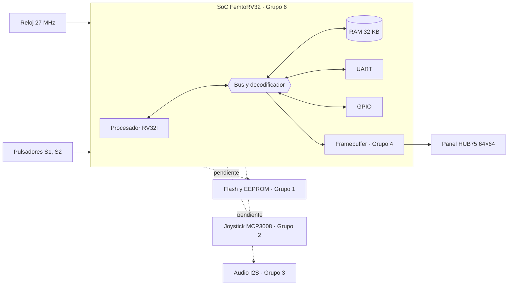

# Estructura de la consola

Este documento es el punto de entrada. Dice qué bloques tiene la consola, quién es responsable de cada uno y en qué estado está. Para el detalle, cada tema tiene su documento (la lista está al final).

## 1. Bloques

Las líneas punteadas son periféricos que todavía no tienen hardware en el SoC.

## 2. Estado por bloque

| Bloque | Grupo | Dirección | Estado |
|---|---|---|---|
| Procesador, RAM, bus | 6 | `0x0000_0000` | Funcionando en la placa |
| UART | 6 | `0x0040_0000` | Heredada del laboratorio 4, sin prueba propia |
| GPIO y pulsadores | 6 | `0x0041_0000` | Funcionando; los pulsadores son el joystick virtual |
| Panel y framebuffer | 4 | `0x0048_0000` | Funcionando; falta confirmar la fila D y el nivel de tensión |
| Motor del juego y menú | 5 | Firmware | Funcionando |
| Flash SPI y EEPROM | 1 | `0x0042_0000` (Flash), `0x0046_0000` (EEPROM) | Diseñado, sin RTL |
| Joystick MCP3008 | 2 | `0x0043_0000` | Diseñado, sin RTL |
| Audio I2S | 3 | `0x0047_0000` | Diseñado, sin RTL |

El multiplicador del laboratorio 4 ocupa `0x0042_0000` y no lo usa el firmware. Hay que liberarlo para la Flash del Grupo 1.

## 3. Decisiones tomadas

1. **Procesador y juego en C.** El motor del Grupo 5 se compila para el FemtoRV32. No se reescribe en Verilog.
2. **Récords en la EEPROM I2C.** La tarjeta SD no tiene grupo asignado, así que queda fuera del alcance actual. La EEPROM cubre los récords y los gráficos caben en la BRAM.
3. **Framebuffer de 3 bits por píxel.** Con 24 bits la BSRAM no alcanza (30 bloques de 26). Quedan 8 colores.
4. **Pulsadores como joystick virtual.** Mientras el Grupo 2 no entregue el joystick, S1 y S2 dan las direcciones con giros y las acciones con pulsaciones largas. Detalle en `arquitectura-consola.md`, sección 6.
5. **El menú vive en el firmware del Grupo 6.** El motor del Grupo 5 no se modifica. Solo se reemplaza el dibujo del menú.
6. **Sondeo, no interrupciones.** El procesador lee los registros de estado en un bucle. Es más fácil de depurar y basta para este proyecto.

## 4. Decisiones abiertas

1. Dirección `0x0043_0000`: joystick (Grupo 2) o teclado PS/2 (README raíz).
2. Uso de la Flash de la Tang Nano 9K, cuyos pines se comparten con la configuración.
3. Buffer de nivel 3,3 V a 5 V para el panel, y la medición de la fila D.
4. Temporizador MMIO para quitar el bucle de retardo del paso de juego.

El detalle de cada punto está en `integracion-perifericos.md`, secciones 5, 7 y 10.

## 5. Documentos del Grupo 6

| Documento | Para qué sirve |
|---|---|
| `integracion-perifericos.md` | Integración completa de los seis grupos: periféricos, mapa, riesgos y plan |
| `arquitectura-consola.md` | Referencia técnica: cajas negras, bloques, flujos y estados |
| `integracion-lab4-grupos4-5.md` | Registro de la primera integración y sus decisiones |
