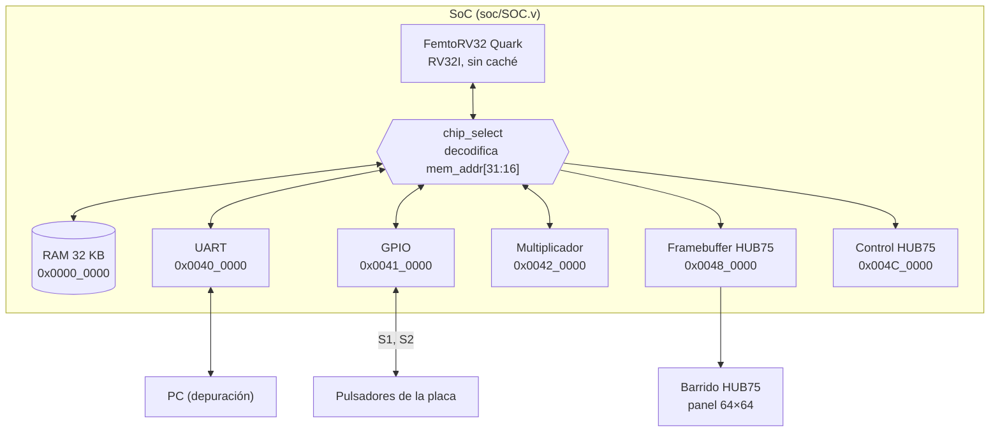
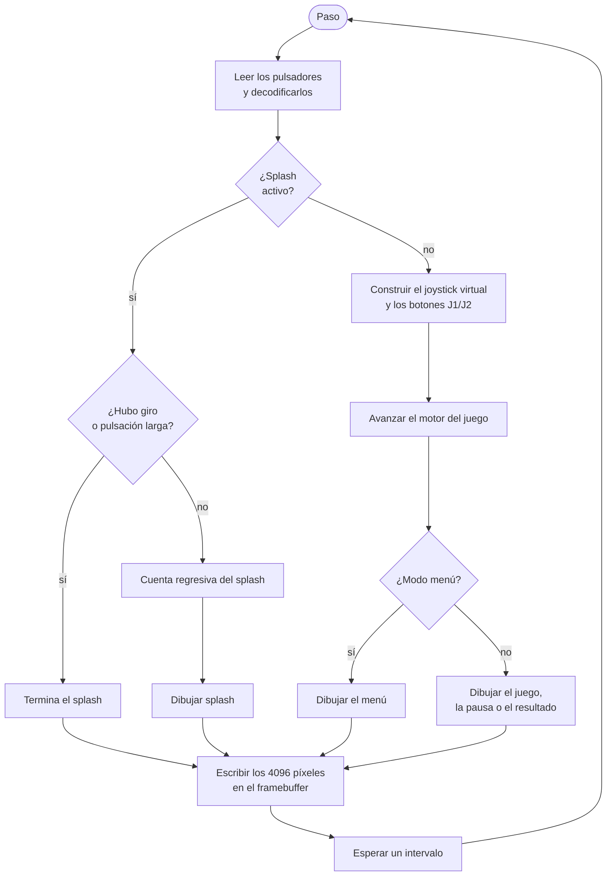

# Integración de los periféricos de la consola

Proyecto final de Electrónica Digital 1 · Grupo 6 (Inicio e integración)

Este documento explica cómo se unen los periféricos de la consola en una sola FPGA: qué hace cada uno, cómo se conecta al procesador, qué tenemos hoy funcionando y qué falta. Está pensado para leerse de corrido. Las secciones son independientes, pero el orden tiene sentido: primero el marco general, después cada periférico, y al final los problemas que hemos encontrado y el plan para cerrar lo que falta.

Donde algo no está verificado lo decimos. Donde una decisión fue nuestra y tuvo un costo, también lo contamos.

---

## 1. Resumen

La consola es una FPGA Tang Nano 9K que ejecuta un procesador FemtoRV32 (RISC-V de 32 bits, conjunto RV32I). El procesador corre el programa de la consola, que tiene un menú y dos juegos (PAC-MAN y Snake). Los periféricos se conectan al procesador como posiciones de memoria: el programa escribe o lee direcciones y el hardware responde. A esto se le llama E/S mapeada en memoria (MMIO).

Hoy, en la placa, funciona lo siguiente:

- El procesador arranca desde su memoria de programa (RAM de 32 KB dentro de la FPGA).
- El programa dibuja un splash con el logo de la UNAL y luego un menú de dos juegos en el panel LED de 64×64.
- Los dos pulsadores de la placa (S1 y S2) hacen de joystick, mientras los joysticks reales no están conectados.
- Se puede elegir un juego, jugarlo, pausarlo, reiniciarlo y volver al menú.

Lo que falta, en una frase: los periféricos de memoria externa (Flash y EEPROM), el joystick analógico (MCP3008), el audio (I2S) y la memoria de récords todavía están diseñados en documentación, pero no tienen hardware Verilog integrado en el SoC. Ese trabajo es la parte grande que queda.

La tabla siguiente resume el estado con el criterio que usamos en todo el documento: un periférico solo se cuenta como **integrado** si su hardware está en el SoC y el programa lo puede usar.

| Grupo | Periférico | Diseño | RTL en el SoC | Simulación | Integrado | Probado en la placa |
|---|---|---|---|---|---|---|
| 1 | Flash SPI y EEPROM I2C | Documentado | No | No | No | No |
| 2 | Joystick (MCP3008, SPI) | Documentado | No | No | No | No |
| 3 | Audio (I2S, MAX98357A) | Documentado | No | No | No | No |
| 4 | Panel HUB75 y framebuffer | Sí | Sí | Sí | Sí | Sí (imagen en el panel) |
| 5 | Juego y menú (firmware en C) | Sí | Firmware | Sí | Sí | Sí |
| 6 | SoC, bus, UART, pulsadores | Sí | Sí | Sí | Sí | Parcial |

La columna "Probado en la placa" de Grupo 6 es parcial porque la UART viene heredada del laboratorio 4 y no tenemos una prueba propia documentada de ella. Los pulsadores sí están probados en la placa.

---

## 2. El problema que resuelve la integración

Seis grupos hacen cada uno un pedazo: memoria, joystick, audio, pantalla, juego y el sistema que une todo. Si cada grupo diseña a su manera, la integración se vuelve un rompecabezas que nadie puede armar. Por eso el primer trabajo del Grupo 6 fue fijar tres cosas comunes:

1. **Un procesador y un bus.** Usamos el FemtoRV32 del laboratorio 4 con su RAM, su UART y su GPIO. El bus es el de ese laboratorio y no lo cambiamos.
2. **Un mapa de memoria.** Cada periférico tiene una dirección base. El decodificador (`chip_select.v`) mira los 16 bits altos de la dirección y decide a qué bloque va la lectura o la escritura.
3. **Un contrato de periférico.** Todos los módulos tienen los mismos puertos hacia el bus, de modo que se puedan conectar sin cambiar el procesador.

La forma de hacerlo fue deliberadamente simple. El procesador **sondea** los periféricos: lee un registro de estado en un bucle hasta que el dato está listo. No usamos interrupciones. Con un procesador sin sistema operativo y un juego que avanza por pasos, sondear es más fácil de depurar y de demostrar que una lógica de interrupciones, y para este proyecto no hay ventaja real en usar interrupciones.

---

## 3. La plataforma

**Tarjeta.** Sipeed Tang Nano 9K, con FPGA Gowin GW1NR-LV9QN88PC6/I5. Sus recursos son 8640 LUT4, 6480 flip-flops, 468 Kbit de memoria de bloque (BSRAM) y dos PLL. El oscilador de la placa es de 27 MHz.

> **Aclaración sobre la tarjeta.** Algunos documentos del repositorio, incluido el README de este grupo, hablan de la Tang Primer 25K. El código, el archivo de pines (`soc/top.cst`) y el bitstream que hemos cargado son para la Tang Nano 9K. Antes de la presentación conviene unificar ese dato en todos los README. Ver §9.

**Herramientas.** Yosys para la síntesis, nextpnr-himbaechel para el *place and route*, Apycula (`gowin_pack`) para generar el bitstream y openFPGALoader para cargarlo. La simulación es con Icarus Verilog. Todo corre en WSL dentro de un paquete oss-cad-suite.

**Uso de recursos de la última síntesis.** Con el SoC completo (procesador, RAM, UART, GPIO, multiplicador, panel y firmware de 12 064 bytes):

| Recurso | Usado | Disponible | Porcentaje |
|---|---|---|---|
| BSRAM | 20 | 26 | 76 % |
| Frecuencia máxima del reloj del SoC | 57,8 MHz | — | La placa corre a 27 MHz |

La BSRAM es el recurso que más aprieta. Por eso el framebuffer guarda 3 bits por píxel y no 24. Con RGB completo el diseño necesitaba 30 bloques de BSRAM y la FPGA solo tiene 26.

---

## 4. La arquitectura del SoC

El SoC está en `soc/SOC.v`. Su estructura es la siguiente.



### 4.1 El decodificador

`chip_select.v` mira `mem_addr[31:16]`, es decir, los 16 bits altos de la dirección. Eso le da bloques de 64 KB. Cada bloque tiene una señal `cs[k]` que se activa cuando la dirección cae dentro de él. Cualquier dirección que no coincida con un bloque conocido cae en la RAM. Es un comportamiento heredado del laboratorio, y tiene una consecuencia que hay que recordar: **si un periférico no está en la lista del decodificador, su lectura o escritura se va silenciosamente a la RAM**. Lo tenemos en cuenta en §9.

### 4.2 El acceso a la memoria y a los periféricos

Las lecturas tienen una latencia de un ciclo: el dato aparece en la salida en el flanco siguiente a la petición. Todos los periféricos del curso siguen esa regla, de modo que el procesador ve un comportamiento uniforme. Las escrituras se hacen en el flanco de subida con `wr` y `cs` activos al mismo tiempo.

### 4.3 El contrato de periférico

Cada periférico MMIO tiene esta forma:

```verilog
module perip_xxx (
    input         clk, rst,
    input  [31:0] d_in,     // dato que escribe la CPU
    input         cs,       // selección, generada por el decodificador
    input  [4:0]  addr,     // desplazamiento dentro del bloque (registros cada 4 bytes)
    input         rd, wr,
    output [31:0] d_out     // dato leído, registrado (1 ciclo)
    // + las señales propias del periférico (pines, buses externos)
);
```

Este contrato es el que propuso el README raíz y lo seguimos en GPIO, UART y el panel. Los periféricos de los demás grupos todavía no lo implementan, así que cuando lleguen habrá que revisarlos contra esta forma.

---

## 5. El mapa de memoria

Esta es la tabla que el SoC usa hoy, con los conflictos señalados. Las direcciones de los grupos 1, 2, 3 y 4 vienen del README raíz y de los README de cada grupo.

| Base | Bloque | Grupo | Estado en el SoC | Observación |
|---|---|---|---|---|
| `0x0000_0000` | RAM, 32 KB (programa, datos y pila; la pila empieza en `0x8000`) | 6 | Activo | Firmware de 12 064 bytes |
| `0x0040_0000` | UART | 6 (Lab 4) | Activo | Sin prueba propia documentada |
| `0x0041_0000` | GPIO: `LEDS` en `+0x04`, `BOTONES` en `+0x08` | 6 (Lab 4) | Activo | Los pulsadores son el joystick virtual |
| `0x0042_0000` | Multiplicador | 6 (Lab 4) | Activo en el SoC, sin uso en el firmware | **Conflicto:** el Grupo 1 quiere la Flash SPI aquí |
| `0x0043_0000` | Libre en el decodificador | 2 | Sin conectar | **Conflicto:** el README raíz lo asigna al teclado PS/2 |
| `0x0044_0000` | Libre | — | Sin asignar | |
| `0x0045_0000` | Libre | — | Sin asignar | |
| `0x0046_0000` | EEPROM I2C 24LC256 | 1 | **No decodificado** | Cae en la RAM |
| `0x0047_0000` | Audio I2S | 3 | **No decodificado** | Cae en la RAM |
| `0x0048_0000` | Framebuffer HUB75, 4096 palabras de 32 bits | 4 | Activo, solo escritura | Pixel `(x, y)` en `base + 4·(y·64 + x)` |
| `0x004C_0000` | Control del panel | 4 | Reservado | Lectura 0, escritura ignorada |

Hay tres conflictos que hay que resolver antes de cerrar la integración:

- **`0x0042_0000`.** El multiplicador viene del laboratorio 4, pero el firmware de la consola no lo usa (la multiplicación la hace la biblioteca de software `libgcc`). La propuesta es moverlo o retirarlo para que la Flash del Grupo 1 use esa base, que es la que aparece en su documentación.
- **`0x0043_0000`.** El Grupo 2 dice que su joystick vive aquí, mientras el README raíz lo asigna a un teclado PS/2. Hay que decidir cuál de los dos va allí. Nuestra recomendación es que el joystick quede en `0x0043_0000`, porque es un periférico obligatorio de la consola y el teclado no está en el enunciado.
- **`0x0046_0000` y `0x0047_0000`.** El decodificador no los conoce todavía. Cuando el Grupo 1 y el Grupo 3 traigan su hardware, hay que agregar dos entradas a `chip_select.v`. Si no se agregan, sus registros no responden y el programa parece fallar sin ningún error visible.

---

## 6. Cómo se integra un periférico, paso a paso

Este es el procedimiento que seguimos y que proponemos a los demás grupos. Lo hemos aplicado al panel HUB75 y a los pulsadores; el resto de grupos lo puede aplicar igual.

1. **Asignar la dirección base** en el mapa de la §5. Si la base está ocupada, se negocia con el grupo dueño antes de tocar código.
2. **Escribir el módulo con el contrato** de la §4.3. Los registros van cada 4 bytes, y las lecturas tienen latencia de un ciclo.
3. **Agregar la selección en `chip_select.v`** y el dato de lectura a su multiplexor.
4. **Instanciar el módulo en `SOC.v`** y conectar sus pines externos en `top.v`.
5. **Escribir la restricción de pines** en `top.cst` y revisar el banco de voltaje de cada pin.
6. **Simular.** La prueba mínima es escribir y leer cada registro desde un programa de prueba, y revisar que el contenido aparece en la simulación.
7. **Sintetizar** con `make syn`. Revisar BSRAM, LUT y la frecuencia máxima.
8. **Cargar en la placa** y verificar con una prueba visible (un LED, la pantalla o la UART).
9. **Documentar** la tabla de registros en el README del grupo y actualizar el mapa de la §5.

La regla más importante de todas es la 3. Un periférico que no está en el decodificador no existe para el procesador, y el error no aparece en ningún lado: el programa lee basura o lee la RAM.

---

## 7. Periféricos, uno por uno

### 7.1 Grupo 1 · Memoria externa (Flash SPI y EEPROM I2C)

**Qué hace en la consola.** Guarda los récords de los juegos (los top 5 por juego, con iniciales) en una memoria que no se borra al apagar la consola. La Flash SPI de la tarjeta guardaría gráficos, pero ese uso quedó pendiente porque la BRAM alcanza para el panel.

**Protocolos.** SPI en modo 0 para la Flash, y I2C para la EEPROM 24LC256 (dirección `0x50`).

**Diseño documentado.** El grupo tiene el diagrama de bloques, el diagrama de tiempos SPI e I2C, el diagrama de flujo de la máquina y el ASMD del protocolo SPI. Las señales de la Flash son SCK, MOSI, MISO, CS, WP y HOLD. Las de la EEPROM son SCL y SDA, con pull-up de 4,7 kΩ.

**Registros propuestos.**

| Bloque | Desplazamiento | Registro | Contenido |
|---|---|---|---|
| SPI (`0x42_0000`) | `0x00` | CONTROL | Arranque, lectura o escritura, comando, bytes a leer, mantener CS |
| | `0x04` | ADDR | Dirección de 24 bits |
| | `0x08` | WDATA | Byte a escribir |
| | `0x0C` | RDATA | Dato leído |
| | `0x10` | STATUS | BUSY y DONE |
| | `0x14` | CLK_DIV | SCK = 50 MHz / (2·(CLK_DIV+1)); reset 1 → 12,5 MHz |
| I2C (`0x46_0000`) | `0x00` | CONTROL | START, STOP, WRITE, READ, ACK de salida |
| | `0x04` | TX_DATA | Byte a enviar |
| | `0x08` | RX_DATA | Byte recibido |
| | `0x0C` | STATUS | BUSY, ACK de entrada, DONE |
| | `0x10` | CLK_DIV | SCL = 50 MHz / (4·(CLK_DIV+1)); reset 124 → 100 kHz |

**Decisión tomada: se descartó la SPI-RAM.** En la primera versión, los gráficos pasaban de la Flash a una SRAM serial (23LC1024) y de ahí a la BRAM. Se descartó porque no cumplía una función propia: los gráficos de un panel de 64×64 caben en la BRAM, y la Flash se lee por el mismo SPI a la misma velocidad. Además, no se consigue en Colombia sin pedido al exterior. El diseño quedó con 8 pines de la FPGA en vez de 12.

**Estado y riesgos.**

- No hay RTL. El directorio `rtl/` del grupo está vacío.
- La Flash de la Tang Nano 9K es la que usa la configuración del FPGA. Sus pines (MSPI) se comparten con la carga del bitstream. El Grupo 1 documentó la Flash de la Tang Primer 25K, que no tiene ese problema. Si la Flash de la Nano 9K se va a usar para datos, hay que confirmar que los pines de MSPI quedan libres después de la configuración, o usar la EEPROM como única memoria de récords.
- La EEPROM sí se puede usar sin conflicto: solo ocupa dos pines y tiene su propia dirección.

**Lo que necesitamos del grupo.** El RTL de los dos controladores, el formato de la tabla de récords y el tiempo de escritura de la EEPROM (el 24LC256 tarda hasta 5 ms en cada ciclo de escritura, y el programa tiene que esperar ese tiempo).

### 7.2 Grupo 2 · Joystick (MCP3008 por SPI)

**Qué hace en la consola.** Lee los dos joysticks: cuatro ejes analógicos (X e Y de cada jugador) y dos pulsadores. Un joystick entrega una tensión de 0 a 3,3 V por eje, y la FPGA no puede leerla directamente, así que el MCP3008 la convierte en un número de 10 bits.

**Por qué un conversor externo.** La FPGA solo lee señales digitales. El MCP3008 tiene 8 canales de 10 bits y se comunica por SPI en modo 0. Con 3,3 V de referencia, cada paso representa unos 3,22 mV. El centro del joystick queda cerca de 512.

**Cómo se comunican.** Cada conversión son 17 pulsos de reloj: un bit de inicio, el bit SGL/DIFF (en 1, modo single-ended), tres bits para elegir el canal, un bit nulo y los 10 bits del resultado, del más significativo al menos. Usamos 1,35 MHz como frecuencia de SCLK, que es el máximo del fabricante a 2,7 V; a 3,3 V queda como límite conservador. Los tiempos mínimos del datasheet son 125 ns para los niveles alto y bajo del reloj, 100 ns entre CS y el primer flanco, y 270 ns de CS en alto entre conversiones.

**Registros propuestos** (base `0x43_0000`, registros de 32 bits, valores en los bits `[9:0]`):

| Desplazamiento | Registro | Acceso | Descripción |
|---|---|---|---|
| `0x00` | CTRL | R/W | Bit 0 ENABLE (barrido continuo), bit 1 START (barrido único) |
| `0x04` | STATUS | R | Bit 0 BUSY, bit 1 VALID |
| `0x08` | J1_X | R | Eje X del jugador 1 (CH0) |
| `0x0C` | J1_Y | R | Eje Y del jugador 1 (CH1) |
| `0x10` | J2_X | R | Eje X del jugador 2 (CH2) |
| `0x14` | J2_Y | R | Eje Y del jugador 2 (CH3) |
| `0x18` | BUTTONS | R | Bit 0 botón J1, bit 1 botón J2 |
| `0x1C` | CLKDIV | R/W | Opcional: divisor del reloj de SCLK |

El periférico hace los barridos solo, y el procesador únicamente lee. Así el programa nunca espera a una conversión.

**Cómo se conecta con lo que ya tenemos.** El firmware de la consola ya tiene el punto de entrada: la función `read_inputs()` de `soc/firmware/main.c`. Hoy esa función lee los pulsadores de la placa y deja los ejes en el centro. Cuando el periférico del Grupo 2 exista, `read_inputs()` lee los registros J1_X a J2_Y y el BUTTONS, y el resto del programa no cambia. El motor del juego ya espera exactamente esos cuatro ejes y dos botones, con centro en 512 y zona muerta de ±128.

**Estado y riesgos.**

- No hay RTL. El directorio `rtl/` del grupo está vacío.
- El botón de cada joystick entra por un pin digital de la FPGA, no por el MCP3008, que solo lee tensiones. Falta decidir si se agrega antirrebote por software o por hardware.
- Cada jugador usa dos canales del MCP3008 (CH0 y CH1 para el jugador 1, CH2 y CH3 para el jugador 2), según el datasheet del conversor.

**Mientras tanto.** Como el periférico no está, la consola usa los pulsadores S1 y S2 como joystick virtual (§8). Eso permite probar todo el juego en la placa sin esperar al Grupo 2.

### 7.3 Grupo 3 · Audio (I2S con MAX98357A)

**Qué hace en la consola.** Genera los efectos de sonido (menú, punto, choque y victoria) y, si se alcanza, una música de fondo estilo chiptune. El amplificador es un MAX98357A, un DAC de clase D que recibe audio digital por I2S y entrega hasta 3,2 W a un parlante de 8 Ω.

**Cómo funciona I2S.** Es un protocolo síncrono y unidireccional. La FPGA es el maestro y genera tres señales: BCLK (reloj de bit), LRCK o WS (selección de canal) y DIN (datos). Los números del proyecto son estos:

- BCLK = 27 MHz / 20 = 1,35 MHz.
- Frecuencia de muestreo = BCLK / 32 = 42,1875 kHz, con una trama de 32 ciclos de BCLK (16 bits por canal).
- Las muestras son de 16 bits con signo, MSB primero.

**Registros propuestos.** El grupo tiene pendiente el contrato de sonidos. La propuesta que necesitamos es que el programa escriba un identificador de efecto (menú, punto, choque, victoria) en un registro, y que el hardware reproduzca la secuencia correspondiente sin intervención del procesador. Así el juego no se detiene mientras suena un efecto.

**Estado y riesgos.**

- No hay RTL. El directorio `rtl/` del grupo está vacío.
- El firmware ya tiene el gancho de sonido: `play_sound` está en `NULL`. Cuando llegue el periférico, basta con asignar la función que escribe el identificador en el registro.
- El amplificador necesita alimentación separada y masa común con la FPGA. Hay que medir el ruido en la salida antes de dar el sonido por bueno.

### 7.4 Grupo 4 · Panel HUB75 de 64×64 y framebuffer

Es el periférico más avanzado del proyecto y el único que ya corre en la placa. También es el más delicado en la parte eléctrica.

**Qué hace en la consola.** Muestra la imagen del juego en un panel LED RGB de 64 columnas por 64 filas. El panel usa la interfaz HUB75E, que es paralela y multiplexada: no es SPI. Tiene datos RGB para dos mitades de la pantalla al mismo tiempo (R1, G1, B1 para la mitad superior y R2, G2, B2 para la inferior), selección de fila (A, B, C, D, E), y las señales CLK, LAT y OE.

**Cómo está hecho.** Son tres piezas:

1. **Framebuffer** (`rtl/hub75/hub75_fb.v`). Guarda 4096 píxeles de 3 bits, uno por color lógico. El procesador escribe en él por el bus, en la dirección `0x0048_0000`. Usamos una palabra de 32 bits por píxel y solo se leen los bits `[2:0]`, que son `{R, G, B}`. Así el dato entra en la BSRAM.
2. **Datapath y control del barrido** (`hub75_datapath.v`, `hub75_control.v`, `hub75_panel.v`). Leen el framebuffer en cada fila y producen las señales del panel. La modulación de brillo usa 8 planos de bits, de modo que cada color tiene 8 niveles de intensidad por canal (el brillo se controla por el tiempo que el bit encendido permanece activo).
3. **Periférico MMIO** (`rtl/perip_hub75.v`). Es la interfaz entre el bus y el framebuffer. El registro de control en `0x004C_0000` está reservado para una versión futura.

**Qué probamos.**

- La simulación del SoC completo ejecuta el firmware, dibuja un cuadro completo y termina con 4096 escrituras al framebuffer y 982 píxeles distintos de negro. El testbench (`sim/SOC_tb_juego.v`) da PASS.
- En la placa, el panel muestra el menú de la consola con sus colores. La imagen es estable y se lee bien.

**Pendientes eléctricos.** Estos puntos hay que cerrarlos antes de la presentación.

1. **La fila D.** La serigrafía del conector del panel tiene `C / NC` en la fila 6, en lugar de `C / D`. En HUB75E estándar, el pin 12 es D, que es el quinto bit de dirección que necesita un panel de 1/32 para cubrir las 32 filas de cada mitad. Nuestro SoC conecta `addr[3]` (D) al pin 35 de la FPGA, así que supone que D está cableado. El equipo del Grupo 4 lo marcó como riesgo crítico (R01) y pide comprobarlo con multímetro, sin energía. Hasta que eso no esté medido, no podemos afirmar que las 64 filas están bien direccionadas. Este punto puede explicar cualquier corte o repetición de filas en la pantalla.
2. **Niveles de tensión.** La FPGA entrega 3,3 V y el panel está diseñado para entradas de 5 V (en la familia comparable). El Grupo 4 propone un buffer 74AHCT245 entre la FPGA y el panel. En nuestra conexión actual no hay ese buffer documentado. La imagen se ve, pero eso no garantiza margen de ruido. Hay que decidir si se agrega el buffer antes de usar el panel en la sustentación.
3. **Alimentación.** El panel necesita una fuente de 5 V separada, con corriente suficiente para el peor caso (todos los píxeles blancos). No puede alimentarse desde USB ni desde un GPIO de la FPGA. La corriente real no está medida.
4. **Tearing.** No hay doble buffer. Si el procesador escribe el cuadro mientras el barrido lee la misma memoria, se puede ver una franja de un cuadro sobre el siguiente. En el juego eso se nota poco, pero es un defecto conocido.

**Lo que necesitamos del grupo.** La medición de la fila D, la decisión sobre el buffer de nivel, y la fuente de 5 V que se va a usar en la presentación.

### 7.5 Grupo 5 · Juego y menú (firmware en C)

**Qué hace en la consola.** Es el motor del juego: el menú, PAC-MAN (un jugador o dos en cooperación, tres vidas compartidas) y Snake (individual o competitivo, con crecimiento hasta 128 segmentos). Todo el motor es código C sin sistema operativo, que se compila para RV32I y se ejecuta en el FemtoRV32.

**Por qué en C y no en Verilog.** Escribir PAC-MAN y Snake directamente en hardware habría requerido una máquina de estados muy grande, difícil de cambiar y de depurar. En C el juego es legible, se prueba en el computador y se compila sin cambios para la FPGA. El costo es el procesador y el bus, que ya teníamos del laboratorio.

**Cómo está organizado.** El motor es independiente del hardware. Recibe una muestra abstracta de los dos joysticks (cuatro ejes de 10 bits y dos botones), y produce un framebuffer lógico de 64×64 con índices de color de 3 bits. No sabe nada de direcciones de memoria. La conexión con el hardware la hace el adaptador de plataforma (`platform.h` y el `main.c` del Grupo 6).

El motor se organiza así:

- `console.c`: la máquina de estados principal. Tiene los modos MENU, PACMAN, SNAKE y RESULT, y las transiciones entre ellos.
- `controls.c`: convierte los ejes en una dirección (arriba, abajo, izquierda o derecha) con una zona muerta. Si el movimiento es diagonal, elige el eje con mayor desplazamiento.
- `maze.c`, `snake.c`: la lógica de cada juego, en pasos discretos.
- `draw.c`: el dibujo en el framebuffer lógico, incluyendo una fuente 3×5 propia.
- `services.c`: registra el resultado de una partida y los récords de la sesión.

**Qué probamos.** El motor tiene pruebas en el computador (`make test`) y una comparación con una referencia en HTML. Eso asegura que la lógica y el dibujo son correctos antes de llevarlos a la FPGA. En la placa, el motor corre sin cambios.

**Lo que el Grupo 5 dejó hecho en hardware.** La carpeta `rtl/menu/` tiene una versión en Verilog del renderizado del menú (`menu_render.v`, `menu_pixel.v`, `menu_text.v`). Se probó en un proyecto aparte (`fpga/menu_test`) con el panel, y se sintetizó. En el SoC final no se usa: el menú que corre es el del firmware, porque el firmware permite cambiar el diseño sin resintetizar.

**Cambios que hicimos desde el Grupo 6.** Para no tocar el código del Grupo 5, el Grupo 6 reemplazó solo la pantalla del menú. El motor sigue siendo el mismo. El menú, el splash y la brújula del joystick virtual viven en `soc/firmware/unal_menu.c`. Esta separación permite que el Grupo 5 siga evolucionando su versión sin conflictos.

**Riesgos de temporización.** El motor avanza un paso por cada llamada, y el tiempo de cada paso depende del bucle de retardo del procesador, que no está calibrado. Ver §8.3.

### 7.6 Grupo 6 · SoC, bus, UART y pulsadores

**Qué hace.** Une todo lo anterior: el procesador, la RAM, el decodificador, la UART, el GPIO, el panel, el firmware y el archivo de pines. Es responsable del mapa de memoria, de la secuencia de arranque y del bitstream que se carga en la placa.

**La UART.** Viene del laboratorio 4 sin cambios. Sirve para depurar desde el computador. Hoy el firmware no la usa para imprimir, así que su prueba se limita a que el hardware compile y el bloque exista en el SoC. Eso debe documentarse con una prueba de transmisión antes de la presentación.

**Los pulsadores.** Son el GPIO de la placa. Los dos pulsadores de usuario (S1 y S2) son activos en bajo, y el archivo `top.v` los invierte para que el procesador vea un 1 cuando están presionados. Pasan por un sincronizador de dos flancos, de modo que la lectura del procesador es estable.

**La secuencia de arranque.** Al encenderse, el reset de la FPGA dura 2¹⁶ ciclos de reloj (unos 2,4 ms). Luego el procesador arranca en `0x0000` y ejecuta `crt0.S`, que prepara la pila en `0x8000`. Después el firmware inicializa el motor y muestra el splash.

**El flujo de construcción.** Todo se hace con un Makefile dentro de `soc/`:

```sh
make firmware      # compila el firmware (del Grupo 5 + el Grupo 6) a firmware.hex
make sim           # simula el SoC y comprueba el cuadro completo
make syn           # sintetiza, hace place & route y genera build/top.fs
make config        # carga el bitstream en la placa
```

Cada paso se puede repetir sin reconstruir lo que no cambió, porque el Makefile declara las dependencias.

---

## 8. El flujo de software

### 8.1 Un paso de lógica

El programa principal es un bucle infinito. Cada vuelta corresponde a un paso del juego:



Cada paso escribe el cuadro completo. Es más costoso que escribir solo lo que cambió, pero es simple y no deja restos de cuadros anteriores.

### 8.2 Los pulsadores como joystick virtual

Mientras no llegue el joystick real, los dos pulsadores tienen que dar las cuatro direcciones y las dos acciones. Con dos botones no hay forma de tener cuatro direcciones directas, así que usamos un esquema de giro relativo que se parece al de algunos juegos clásicos:

- **Pulsación corta de S1:** gira el joystick virtual 90° a la izquierda.
- **Pulsación corta de S2:** gira 90° a la derecha.
- **Pulsación larga de S1:** botón J1 (iniciar, pausar o reanudar).
- **Pulsación larga de S2:** botón J2 (reiniciar).
- **S1 y S2 juntos:** volver al menú.

Una pulsación se considera larga cuando dura 8 pasos de lógica o más. Un giro se cancela si el otro botón también estaba presionado en ese gesto, para que la combinación no gire por accidente.

La lógica se verificó en el computador con un programa de prueba que simula la secuencia de pulsos. Los cinco casos cubiertos son: un giro corto a la izquierda, un giro corto a la derecha, una pulsación larga sin giro, la combinación de ambos botones y una combinación rápida que no debe girar.

En el menú, el joystick virtual apunta a un eje, y el motor lo interpreta como si fuera el joystick real: arriba elige PAC-MAN, abajo elige Snake, izquierda pone un jugador y derecha pone dos. Para iniciar, se mantiene S1.

### 8.3 Lo que no está calibrado

El motor espera un tiempo entre pasos, y el procesador no tiene un temporizador (`timer`). El tiempo se calcula con un bucle de retardo de 200 000 vueltas, que es un valor provisional. Eso tiene dos consecuencias prácticas:

- El juego puede ir más rápido o más lento de lo que se espera.
- Un toque de botón muy corto puede caer entre dos pasos y perderse, o leerse como una pulsación larga si el paso es muy largo.

La solución de largo plazo es agregar un temporizador al SoC que marque el paso con un tiempo fijo. Está en la lista de pendientes. Mientras tanto, la calibración se hace contando los pasos con un cronómetro en la placa.

---

## 9. Problemas que encontramos y cómo los resolvimos

Estas son las decisiones que tuvieron un costo. Muestran cómo se razona una integración, y por eso las dejamos a la vista.

**Problema 1. Dos grupos querían la misma dirección.** El multiplicador del laboratorio y la Flash del Grupo 1 coinciden en `0x0042_0000`. Decidimos no tocar el multiplicador de inmediato, porque el firmware no lo usa y su liberación se puede hacer en una sola línea de `chip_select.v`. Queda como acuerdo pendiente con el Grupo 1.

**Problema 2. El framebuffer no cabía a 24 bits.** Con RGB completo, el SoC necesitaba 30 bloques de BSRAM y la Tang Nano 9K tiene 26. Pasamos a 3 bits por píxel, que bajó el uso a 20 bloques. El costo es que solo hay 8 colores. Para un juego de 64×64 es una restricción aceptable.

**Problema 3. Los nombres de los archivos de pines no coincidían.** El archivo de restricciones de nextpnr solo lee la primera sentencia de cada línea. Si `IO_LOC` e `IO_PORT` van en la misma línea, el segundo se ignora y la síntesis falla con un error de banco de voltaje que no dice nada del problema real. Cada sentencia tiene que ir en su propia línea. Lo dejamos escrito en la documentación para no repetir el error.

**Problema 4. El Grupo 5 tenía una versión del menú en hardware y otra en firmware.** Elegimos el firmware para el menú del SoC, porque cambiarlo no requiere resintetizar. La versión en Verilog se conserva y se documenta como prueba.

**Problema 5. El programa necesitaba un joystick que todavía no existe.** Usamos los pulsadores como joystick virtual (§8.2). Es una solución temporal, pero permite probar el juego completo en la placa y no depende de otro grupo para verificar el resto del sistema.

**Problema 6. La imagen del menú se cortaba en los bordes.** El panel físico no muestra los píxeles del borde de manera confiable. Redistribuimos el menú para que todo quede a 4 píxeles o más de cada borde y lo verificamos en el computador con una comprobación automática: ningún píxel encendido dentro del margen.

**Problema 7. Dirección no decodificada.** Un periférico con dirección fuera del decodificador lee la RAM sin avisar. Es el error más peligroso de la integración porque no produce un fallo visible. Lo documentamos en §5 y en el procedimiento de §6.

---

## 10. Riesgos abiertos, en orden de prioridad

| Prioridad | Riesgo | Efecto si pasa | Qué hacemos |
|---|---|---|---|
| 1 | La fila D del panel está en `NC`, no en D | Filas mal direccionadas, cortes o repeticiones en la imagen | Medir continuidad sin energía y comparar con la dirección que usa el SoC |
| 2 | Nivel de 3,3 V hacia un panel de 5 V sin buffer | Señales por debajo del umbral, parpadeo o errores de color | Decidir si se agrega el 74AHCT245 antes de la presentación |
| 3 | Fuente de 5 V sin medir la corriente real | Caída de tensión, reinicios o daño | Medir el consumo con el panel en blanco y a plena carga |
| 4 | Dirección `0x0043_0000` ocupada por dos propuestas | El joystick o el teclado no responde | Acordar con el Grupo 2 y el README raíz |
| 5 | Flash de la Nano 9K compartida con la configuración | No se puede usar para datos sin conflicto | Usar la EEPROM como memoria de récords, o confirmar el uso de MSPI |
| 6 | Temporización sin timer | Velocidad de juego y pulsaciones incorrectas | Agregar un temporizador MMIO y calibrar |
| 7 | Periféricos sin RTL (grupos 1, 2 y 3) | El sistema no tiene memoria externa, joystick real ni sonido | Plan de entrega con fechas por grupo (§11) |
| 8 | Direcciones no decodificadas caen en la RAM | Lecturas falsas sin error visible | Agregar cada periférico a `chip_select.v` en el mismo cambio que su RTL |
| 9 | Tearing en el panel | Franjas de cuadros mezclados | Doble buffer o actualización al final de cuadro |
| 10 | Documentos con la tarjeta equivocada | Confusión en la presentación | Unificar a Tang Nano 9K en todos los README |

---

## 11. Plan para cerrar la integración

El plan está ordenado por dependencias. Lo que está arriba bloquea lo de abajo.

1. **Cerrar el panel (Grupo 4 y Grupo 6).** Medir la fila D, decidir el buffer de nivel y medir la fuente. Sin esto, cualquier demostración del panel queda en duda.
2. **Resolver el mapa de memoria (Grupos 1, 2, 4 y 6).** Liberar `0x0042_0000`, decidir `0x0043_0000` y reservar `0x0046_0000` y `0x0047_0000` en el decodificador. Es una reunión de media hora con un cambio de cinco líneas.
3. **Agregar el temporizador (Grupo 6).** Un registro MMIO con el número de ciclos entre pasos. Quita el bucle de retardo y permite calibrar el juego.
4. **Integrar el joystick (Grupo 2).** Cuando el RTL esté, `read_inputs()` cambia de los pulsadores a los registros. Es el cambio que más mejora la experiencia de juego.
5. **Integrar el audio (Grupo 3).** Definir el contrato de efectos y conectar `play_sound`.
6. **Integrar la memoria de récords (Grupo 1).** Empezar por la EEPROM, que es la más simple, y dejar la Flash para después si hay tiempo.
7. **Documentar la UART.** Una prueba de transmisión desde el firmware, con su captura en el computador.

Cada paso termina con la misma comprobación: la simulación del SoC sigue dando PASS, el `make syn` sigue cerrando, y la placa responde.

---

## 12. Cómo verificar lo que decimos

Para que cualquier integrante pueda comprobar lo que afirma este documento, estas son las pruebas que hay en el repositorio:

| Qué se afirma | Cómo se comprueba | Dónde |
|---|---|---|
| El firmware compila | `make firmware` | `soc/Makefile` |
| El SoC dibuja un cuadro completo | `make sim CICLOS=2000000` debe imprimir PASS | `soc/sim/SOC_tb_juego.v` |
| El diseño cabe en la FPGA | `make syn`, revisar BSRAM y frecuencia | `soc/build/nextpnr-top.log` |
| El menú no tiene píxeles en el margen | Comprobación en el computador | Script de verificación del Grupo 6 |
| La lógica de los pulsadores es correcta | Cinco casos de prueba en el computador | Descritos en §8.2 |
| El bitstream está en la placa | Verificación CRC de openFPGALoader | Salida de `make config` |

Los resultados de la síntesis y de la simulación de este documento son de la última ejecución. Si el código cambia, hay que volver a correr las pruebas antes de citar estos números.

---

## 13. Referencias dentro del repositorio

- `grupo6-inicio-integracion/soc/top.v` · puertos de la FPGA y reset
- `grupo6-inicio-integracion/soc/top.cst` · asignación de pines
- `grupo6-inicio-integracion/soc/SOC.v` · bus y periféricos conectados
- `grupo6-inicio-integracion/soc/chip_select.v` · decodificador del mapa de memoria
- `grupo6-inicio-integracion/soc/firmware/main.c` · bucle principal y joystick virtual
- `grupo6-inicio-integracion/soc/firmware/unal_menu.c` · splash y menú
- `grupo6-inicio-integracion/rtl/hub75/` y `rtl/perip_hub75.v` · panel y framebuffer
- `grupo6-inicio-integracion/docs/arquitectura-consola.md` · cajas negras y flujos
- `grupo1-memoria-externa/tareas-y-actividades/README.md` · registros SPI e I2C
- `grupo2-joystick/README.md` · registros del joystick y secuencia del MCP3008
- `grupo3-audio/README.md` · parámetros de I2S
- `grupo4-pantalla/docs/02-interfaz-hub75e-y-tang-nano9k.md` y `03-riesgos-y-pruebas.md` · interfaz y riesgos del panel
- `grupo5-juego-menu/docs/contratos-MMIO.md` · contrato del motor y pendientes de integración
- `README.md` (raíz) · plataforma, arquitectura general y mapa de memoria propuesto
